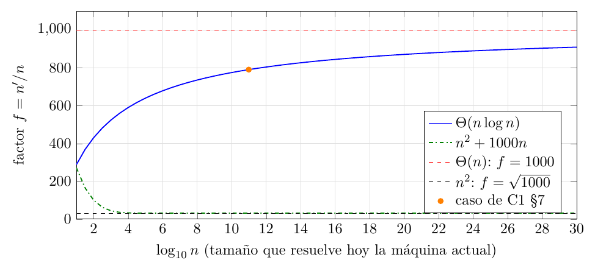

# Ejercicio 1: una computadora mil veces más rápida

## Enunciado

**Ejercicio 1 ($`\star`$; C1).** Una computadora mil veces más rápida. ¿Cuánto crece el tamaño de entrada que se resuelve en una hora con un algoritmo $`\Theta(n^2)`$? ¿Y con uno $`\Theta(n\log n)`$? Estima los dos factores.

## Respuesta corta

- $`\Theta(n^2)`$: el tamaño crece $`\sqrt{1000}\approx \mathbf{31{,}6}`$ veces, sin depender de $`n`$.

- $`\Theta(n\log n)`$: crece **entre $`\approx525`$ ($`n=10^3`$) y $`\approx840`$ ($`n=10^{15}`$) veces**, y $`\approx\mathbf{790}`$–$`\mathbf{800}`$ para los tamaños de una hora de cómputo actual ($`n\approx10^{11}`$; el caso de C1 §7 da $`791`$). El factor depende de $`n`$ y tiende a $`1000`$ muy despacio.

Ambas cifras suponen que el costo es *asintóticamente* $`a\,n^2`$ o $`a\,n\log n`$ (hipótesis (H) de la sección <a href="#sec:hip" data-reference-type="ref" data-reference="sec:hip">2</a>); con $`\Theta`$ a secas el factor no queda determinado. Modelo: word RAM, máquina nueva $`1000`$ veces más rápida en todas las operaciones.

## Modelo y planteamiento

Seguimos C1 §7. El costo $`c(n)`$ de un algoritmo es su número de operaciones en el word RAM, y el tiempo es el costo dividido por la velocidad. Con una hora de presupuesto, la máquina actual dispone de $`T`$ operaciones y una $`K`$ veces más rápida de $`KT`$, con $`K=1000`$. Sea $`c`$ no decreciente, $`n`$ el mayor tamaño que resuelve la máquina actual y $`n'`$ el de la nueva:
``` math
c(n)\le T<c(n+1),\qquad c(n')\le KT<c(n'+1).
```

**Del caso discreto a la ecuación.**

De $`c(n)\le T<c(n+1)`$ se sigue $`c(n)/T\in\bigl(\,c(n)/c(n+1),\,1\bigr]`$ (abierto a la izquierda), y análogamente $`c(n')/(KT)\in\bigl(c(n')/c(n'+1),1\bigr]`$. Si $`c(n+1)/c(n)\to1`$ (cierto para $`n^2`$ y para $`n\log n`$: la razón es $`1+O(1/n)`$), se obtiene $`c(n')/c(n)=K'`$ con $`K'=K(1+o(1))`$. Pasar de ahí a $`n'/n=f(1+o(1))`$ pide una línea más: la solución $`f`$ de $`c(fn)=K'c(n)`$ depende de $`K'`$ con elasticidad acotada, de modo que un error relativo $`\varepsilon`$ en $`K'`$ produce uno $`O(\varepsilon)`$ en $`f`$. Para $`n^2`$, $`f=\sqrt{K'}`$ y el error es $`\varepsilon/2`$. Para $`n\ln n`$, derivando $`fn\ln(fn)=K'n\ln n`$ se obtiene $`\partial\ln f/\partial\ln K'=\ln(fn)/(\ln(fn)+1)\le1`$. Así, el error relativo de reemplazar las desigualdades por la igualdad
``` math
c(fn)=K\,c(n),\qquad f=n'/n \tag{$\ast$}
```
tiende a $`0`$ con $`n`$. Para $`n`$ pequeño la aproximación es mala: $`c(3)/c(2)=2{,}38`$ en $`n\log_2 n`$ (salida F del código). Por eso los bordes $`n=2,3`$ se tratan aparte en la sección <a href="#sec:exp" data-reference-type="ref" data-reference="sec:exp">7</a>.

En este ejercicio no hay un algoritmo que demostrar, así que no hay invariante ni cota mínima. La monotonía de $`c`$ cumple el papel del invariante, y lo que se demuestra son cotas rigurosas para $`f`$.

## Qué significa “estima”: la hipótesis sobre $`\Theta`$

$`\Theta(n^2)`$ significa solo que existen $`c_1,c_2>0`$ y $`n_0`$ con $`c_1m^2\le c(m)\le c_2m^2`$ para todo $`m\ge n_0`$. Con eso, el factor *no queda determinado*.

**Lema 1**. *Si $`c_1m^2\le c(m)\le c_2m^2`$ para todo $`m\ge n_0`$, y $`n\ge n_0`$, entonces $`\;n'/(n+1)<\sqrt{Kc_2/c_1}\;`$ y $`\;(n'+1)/n>\sqrt{Kc_1/c_2}`$.*

*Demostración.* $`c_1n'^2\le c(n')\le KT<K\,c(n+1)\le Kc_2(n+1)^2`$, y se despeja. Para la otra: $`c_2(n'+1)^2\ge c(n'+1)>KT\ge K\,c(n)\ge Kc_1n^2`$. ◻

El rango es amplio, y se alcanza. Sea $`c_1=1`$, $`c_2=4`$ ($`K=1000`$, el rango es $`[15{,}81;\,63{,}25]`$):

- $`c(n)=n^2`$ para $`n\le10^6`$ y $`4n^2`$ después. Con $`n=10^6`$ ($`T=10^{12}`$), la máquina nueva resuelve $`4n'^2\le10^{15}`$, o sea $`n'=15\,811\,388`$ y $`f=15{,}81`$: la mitad de $`\sqrt{1000}`$.

- $`c(n)=4n^2`$ para $`n\le10^6`$, meseta $`4\cdot10^{12}`$ hasta $`2\cdot10^6`$ y $`n^2`$ después. Con $`n=5\cdot10^5`$ da $`f=63{,}25`$, el doble.

(Motivación, *fuera* del modelo word RAM, que no tiene caché: es lo que pasaría en una máquina real si, al crecer la entrada, se saliera de la caché y la constante cambiara de $`c`$ a $`4c`$. Aquí solo sirve para que el contraejemplo sea creíble.) Para $`n\log n`$ el análogo es $`f_{Kc_1/c_2}(n)\lesssim f\lesssim f_{Kc_2/c_1}(n)`$, donde $`f_{k}(n)`$ es la solución de $`fn\ln(fn)=k\,n\ln n`$. La demostración es la del Lema <a href="#lema:theta" data-reference-type="ref" data-reference="lema:theta">1</a>, con $`g(m)=m\ln m`$, creciente, en lugar de $`m^2`$. Con $`c_2/c_1=4`$ y $`n=10^{11}`$ el rango es $`[206{,}5;\,3038]`$, y el límite superior pasa de $`1000`$ porque la constante puede *mejorar* al crecer la entrada ($`c_2`$ en $`n`$ y $`c_1`$ en $`n'`$).

La lectura razonable de “estima” es la que la conferencia usa: el costo se comporta como una constante por la función, sin saltos de constante.

**Hipótesis (H) 1**. $`c(n)\sim a\,n^2`$ (resp. $`c(n)\sim a\,n\log n`$), es decir $`c(n)/(a\,n^2)\to1`$, con $`a>0`$ desconocida. La constante $`a`$ se cancela en $`(\ast)`$; los términos de menor orden se tratan en la sección <a href="#sec:menor" data-reference-type="ref" data-reference="sec:menor">5</a>.

## Algoritmo $`\Theta(n^2)`$

Bajo (H), $`(\ast)`$ queda $`a f^2n^2=K a n^2`$ (módulo $`1+o(1)`$):
``` math
f=\sqrt{K}=\sqrt{1000}=10\sqrt{10}\approx 31{,}62 .
```
No depende de $`n`$ ni de $`a`$. Mil veces más potencia compran un tamaño solo $`31{,}6`$ veces mayor. Es la cifra de la tabla de C1 §7 ($`1{,}9\cdot10^{6}\to6\cdot10^{7}`$). Con $`c(n)=n^2`$ exacto, el código da $`n'/n=31{,}6228`$ para $`n\ge10^6`$ (salida A).

## Algoritmo $`\Theta(n\log n)`$

Con $`c(n)=a\,n\log n`$ la constante $`a`$ y la base se cancelan ($`\log_bx=\ln x/\ln b`$ aparece en ambos lados). Con logaritmo natural, $`(\ast)`$ es
``` math
fn\,\ln(fn)=K\,n\ln n .
```
Aquí $`f`$ *sí* depende de $`n`$.

**Lema 2**. *Sea $`n\ge 2`$ y $`K>1`$. La ecuación tiene una única solución $`f>1`$, y cumple
``` math
L:=\frac{K}{1+\log_n K}\;\le\; f\;<\;K .
```
*

*Demostración.* $`g(m)=m\ln m`$ es estrictamente creciente para $`m>1`$, y la ecuación es $`g(fn)=K\,g(n)`$ con $`g(n)>0`$. Como $`g(Kn)=Kn(\ln K+\ln n)>K\,g(n)`$, la solución cumple $`fn<Kn`$, es decir $`f<K`$ (existencia por continuidad, unicidad por monotonía). Para la cota inferior, $`f=\dfrac{K\ln n}{\ln n+\ln f}`$ y $`\ln f<\ln K`$, luego $`f>\dfrac{K\ln n}{\ln n+\ln K}=L`$. ◻

Con $`\log_n 1000\approx 9{,}97/\log_2 n`$: $`\;1000/(1+9{,}97/\log_2 n)\le f<1000`$. Cuando $`n\to\infty`$, $`f\to1000`$, pero muy despacio. Es un algoritmo *casi lineal*, que casi aprovecha toda la potencia sin lograrlo nunca.

**Cómo calcular $`f`$ (forma cerrada y punto fijo).**

Con $`u=\ln n'`$ se tiene $`u\,e^u=Kn\ln n`$, o sea $`u=W(Kn\ln n)`$ ($`W`$ de Lambert) y $`f=K\ln n/W(Kn\ln n)`$. Sin $`W`$, se itera $`f\leftarrow\varphi(f)=\dfrac{K\ln n}{\ln n+\ln f}`$. Esto vale para $`K=1000`$ (no para todo $`K>1`$: con $`K=1{,}5`$ y $`n=2`$ se tiene $`L=0{,}946<1`$ y $`|\varphi'(f^*)|=1{,}15>1`$). *Justificación:* $`\varphi`$ es decreciente y manda $`[L,K]`$ en $`[L,K]`$, porque $`\varphi(K)=L`$ y $`\varphi(L)\le K`$ (pues $`L\ge1`$, ya que $`L\ge91`$ para $`K=1000`$ y $`n\ge2`$). Su punto fijo $`f^*`$ es el del lema, y
``` math
\varphi'(f)=-\frac{\varphi(f)}{f\,(\ln n+\ln f)}=-\frac{\varphi(f)}{f\ln(fn)},\qquad
  \varphi'(f^*)=-\frac1{\ln(f^*n)}.
```
La invarianza y $`|\varphi'(f^*)|<1`$ solo dan convergencia local. Para convergencia desde $`f=K`$ hace falta una cota en todo $`[L,K]`$. Allí $`\varphi(f)\le K`$ y $`f\ge L`$, luego
``` math
|\varphi'(f)|\le\frac{K}{L\ln(Ln)}.
```
Como $`L=K\ln n/(\ln n+\ln K)`$ y $`\ln(Ln)`$ crecen con $`n`$, esta cota decrece con $`n`$. En $`n=4`$ vale $`0{,}9197<1`$, así que $`|\varphi'|\le0{,}92`$ en $`[L,K]`$ para todo $`n\ge4`$ (demostrado). Quedan $`n=2`$ y $`n=3`$, donde la cota fina $`\varphi(L)/(L\ln(Ln))`$ (pues $`\varphi(f)\le\varphi(L)`$ al ser $`\varphi`$ decreciente) da $`0{,}2804`$ y $`0{,}2209`$ (cálculo numérico, salida E). Así $`\sup_{[L,K]}|\varphi'|<1`$ para todo entero $`n\ge2`$ con $`K=1000`$, $`\varphi`$ es contractiva en $`[L,K]`$ y, por el teorema de Banach, la iteración converge desde cualquier punto de $`[L,K]`$, en particular desde $`f=K`$. Cerca de $`f^*`$ el error se multiplica por $`\approx1/\ln(f^*n)`$ en cada paso: $`0{,}076`$ para $`n=10^3`$ y $`0{,}031`$ para $`n=10^{11}`$. El código lo confirma (salida E): el cociente de errores consecutivos es $`0{,}0759`$ y $`0{,}0312`$, y a los 6 pasos el error es $`6\cdot10^{-5}`$ y $`2\cdot10^{-7}`$.

**Estimación de cabeza.**

Localmente $`n\log n`$ se comporta como $`n^{1+1/\ln n}`$ (elasticidad $`d\ln c/d\ln n=1+1/\ln n`$), así que $`f\approx K^{\ln n/(\ln n+1)}`$. Esa estimación *siempre subestima*. Sea $`e(m)=1+1/\ln m`$, decreciente. Entonces $`\ln c(fn)-\ln c(n)=\int_{\ln n}^{\ln n+\ln f}e(e^s)\,ds\le e(n)\ln f`$, así que $`K=c(fn)/c(n)\le f^{\,e(n)}`$, es decir $`f\ge K^{1/e(n)}=K^{\ln n/(\ln n+1)}`$ (estricto, porque $`e`$ es estrictamente decreciente). Los datos lo muestran en cada fila de la tabla (el código lo comprueba con `assert`, también en $`10^{20},10^{50},10^{100}`$). Tabla (salida D, $`K=1000`$):

| $`n`$ (tamaño actual) | cota $`L`$ del lema | elasticidad | $`f`$ real | $`f`$ (entero, $`\log_2`$) |
|---:|---:|---:|---:|---:|
| $`10`$ | 250,0 | 123,5 | 288,9 | 288,9 |
| $`10^{2}`$ | 400,0 | 291,6 | 431,5 | 431,5 |
| $`10^{3}`$ | 500,0 | 417,5 | 524,5 | 524,5 |
| $`10^{4}`$ | 571,4 | 508,4 | 590,7 | 590,7 |
| $`10^{6}`$ | 666,7 | 627,3 | 679,3 | 679,3 |
| $`10^{9}`$ | 750,0 | 727,6 | 757,6 | 757,6 |
| $`9{,}86\cdot10^{10}`$ (C1 §7) | 785,6 | 769,1 | 791,4 | 791,4 |
| $`10^{12}`$ | 800,0 | 785,6 | 805,1 | 805,1 |
| $`10^{15}`$ | 833,3 | 823,4 | 836,9 | 836,9 |

La fila de C1 §7 cumple $`785{,}6\le791{,}4<1000`$: de $`9{,}86\cdot10^{10}`$ a $`7{,}8\cdot10^{13}`$, que es lo que muestra la tabla de la conferencia. La cota del lema es ajustada a cerca del $`1\%`$ ya en $`n=10^{9}`$, y la elasticidad queda a menos del $`4\%`$ para $`n\ge10^{9}`$ (y a $`7{,}7\%`$ en $`n=10^{6}`$).



En escala lineal se ve que $`n\log n`$ sube rápido y se aplana, sin tocar nunca la recta de $`1000`$. La curva de $`n^2+1000n`$ nace en $`272`$ en $`n=10`$ (tanto más cerca de $`1000`$ cuanto menor es $`n`$, porque domina el término lineal) y cae hasta el $`31{,}6`$ del cuadrático puro.

## Los términos de menor orden

Sea $`c(n)=n^2+bn`$ con $`b>0`$. La ecuación $`(\ast)`$ es $`f^2n^2+bfn=K(n^2+bn)`$, es decir
``` math
f^2=K+\frac{b(K-f)}{n}.
```
Como $`c(Kn)=K^2n^2+bKn\ge K\,c(n)`$, la solución cumple $`f\le K`$, y el último término es $`\ge0`$: así $`f\ge\sqrt K`$. Además $`f^2\le K+bK/n\to K`$. Entonces $`\sqrt K\le f\le\sqrt{K+bK/n}`$ y $`f\to\sqrt K`$.

Para $`n`$ pequeño domina $`bn`$, el costo se comporta como lineal y el factor se acerca a $`K`$. Con $`b=1000`$ y $`n=10`$ el código da $`f=271{,}7`$, lejos de $`31{,}6`$ y en dirección a $`1000`$ (salida B); con $`n=10^3`$ da $`44{,}2`$ y con $`n=10^6`$ da $`31{,}638`$.

## Por qué este enfoque

La alternativa es una tabla numérica, como la de C1 §7. Sirve de comprobación, pero no explica por qué ni cuánto depende el resultado de la constante o de $`n`$. La ecuación $`(\ast)`$ aísla la pregunta que importa, cuánta entrada compra un presupuesto $`K`$ veces mayor, y deja que $`a`$ se cancele. La sección <a href="#sec:hip" data-reference-type="ref" data-reference="sec:hip">2</a> dice además cuándo no se puede.

**Una analogía.**

Si el costo es el área de un terreno cuadrado de lado $`n`$, mil veces más presupuesto de área compra un lado $`\sqrt{1000}\approx31{,}6`$ veces mayor. El presupuesto es el área y el tamaño es el lado: el algoritmo cuadrático convierte área en lado. Un algoritmo $`n^k`$ lo hace con la raíz $`k`$-ésima, $`K^{1/k}`$; uno $`2^n`$ con el logaritmo, $`n'=n+\log_2K\approx n+10`$ (C1 §7).

## Comprobación experimental

Código: `ej01_factores.py`. Resuelve con búsqueda binaria entera (la `mayor_n` de C1 §7), bisección sobre reales y punto fijo. Los `assert` verifican el lema, la subestimación de la elasticidad y $`L\le f^*\le K`$. Salida real completa:

``` default
```

**Casos elegidos.**

*Típicos:* $`n=10^3`$ a $`10^{9}`$ (el comportamiento asintótico) y el caso de C1 §7. *Bordes:* $`n=2,3`$, donde $`c(n+1)/c(n)=2{,}38`$ y $`1{,}68`$, así que la aproximación $`(\ast)`$ pesa más: el factor real es $`125{,}5`$ y $`175{,}3`$. El código toma $`T=c(n)`$ (convención que el modelo de la sección 1 no impone: allí solo se exige $`c(n)\le T<c(n+1)`$), y con ella el factor entero es $`125{,}0`$ y $`175{,}3`$. Con el modelo completo, el factor entero depende de $`T`$: recorre $`[125{,}0;\,263{,}0]`$ para $`n=2`$ y $`[175{,}3;\,275{,}0]`$ para $`n=3`$ cuando $`T\in[c(n),c(n+1))`$ (salida F). En los bordes, pues, la discretización puede mover el factor hasta $`\times2{,}1`$, no unas décimas. La conclusión cualitativa se mantiene. Allí la cota del lema es más floja ($`91{,}2`$ y $`137{,}2`$), aunque se cumple. *Adversariales:* para (H), las dos funciones de la salida C ($`f=15{,}81`$ y $`63{,}25`$); para la afirmación “el factor es $`\sqrt{1000}`$”, $`n^2+1000n`$ con $`n=10`$ ($`271{,}7`$). En la salida C la convención $`T=c(n_0)`$ es legítima, porque $`T`$ es un escenario elegido a propósito. En la fila $`n=10`$ de la tabla el factor entero ($`288{,}9`$) y el real ($`288{,}95`$) coinciden hasta la décima; la diferencia ($`0{,}05`$) viene del redondeo de $`n'`$ a entero.

## Conclusión

- $`\Theta(n^2)`$ bajo (H): $`n'\approx\sqrt{1000}\,n\approx 31{,}6\,n`$, independiente de $`n`$. Sin (H), solo $`\sqrt{250}\lesssim f\lesssim\sqrt{4000}`$ para $`c_2/c_1=4`$, y se alcanza.

- $`\Theta(n\log n)`$ bajo (H): $`n'=f\,n`$ con $`\dfrac{1000}{1+\log_n1000}\le f<1000`$. Vale $`\approx 525`$ en $`n=10^3`$, $`\approx 680`$ en $`10^6`$, $`\approx 791`$ en $`10^{11}`$.

Vale en el word RAM, con la máquina nueva $`1000`$ veces más rápida en *todas* las operaciones. Con jerarquía de memoria el factor real puede ser menor, y la sección <a href="#sec:hip" data-reference-type="ref" data-reference="sec:hip">2</a> muestra cuánto.
