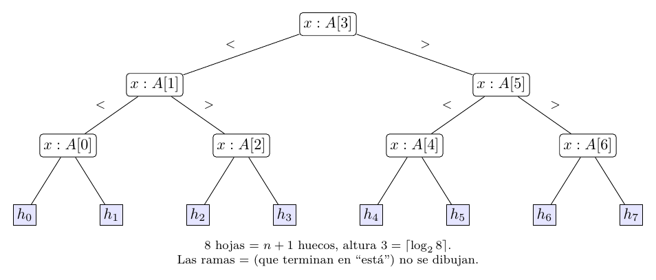
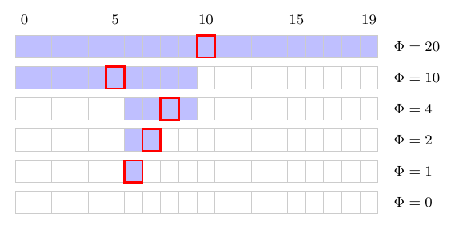

# Ejercicio 2: invariante, potencial y cota de información de la búsqueda binaria

## Enunciado

**Ejercicio 2 ($`\star`$; C3, C5).** Da el invariante y el potencial de la búsqueda binaria, y la cota de información que la hace óptima.

## Respuesta corta

Sea $`A[0..n-1]`$ ordenado y $`x`$ el valor buscado, con el intervalo $`[lo,hi)`$.

- **Invariante $`I`$:** $`0\le lo\le hi\le n`$, todo elemento de $`A[0..lo-1]`$ es $`<x`$ y todo elemento de $`A[hi..n-1]`$ es $`>x`$.

- **Potencial:** $`\Phi=hi-lo\in\mathbb N`$. Cada vuelta que no devuelve cumple $`\Phi'\le\lfloor\Phi/2\rfloor<\Phi`$, así que hay a lo sumo $`\lceil\log_2(n+1)\rceil`$ vueltas, una comparación cada una.

- **Cota de información:** los $`n+1`$ huecos donde puede caer un $`x`$ ausente exigen $`n+1`$ hojas distintas en la parte binaria del árbol de decisión. Con comparaciones de tres respuestas, *incluso decidir si $`x`$ está* necesita $`\lceil\log_2(n+1)\rceil`$ comparaciones en el peor caso, y la búsqueda binaria las alcanza. Con comparaciones de dos respuestas, localizar $`x`$ necesita $`\lceil\log_2(2n+1)\rceil=\lceil\log_2(n+1)\rceil+1`$ ($`n\ge1`$), y `lower_bound` más una comparación de igualdad las alcanza. La cota es exacta en los dos modelos.

Modelos: el costo en tiempo vale en el word RAM (acceso a $`A[i]`$ de costo 1); las cotas mínimas valen en el modelo de comparaciones de C5 §1, con elementos distintos.

## Problema y modelos

**Entrada:** un arreglo $`A[0..n-1]`$ ordenado de forma no decreciente (en la parte de correctitud se admiten duplicados) y un valor $`x`$ del mismo orden total. **Salida:** `("está", m)` con $`A[m]=x`$, o `("hueco", g)` si $`x\notin A`$, donde $`g`$ es el único índice con $`A[g-1]<x<A[g]`$ (con $`A[-1]=-\infty`$, $`A[n]=+\infty`$). El hueco $`g`$ es la posición donde habría que insertar $`x`$.

Hay dos modelos y los distinguimos siempre. Para el *costo* usamos el word RAM de C1: leer $`A[i]`$ cuesta $`1`$. Para la *cota mínima* usamos el modelo de comparaciones de C5 §1: el algoritmo solo puede comparar $`x`$ con elementos de $`A`$, y cada comparación tiene tres respuestas ($`<`$, $`=`$, $`>`$). En la cota los elementos de $`A`$ son distintos. Comparar $`A[i]`$ con $`A[j]`$ no aporta nada, porque el orden de $`A`$ ya se conoce; por eso restringirse a comparar $`x`$ con elementos de $`A`$ no pierde generalidad. Más adelante usamos también un modelo de *dos* respuestas por comparación (una pregunta de sí o no, como $`x\le A[i]`$ o $`x=A[i]`$) y dos versiones del problema: la *búsqueda* (devolver la posición o el hueco) y la *decisión* (¿está $`x`$? sí o no), que es más débil.

## El algoritmo

Es el de C5 §3, con una comparación de tres vías por vuelta.

``` python
def busqueda_binaria(A, x):
    lo, hi = 0, len(A)                 # I: A[:lo] < x < A[hi:]
    while lo < hi:
        m = (lo + hi) // 2
        if x == A[m]:
            return ("esta", m)
        if x < A[m]:
            hi = m
        else:
            lo = m + 1
    return ("hueco", lo)
```

## Correctitud parcial: el invariante

**Invariante $`I`$:** $`0\le lo\le hi\le n`$, y $`A[j]<x`$ para todo $`j<lo`$, y $`A[j]>x`$ para todo $`j\ge hi`$.

*Inicialización.* Con $`lo=0`$ y $`hi=n`$ los dos conjuntos de índices están vacíos y $`0\le0\le n\le n`$.

*Mantenimiento.* Supongamos $`I`$ y que se entra al cuerpo ($`lo<hi`$). Entonces $`m=\lfloor(lo+hi)/2\rfloor`$ cumple $`lo\le m<hi`$. Si $`x=A[m]`$ se devuelve y no hay nada que mantener. Si $`x<A[m]`$, la nueva $`hi'=m`$ cumple $`lo\le hi'\le n`$, y para $`j\ge m`$ se tiene $`A[j]\ge A[m]>x`$ (el arreglo es no decreciente). Si $`x>A[m]`$, la nueva $`lo'=m+1\le hi`$, y para $`j\le m`$ se tiene $`A[j]\le A[m]<x`$. En ambos casos vale $`I`$.

*Conclusión.* Si se devuelve dentro del ciclo, $`A[m]=x`$ y la respuesta es correcta. Si el ciclo termina, no se cumple $`lo<hi`$; con $`lo\le hi`$ de $`I`$ resulta $`lo=hi`$. Entonces $`I`$ dice $`A[j]<x`$ para $`j<lo`$ y $`A[j]>x`$ para $`j\ge lo`$: $`x`$ no está en $`A`$ y $`lo`$ es exactamente su hueco. (El invariante es más fuerte que “si $`x`$ está, está en $`A[lo..hi-1]`$”: da también la posición del hueco.)

## Terminación: el potencial

**Potencial** $`\Phi=hi-lo`$, entero y no negativo por $`I`$. Dentro del cuerpo $`\Phi\ge1`$ y $`m=lo+\lfloor\Phi/2\rfloor`$. Si no se devuelve:

- rama izquierda: $`\Phi'=m-lo=\lfloor\Phi/2\rfloor`$;

- rama derecha: $`\Phi'=hi-m-1=\Phi-\lfloor\Phi/2\rfloor-1=\lceil\Phi/2\rceil-1\le\lfloor\Phi/2\rfloor`$.

En los dos casos $`\Phi'\le\lfloor\Phi/2\rfloor<\Phi`$ (porque $`\Phi\ge1`$). Un entero no negativo no puede bajar para siempre (C3 §1): el ciclo termina.

**Cota de iteraciones.**

Sea $`\Phi_k`$ el potencial tras $`k`$ vueltas. Por inducción, $`\Phi_k\le\lfloor n/2^k\rfloor`$, porque $`\Phi_{k+1}\le\lfloor\Phi_k/2\rfloor\le\lfloor\lfloor n/2^k\rfloor/2\rfloor=\lfloor n/2^{k+1}\rfloor`$. La vuelta $`k+1`$ solo ocurre si $`\Phi_k\ge1`$, es decir si $`2^k\le n`$. Entonces hay a lo sumo $`\lfloor\log_2n\rfloor+1`$ vueltas para $`n\ge1`$, y $`0`$ para $`n=0`$. Como $`\lfloor\log_2n\rfloor+1=\lceil\log_2(n+1)\rceil`$ (si $`2^j\le n<2^{j+1}`$, ambos valen $`j+1`$), el resultado es
``` math
\text{vueltas}\ \le\ \lceil\log_2(n+1)\rceil .
```
**Otra lectura, que prepara la cota.** Sea $`\Psi=\Phi+1`$, el número de huecos que $`I`$ todavía deja posibles: son $`lo,lo+1,\dots,hi`$. Empieza en $`n+1`$, y cada vuelta lo reduce a $`\Psi'\le\lceil\Psi/2\rceil`$. Después de $`k`$ vueltas $`\Psi\le\lceil(n+1)/2^k\rceil`$, que vale $`1`$ en cuanto $`2^k\ge n+1`$. Es el mismo conteo de huecos que usa la cota de información.

## Costo

Cada vuelta hace exactamente una comparación (de tres vías) y un número constante de operaciones del word RAM. Entonces el peor caso son $`\lceil\log_2(n+1)\rceil`$ comparaciones, el tiempo es $`O(\log n)`$ y la memoria extra es $`O(1)`$ (tres variables). El peor caso se alcanza (sección 6); el mejor caso es una comparación, cuando $`x=A[\lfloor n/2\rfloor]`$.

## La cota de información

**Modelo:** árboles de decisión de C5 §2. Cada nodo interno compara $`x`$ con un $`A[i]`$ y cada hoja es una respuesta. El peor caso de un algoritmo es la altura de su árbol. Los elementos de $`A`$ son distintos.

**La trampa de las tres ramas.**

Un árbol ternario de altura $`h`$ tiene a lo sumo $`3^h`$ hojas, y hay $`2n+1`$ respuestas posibles ($`n`$ posiciones y $`n+1`$ huecos). Eso solo da $`h\ge\lceil\log_3(2n+1)\rceil`$; para $`n=1000`$ es $`7`$, lejos de los $`10`$ de la búsqueda binaria. El argumento correcto usa solo los huecos, que nunca recorren la rama $`=`$.

**Qué se demuestra y por qué hace falta un argumento.**

Para la *búsqueda* con salida `("hueco", g)`, una hoja tiene una sola respuesta y huecos distintos tienen respuestas distintas, así que “huecos distintos, hojas distintas” es trivial. La cota interesante es para la *decisión*: una hoja solo dice “sí” o “no”, y todos los huecos responden “no”. Ahí nada obliga a hojas distintas, y hay que probarlo. Como resolver la búsqueda resuelve la decisión, una cota para la decisión es *más fuerte*: vale para los dos problemas.

**Lema 1**. *Sea $`A`$ de elementos distintos y $`\mathcal A`$ un algoritmo de decisión correcto en el modelo de tres respuestas. Si $`x_1,x_2\notin A`$ caen en huecos distintos, $`\mathcal A`$ los lleva a hojas distintas.*

*Demostración.* (C5 §3, lema 4.) Sean $`g_1<g_2`$ los huecos de $`x_1,x_2`$, de modo que $`x_1<A[g_1]\le A[g_2-1]<x_2`$. Supongamos que terminan en la misma hoja $`\lambda`$. Entonces siguen el mismo camino, y en cada comparación de ese camino con un $`A[i]`$ reciben la misma respuesta. Como ninguno está en $`A`$, esa respuesta es $`<`$ o $`>`$:

- si es $`<`$, entonces $`A[i]>x_1`$ y $`A[i]>x_2`$, o sea $`A[i]>x_2`$;

- si es $`>`$, entonces $`A[i]<x_1`$.

Luego *ningún $`A[i]`$ comparado en ese camino está entre $`x_1`$ y $`x_2`$*. Pero $`a=A[g_1]`$ sí está entre ellos ($`x_1<a<x_2`$), así que el algoritmo no lo comparó. Ahora corremos $`\mathcal A`$ con $`x=a`$. En cada comparación del camino, $`A[i]>x_2>a`$ o $`A[i]<x_1<a`$, de modo que $`a`$ recibe la misma respuesta que $`x_1`$ y sigue el mismo camino hasta $`\lambda`$. Allí $`\mathcal A`$ responde “no” (es la hoja de $`x_1`$), pero $`a\in A`$. El algoritmo se equivoca, y eso contradice que es correcto. ◻

**Lema 2**. *Todo algoritmo correcto de decisión (y por lo tanto de búsqueda) en el modelo de tres respuestas necesita $`\lceil\log_2(n+1)\rceil`$ comparaciones en el peor caso.*

*Demostración.* Por el lema 1, los $`n+1`$ huecos llegan a $`n+1`$ hojas distintas. Sus trayectorias solo usan las ramas $`<`$ y $`>`$ (la respuesta $`=`$ significaría $`x\in A`$). Esos nodos forman un árbol binario con al menos $`n+1`$ hojas, y uno de altura $`h`$ tiene a lo sumo $`2^h`$, luego $`2^h\ge n+1`$ y $`h\ge\lceil\log_2(n+1)\rceil`$. La altura del árbol completo es al menos $`h`$. ◻

**Optimalidad con tres respuestas.** La búsqueda binaria hace a lo sumo $`\lceil\log_2(n+1)\rceil`$ comparaciones (sección 4) y resuelve la búsqueda completa, así que la cota es exacta, y no se puede mejorar ni siquiera para el problema más débil de decisión.

**Con dos respuestas por comparación.**

Aquí todo el árbol es binario y la *búsqueda* tiene $`2n+1`$ respuestas distintas, que exigen $`2n+1`$ hojas distintas (cada hoja tiene una sola respuesta). Entonces la altura es al menos $`\lceil\log_2(2n+1)\rceil`$. Para $`n\ge1`$, $`2n+1`$ es impar y mayor que $`1`$, y no es potencia de $`2`$; como $`\lceil\log_2y\rceil=\lceil\log_2(y+1)\rceil`$ si $`y`$ no es potencia de $`2`$,
``` math
\lceil\log_2(2n+1)\rceil=\lceil\log_2(2n+2)\rceil=\lceil\log_2(n+1)\rceil+1 .
```
El algoritmo que lo alcanza es `lower_bound` más una comparación de igualdad. Con el invariante $`A[:lo]<x\le A[hi:]`$, cada vuelta pregunta $`x\le A[m]`$ y hace $`hi=m`$ (sí) o $`lo=m+1`$ (no). Mantenimiento: si $`x\le A[m]`$, $`A[j]\ge A[m]\ge x`$ para $`j\ge m`$; si $`x>A[m]`$, $`A[j]\le A[m]<x`$ para $`j\le m`$. El potencial $`hi-lo`$ cumple la misma recurrencia que antes ($`\Phi'\le\lfloor\Phi/2\rfloor`$), así que hay a lo sumo $`\lceil\log_2(n+1)\rceil`$ preguntas. Al final $`lo=hi=g`$ con $`A[:g]<x\le A[g:]`$, y $`x\in A`$ si y solo si $`g<n`$ y $`A[g]=x`$: una pregunta más. En total $`\lceil\log_2(n+1)\rceil+1`$, igual a la cota. Entonces la cota es exacta también en el modelo de dos respuestas (para la búsqueda). Como el algoritmo hace una comparación más que la búsqueda binaria de tres respuestas, esa diferencia de uno es el precio de que cada comparación tenga una respuesta menos.



La figura es el árbol de la búsqueda binaria con $`n=7`$ (en C5, figura 7, $`a_i=A[i-1]`$; aquí usamos $`A[0..n-1]`$ en todo el documento). El programa de la sección 8 lo reconstruye ejecutando el algoritmo y encuentra $`8`$ caminos distintos para los $`8`$ huecos.

## Una traza del potencial

Con $`n=20`$ y $`x=13`$, que cae entre $`A[6]=12`$ y $`A[7]=14`$ ($`A[i]=2i`$), el intervalo $`[lo,hi)`$ y el potencial son:



Azul: el intervalo $`[lo,hi)`$. Rojo: la posición $`m`$ examinada. El potencial es $`20,10,4,2,1,0`$ y las $`5`$ vueltas coinciden con $`\lceil\log_2 21\rceil=5`$. La salida real, con $`lo`$, $`hi`$ y $`A[m]`$, está al final de la sección siguiente.

## Comprobación experimental

Código: `ej02_busqueda.py`. Vigila el invariante $`I`$ y la desigualdad $`\Phi'\le\lfloor\Phi/2\rfloor`$ con `assert` en cada vuelta, y mide el peor caso sobre las $`2n+1`$ clases de entrada ($`n`$ aciertos y $`n+1`$ huecos), tanto con tres respuestas (sección 2) como con dos (sección 6b: peor caso $`\lceil\log_2(n+1)\rceil+1=\lceil\log_2(2n+1)\rceil`$ para $`n=1..3000`$). Salida real completa:

<details>
<summary><code>ej02_salida.txt</code></summary>

```text
=== 1. Correctitud con invariante y potencial vigilados (aleatorio) ===
  20000 casos (arreglos con duplicados, x dentro y fuera): sin fallos de aserto

=== 2. Peor caso exacto sobre TODAS las entradas (2n+1 clases) = ceil(log2(n+1)) ===
  n = 0..3000: peor caso == ceil(log2(n+1)) en todos salvo 0: []
  borde y tipicos:  n  peor  cota
               0    0    0
               1    1    1
               2    2    2
               3    2    2
               7    3    3
               8    4    4
              15    4    4
              16    5    5
            1000   10   10
            1023   10   10
            1024   11   11

=== 3. Hojas: los n+1 huecos terminan en hojas distintas (lema 4 de C5) ===
  n=    7: 8 caminos distintos para 8 huecos
  n=    8: 9 caminos distintos para 9 huecos
  n=  100: 101 caminos distintos para 101 huecos
  n= 1000: 1001 caminos distintos para 1001 huecos

=== 4. Comparaciones por entrada, n = 7 (arbol de la figura 7 de C5) ===
  x en A  : [(1, 3), (2, 2), (3, 3), (4, 1), (5, 3), (6, 2), (7, 3)]
  huecos  : [('h0', 3), ('h1', 3), ('h2', 3), ('h3', 3), ('h4', 3), ('h5', 3), ('h6', 3), ('h7', 3)]
  histograma (comps -> entradas, 2n+1=15 entradas): {1: 1, 2: 2, 3: 12}

=== 5. Huecos vecinos: los caminos se separan exactamente en A[g] ===
  n = 0..200, 20100 pares de huecos vecinos (g, g+1): el primer desacuerdo es la comparacion con A[g]
  Algoritmo que de verdad se salta el indice j (decision: esta x?):
    n= 7: falla solo en x = A[j] para cada j  (7 fallos en 105 pruebas)
    n= 8: falla solo en x = A[j] para cada j  (8 fallos en 136 pruebas)
    n=15: falla solo en x = A[j] para cada j  (15 fallos en 465 pruebas)
    n=50: falla solo en x = A[j] para cada j  (50 fallos en 5050 pruebas)

=== 6. Variantes con un error de una unidad: el potencial las atrapa ===
  [lo,hi) con lo = m: cuelga en 21 de 49 entradas (n <= 6); la primera: A=[1], x=2
    traza (lo, hi, Phi): [(0, 1, 1), (0, 1, 1), (0, 1, 1), (0, 1, 1)] ... el potencial se queda en 1
  [lo,hi] con hi = m: cuelga en 21 de 49 entradas (n <= 6); la primera: A=[1], x=0
    traza (lo, hi, Phi): [(0, 0, 1), (0, 0, 1), (0, 0, 1), (0, 0, 1)] ... el potencial se queda en 1
  la version correcta termina en <= ceil(log2(n+1)) pasos en las mismas entradas: True
  Caracterizacion (assert para n = 0..12, A distintos, x en 0..2n):
    semi: cuelga <=> n>=1, x no esta y x > A[0];  cerr: cuelga <=> n>=1, x no esta y x < A[n-1]
    con x presente nunca cuelga
    verificado en 169 entradas; cuelgan 78 (semi) y 78 (cerr); por formula: sum_(n=1..12) n = 78
    n <= 6: entradas = 49, x ausente = 28, de ellas en el hueco 0 (o n-1) = 7, cuelgan 28 - 7 = 21

=== 6b. Modelo de 2 vias: lower_bound + comparacion de igualdad ===
  n = 1..3000: peor caso == ceil(log2(n+1)) + 1 == ceil(log2(2n+1)) salvo 0: []
    n=    1  peor=  2  ceil(log2(2n+1))=  2
    n=    2  peor=  3  ceil(log2(2n+1))=  3
    n=    3  peor=  3  ceil(log2(2n+1))=  3
    n=    7  peor=  4  ceil(log2(2n+1))=  4
    n=    8  peor=  5  ceil(log2(2n+1))=  5
    n= 1000  peor= 11  ceil(log2(2n+1))= 11
    n= 1023  peor= 11  ceil(log2(2n+1))= 11
    n= 1024  peor= 12  ceil(log2(2n+1))= 12
  5000 pruebas aleatorias: mismo veredicto que la binaria de 3 vias

=== 7. Traza con el potencial, n = 20, x = 13 (hueco entre 12 y 14) ===
  paso   lo   hi  Phi=hi-lo   m  A[m] x?
     1    0   20         20  10    20  x<A[m]
     2    0   10         10   5    10  x>A[m]
     3    6   10          4   8    16  x<A[m]
     4    6    8          2   7    14  x<A[m]
     5    6    7          1   6    12  x>A[m]
  resultado ('hueco', 7), comparaciones 5, cota ceil(log2 21) = 5
```

</details>

**Casos elegidos.**

*Típicos:* $`20000`$ arreglos aleatorios con duplicados y $`x`$ dentro y fuera (sección 1 de la salida) y $`n=1000`$ (peor caso $`10=\lceil\log_2 1001\rceil`$). *Bordes:* $`n=0`$ (no entra al ciclo, $`0`$ comparaciones, devuelve el hueco $`0`$), $`n=1`$, $`x`$ menor que todos o mayor que todos (huecos $`0`$ y $`n`$), duplicados (el invariante no usa que sean distintos). *Adversariales para la demostración:* (i) $`n=2^k-1`$ y $`n=2^k`$: justo donde $`\lceil\log_2(n+1)\rceil`$ salta, y el programa da $`n=1023\mapsto10`$ y $`n=1024\mapsto11`$; (ii) la sección 5 de la salida verifica, para los $`20100`$ pares de huecos vecinos con $`n\le200`$, que los caminos de la búsqueda binaria se separan *exactamente* en la comparación con $`A[g]`$, como pide la demostración del lema 1; además implementa un algoritmo que de verdad nunca compara con $`A[j]`$ (si cae en $`m=j`$ usa $`m\pm1`$) y falla solo con $`x=A[j]`$, en la versión de decisión; (iii) las variantes con error de una unidad (sección anterior).

## Variantes con un error de una unidad: lo atrapa el potencial

Dos errores típicos son

- **intervalo $`[lo,hi)`$ con $`lo=m`$** en vez de $`lo=m+1`$ (el ejercicio 7 de C3), variante *semi*;

- **intervalo cerrado $`[lo,hi]`$ con $`hi=m`$** en vez de $`hi=m-1`$, variante *cerrada*.

El invariante *se sigue manteniendo* (nunca se pierde un candidato), así que no las detecta: la correctitud parcial vale. Lo que falla es la terminación, y el potencial dice exactamente cuándo. En la semi, con $`\Phi=hi-lo`$ y $`x>A[m]`$: $`\Phi'=\Phi-\lfloor\Phi/2\rfloor=\lceil\Phi/2\rceil`$, igual a $`\Phi`$ si y solo si $`\Phi=1`$. En la cerrada, con $`\Phi=hi-lo+1`$ y $`x<A[m]`$: $`\Phi'=\lfloor(\Phi-1)/2\rfloor+1`$, igual a $`\Phi`$ si y solo si $`\Phi=1`$. Con $`\Phi=1`$ y $`x`$ del lado malo, el ciclo repite el mismo estado.

**Lema 3**. *Con $`A`$ de elementos distintos y $`n\ge1`$:*

1.  *si $`x\in A`$, ninguna de las dos variantes cuelga;*

2.  *la semi cuelga si y solo si $`x\notin A`$ y $`x>A[0]`$;*

3.  *la cerrada cuelga si y solo si $`x\notin A`$ y $`x<A[n-1]`$.*

*Demostración.* (1) Las variantes mantienen “si $`x\in A`$, está en $`A[lo..hi-1]`$” (resp. $`A[lo..hi]`$), porque nunca descartan a $`x`$. El potencial no aumenta y baja estrictamente mientras $`\Phi\ge2`$; luego llega a $`\Phi=1`$ o devuelve antes. Con $`\Phi=1`$ el único candidato es $`x`$, y el siguiente paso lo encuentra.

\(2\) Sea $`x\notin A`$, así que nunca se devuelve dentro del ciclo. Con $`lo=m`$ el ciclo sale solo por la rama izquierda con $`\Phi=1`$ (la derecha da $`\Phi'=\lceil\Phi/2\rceil\ge1`$): es decir, con $`hi=lo+1`$ y $`x<A[lo]`$. Sea $`\ell`$ el valor de $`lo`$ al salir, con $`x<A[\ell]`$. Si $`\ell>0`$, el paso que fijó $`lo=\ell`$ lo hizo con $`m=\ell`$ y $`x>A[m]=A[\ell]`$, que contradice $`x<A[\ell]`$. Luego, si el ciclo sale, $`lo`$ nunca cambió y vale $`0`$, y salir exige $`x<A[0]`$. Recíprocamente, si $`x<A[0]`$ todas las comparaciones son “$`<`$”, $`hi`$ se parte por la mitad hasta $`0`$ y el ciclo sale. Si $`x>A[0]`$ no puede salir (por lo anterior), y como no devuelve, cuelga.

\(3\) Con $`hi=m`$ el ciclo sale solo por la rama derecha con $`m=hi`$ (si no, $`lo'=m+1\le hi`$): es decir, con $`x>A[hi]`$. Sea $`h`$ el valor de $`hi`$ al salir, con $`x>A[h]`$. Si $`h<n-1`$, el paso que fijó $`hi=h`$ lo hizo con $`m=h`$ y $`x<A[m]=A[h]`$, que contradice $`x>A[h]`$. Luego, si sale, $`hi`$ nunca cambió y vale $`n-1`$, y salir exige $`x>A[n-1]`$. Recíprocamente, si $`x>A[n-1]`$ todas las comparaciones son “$`>`$” y $`lo`$ llega a $`n`$. Si $`x<A[n-1]`$, no puede salir y cuelga. ◻

**Qué explica esto.**

Es lo que dice el resumen del tema (§3): la demostración nombra la estructura que las pruebas no ven. Con $`x`$ presente, las variantes *nunca* fallan; solo fallan con $`x`$ ausente, y de ese lado solo cuando $`x`$ queda del lado donde queda atascado el extremo. Una batería que busque valores presentes, o valores menores que todos (semi) o mayores que todos (cerrada), pasa limpia. Con $`A=[1]`$ el fallo ya aparece, con $`x=2`$ (semi) o $`x=0`$ (cerrada): es el caso $`\Phi=1`$.

**Ejecución real (sección 6 de la salida).**

Cada variante cuelga en $`21`$ de las $`49`$ entradas con $`n\le6`$, y la caracterización del lema 3 se verifica con `assert` para $`n\le12`$ y todo $`x`$ (169 entradas, $`78`$ cuelgues por variante, que es $`\sum_{n=1}^{12}n`$). El $`21`$ tiene explicación exacta: hay $`28`$ entradas con $`x`$ ausente, $`7`$ de ellas con $`x`$ en el hueco extremo que no cuelga, y $`28-7=21`$. La traza de $`A=[1]`$ muestra $`(lo,hi,\Phi)=(0,1,1)`$ repetido; la versión correcta termina en todas estas entradas dentro de la cota.

## Por qué este enfoque

**Una analogía.**

Es el juego de las veinte preguntas: se adivina un número entre $`1`$ y $`1000`$ con preguntas de sí o no, y bastan $`10`$ porque $`2^{10}=1024\ge1000`$, y hacen falta $`10`$ porque $`2^{9}=512<1000`$. Aquí, además, el “número” es el hueco, y hay $`n+1`$ y no $`n`$ candidatos: un diccionario de $`7`$ entradas tiene $`8`$ sitios donde puede ir una palabra nueva, y $`3`$ comparaciones bastan. Cuando $`n+1`$ es potencia de $`2`$ (como en $`n=7`$), la búsqueda binaria lee el índice del hueco bit a bit: la primera comparación $`x<A[3]`$ equivale a $`g\le3`$, el bit más alto de $`g`$. En general solo es aproximado, porque $`n+1`$ no es potencia de $`2`$ y los intervalos no se parten exactamente.

**Una visión alternativa.**

El potencial $`\Phi=hi-lo`$ de C3 y la cuenta de huecos de C5 son *la misma cantidad* desplazada en uno: $`\Psi=\Phi+1`$ es el número de huecos posibles. El invariante dice qué huecos quedan, el potencial los cuenta, y el lema de C5 dice que ningún algoritmo puede dejar de contarlos. La cota superior y la inferior hablan del mismo número.

**Por qué este invariante y no otro.**

La alternativa “si $`x`$ está, está en $`A[lo..hi-1]`$” basta para la parte `está`, pero no dice qué hueco devolver cuando $`x`$ falta. El invariante con $`A[:lo]<x<A[hi:]`$ da las dos cosas y no necesita que los elementos sean distintos. (En el word RAM, con palabras de $`w`$ bits, $`lo+hi`$ puede superar $`2^w-1`$ si $`n`$ es cercano a $`2^w`$; se evita con $`m=lo+\lfloor(hi-lo)/2\rfloor`$, que es el mismo valor.)

## Conclusión

- **Invariante:** $`A[:lo]<x<A[hi:]`$, con inicialización, mantenimiento y conclusión (sección 3).

- **Potencial:** $`\Phi=hi-lo`$, con $`\Phi'\le\lfloor\Phi/2\rfloor`$; a lo sumo $`\lceil\log_2(n+1)\rceil`$ vueltas, una comparación cada una (secciones 4–5).

- **Cota mínima:** en el modelo de comparaciones con elementos distintos, $`\lceil\log_2(n+1)\rceil`$ para la decisión y la búsqueda con tres respuestas, y $`\lceil\log_2(n+1)\rceil+1`$ para la búsqueda con dos (sección 6). La búsqueda binaria y `lower_bound` son óptimas en sus modelos.

- **Fuera del modelo la cota no aplica:** la búsqueda por interpolación usa aritmética sobre los valores y hace $`O(\log\log n)`$ comparaciones esperadas con datos uniformes; una tabla hash busca en tiempo esperado constante. Son otras instancias de que toda cota viene con un modelo.
