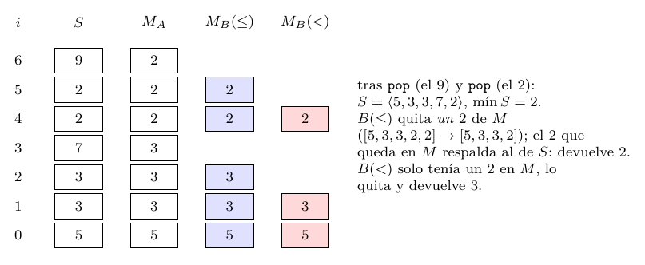

# Ejercicio 3: una pila con mínimo en $`O(1)`$ en el peor caso

## Enunciado

**Ejercicio 3 ($`\star`$; C3).** Una pila con una operación `mínimo` que cuesta $`O(1)`$ en el peor caso. Diseña la estructura, enuncia el invariante que la hace correcta y da el costo de cada operación.

## Respuesta corta

Guardar, junto a cada elemento, el mínimo del prefijo de la pila.

- **Versión A (pares).** Pilas paralelas $`S`$ y $`M`$ con el invariante $`M[i]=\min S[0..i]`$ para todo $`i`$. `push`, `pop`, `top` y `mínimo` cuestan $`O(1)`$ en el peor caso (a lo sumo una comparación). Memoria extra: $`n`$ palabras.

- **Versión B (ahorrativa).** $`M`$ solo recibe $`x`$ si $`x\le\min S`$. Invariante: $`M`$ es la subsecuencia de los *récords no estrictos* de $`S`$. Con $`\le`$ es correcta; con $`<`$ falla con duplicados, y la entrada más corta que la rompe es `push(1), push(1), pop, mínimo`. Memoria extra: entre $`1`$ y $`n`$ palabras ($`n`$ en una secuencia decreciente o constante; $`\approx\ln n`$ en media con orden aleatorio).

- **Versión C (memoria extra $`O(1)`$).** Una sola variable $`\mathit{mn}`$ y los valores codificados $`2x-\mathit{mn}`$. Es exacta con enteros sin límite; en $`w`$ bits se desborda y exige palabras de $`w+2`$ bits.

Modelo: costo en comparaciones y operaciones de palabra del word RAM; la pila de capacidad fija o de lista enlazada da $`O(1)`$ *de peor caso*. Con arreglo dinámico el `push` solo es $`O(1)`$ amortizado.

## Especificación y modelo

**Tipo abstracto.** Una pila $`S=\langle s_0,\dots,s_{k-1}\rangle`$ de elementos de un orden total (el tope es $`s_{k-1}`$) con las operaciones:

- `push`$`(x)`$: $`S\leftarrow\langle s_0,\dots,s_{k-1},x\rangle`$;

- `pop`$`()`$: devuelve $`s_{k-1}`$ y quita el tope. *Precondición:* $`k\ge1`$;

- `top`$`()`$: devuelve $`s_{k-1}`$. *Precondición:* $`k\ge1`$;

- `mínimo`$`()`$: devuelve $`\min\{s_0,\dots,s_{k-1}\}`$. *Precondición:* $`k\ge1`$.

Las operaciones con precondición violada no están especificadas; las implementaciones de abajo lanzan `IndexError` (sección 6). Lo que hay que demostrar es que, después de cualquier secuencia válida de operaciones, `mínimo` devuelve $`\min S`$. No hay ciclos, así que no hay potencial de terminación: cada operación es de línea recta. La herramienta es el *invariante de la estructura* (C3 §1): una propiedad que se cumple al crear la pila y que cada operación preserva.

**Modelo.** Word RAM de C1: leer, escribir y comparar palabras cuesta $`1`$. Medimos el costo en comparaciones de elementos y en accesos a palabras.

## Versión A: pares valor y mínimo del prefijo

``` python
class PilaA:
    def __init__(self):   self.S, self.M = [], []
    def push(self, x):
        m = x if not self.M or x < self.M[-1] else self.M[-1]
        self.S.append(x); self.M.append(m)
    def pop(self):        self.M.pop(); return self.S.pop()
    def top(self):        return self.S[-1]
    def minimo(self):     return self.M[-1]
```

**Invariante $`I_A`$:** $`|M|=|S|=k`$ y $`M[i]=\min S[0..i]`$ para todo $`0\le i<k`$.

*Inicialización.* Con $`k=0`$ las dos pilas están vacías y la condición sobre $`i`$ es vacía.

*Mantenimiento de `push`$`(x)`$.* Antes, $`I_A`$ con $`k`$. Después, $`S[k]=x`$ y $`M[k]=m`$. Para $`i<k`$ nada cambió. Para $`i=k`$: si $`k=0`$, $`m=x=\min S[0..0]`$. Si $`k\ge1`$, $`\min S[0..k]=\min(\min S[0..k-1],x)=\min(M[k-1],x)=m`$ (por $`I_A`$ en $`k-1`$).

*Mantenimiento de `pop` y `top`.* `pop` quita el último índice de las dos pilas; los índices restantes no cambian y siguen cumpliendo $`M[i]=\min S[0..i]`$, porque esa expresión solo mira $`S[0..i]`$. `top` y `mínimo` no modifican nada.

*Conclusión.* Si $`k\ge1`$, `mínimo` devuelve $`M[k-1]=\min S[0..k-1]=\min S`$.

**Costo.** `push`: una comparación y dos escrituras. `pop`, `top`, `mínimo`: $`0`$ comparaciones. Todo $`O(1)`$ *en el peor caso* siempre que el almacenamiento no cambie de tamaño (sección 5). Memoria extra: $`|M|=k`$ palabras.

**Variante en lista enlazada.** Cada nodo guarda `(valor, mínimo de su cola, siguiente)`. Es la misma estructura con $`O(1)`$ de peor caso para `push` porque no hay redimensionamiento (supone que reservar un nodo cuesta $`O(1)`$, como en el word RAM).

## Versión B: solo se guarda cuando baja o iguala el mínimo

Guardar $`M[i]`$ para cada $`i`$ desperdicia memoria cuando el mínimo casi nunca cambia.

``` python
class PilaB:
    def __init__(self):   self.S, self.M = [], []
    def push(self, x):
        if not self.M or x <= self.M[-1]:      # <=, no <
            self.M.append(x)
        self.S.append(x)
    def pop(self):
        y = self.S.pop()
        if y == self.M[-1]:
            self.M.pop()
        return y
    def top(self):        return self.S[-1]
    def minimo(self):     return self.M[-1]
```

**Definición.** $`S[i]`$ es un *récord* si $`i=0`$ o $`S[i]\le\min S[0..i-1]`$ (no estricto: los empates cuentan).

**Invariante $`I_B`$:** $`M`$ es la lista de los récords de $`S`$, en el orden en que aparecen en $`S`$.

**Lema 1**. *Si $`I_B`$ vale y $`k\ge1`$, entonces $`M[-1]=\min S`$, y el tope $`y=S[k-1]`$ es un récord si y solo si $`y=M[-1]`$.*

*Demostración.* Sea $`\mu=\min S`$ y $`j`$ el *último* índice con $`S[j]=\mu`$. Como $`\mu\le`$ todo, $`S[j]\le\min S[0..j-1]`$ y $`S[j]`$ es récord. Para $`i>j`$, $`\min S[0..i-1]=\mu`$ (está $`S[j]`$ y nada es menor), y $`S[i]>\mu`$ porque $`j`$ es el último índice que vale $`\mu`$; luego $`S[i]`$ no es récord. Entonces el último récord es $`S[j]=\mu`$, y $`M[-1]=\mu`$ por $`I_B`$. Si $`y`$ es récord, es el último récord y $`y=M[-1]`$. Recíprocamente, si $`y=M[-1]=\min S`$, entonces $`y\le\min S[0..k-2]`$, es decir, es récord. ◻

*Inicialización.* $`S=M=\varnothing`$ y no hay récords.

*Mantenimiento de `push`$`(x)`$.* La posición nueva $`k`$ es récord si $`k=0`$ o $`x\le\min S[0..k-1]=M[-1]`$ (lema 1). El código añade $`x`$ a $`M`$ exactamente en ese caso, y los récords anteriores no cambian.

*Mantenimiento de `pop`.* Sea $`y`$ el tope. Los récords de $`S[0..k-2]`$ son los de $`S`$ sin $`y`$ (ser récord solo mira los predecesores). Por el lema 1, $`y`$ es récord $`\iff y=M[-1]`$, y entonces es el último elemento de $`M`$: el código lo quita justo en ese caso. *Aquí es donde la igualdad importa:* la condición “$`y=M[-1]`$” reconoce récords *no estrictos*.

*Conclusión.* `mínimo` devuelve $`M[-1]=\min S`$ (lema 1).

**Costo.** `push`: una comparación; `pop`: una comparación; `mínimo`: ninguna. $`O(1)`$ en el peor caso.

## Con $`<`$ en lugar de $`\le`$ falla

Si `push` guarda solo cuando $`x<M[-1]`$, $`M`$ contiene solo los récords *estrictos*, pero `pop` sigue quitando cuando $`y=M[-1]`$. Con duplicados del mínimo, el segundo $`1`$ de `push(1), push(1)` no entra en $`M`$. Al hacer `pop`, $`y=1=M[-1]`$ y se quita el *único* $`1`$ de $`M`$, aunque $`S`$ todavía tiene un $`1`$ debajo: `mínimo` queda sin respaldo. Con otros elementos debajo, devuelve un mínimo equivocado. Ejemplo de la sección 1b de la salida, con $`S=\langle5,3,3,7,2,2,9\rangle`$:



La figura muestra las tres pilas auxiliares tras los siete `push`, de abajo hacia arriba. $`M_A`$ guarda siempre; $`M_B(\le)`$ guarda los récords no estrictos (azul); $`M_B(<)`$ solo los estrictos (rojo). Con $`S`$ en ese estado, `pop` (el $`9`$), `pop` (el $`2`$ de arriba) y `mínimo`, la salida real es $`[9,2,2]`$ para $`A`$, $`B(\le)`$ y el oráculo, y $`[9,2,3]`$ para $`B(<)`$.

**La entrada más corta.** La búsqueda exhaustiva sobre todas las secuencias válidas hasta largo $`7`$ con valores $`\{0,1,2\}`$ ($`141\,519`$ secuencias) encuentra que $`B(<)`$ difiere del oráculo en $`7168`$ de ellas, y la más corta tiene largo $`4`$: `push`$`(v)`$, `push`$`(v)`$, `pop`, y luego `pop` o `mínimo`, para $`v\in\{0,1,2\}`$ (seis secuencias, todas del mismo tipo). Con $`B(<)`$ la ejecución termina en `IndexError` porque $`M`$ quedó vacía; con $`B(\le)`$ da $`[0,0]`$. No hay ninguna más corta: con tres operaciones ninguna sale distinta del oráculo.

**Qué anuncia la demostración.** El lema 1 habla de récords *no estrictos*. Una variante estricta necesitaría, además de $`M`$, saber cuántas copias del mínimo hay (se guarda $`(\text{valor},\text{cuenta})`$) para que `pop` sepa si $`y`$ era el único. Los duplicados del mínimo son la estructura que las pruebas con valores distintos no ven.

## Costos y memoria

**Peor caso, no amortizado.**

Con almacenamiento de capacidad fija, o con listas enlazadas, las cuatro operaciones de las versiones A y B cuestan $`O(1)`$ *en el peor caso*: a lo sumo una comparación y un número constante de accesos. La salida real (sección 5, $`100\,000`$ operaciones aleatorias) da $`\{\text{push}:1,\text{pop}:0,\text{mínimo}:0\}`$ para $`A`$ y $`\{1,1,0\}`$ para $`B`$.

Si $`S`$ y $`M`$ son arreglos dinámicos que duplican su capacidad, el `push` es $`O(1)`$ *amortizado*, pero un `push` suelto puede costar $`\Theta(n)`$ por la copia. La sección 6 de la salida lo mide: con $`2^k+1`$ pushes, el peor cuesta $`2^k+1`$ y la media es $`3{,}000`$. Para $`O(1)`$ de peor caso hace falta capacidad fija, listas enlazadas o desamortización (copiar de a poco durante los pushes siguientes).

**Memoria extra, en el peor caso.**

| $`n=1000`$ pushes | $`A`$ ($`|M|`$) | $`B(\le)`$ | $`B(<)`$ (incorrecta) |
|:------------------|----------------:|-----------:|----------------------:|
| creciente         |            1000 |      **1** |                     1 |
| decreciente       |            1000 |   **1000** |                  1000 |
| todos iguales     |            1000 |   **1000** |                     1 |

La versión B *no ahorra nada* en una secuencia decreciente, ni en una constante (con $`\le`$ cada copia es récord). Su memoria extra en el peor caso es $`n`$, la misma que la de A; solo mejora el caso típico. Con orden aleatorio de elementos distintos, el elemento $`S[i]`$ es récord con probabilidad $`1/(i+1)`$, así que $`\mathbb E|M|=\sum_{i=0}^{n-1}1/(i+1)=H_n\approx\ln n`$: $`7{,}49`$ para $`n=1000`$, y la salida da $`7{,}62`$ de media en $`300`$ pruebas (máximo $`16`$). Con duplicados el ahorro desaparece rápido: con un alfabeto de $`3`$ símbolos, $`|M|\approx334`$ de $`1000`$.

## Comprobación experimental

Código: `ej03_pila_minimo.py`. Compara las versiones contra un oráculo con $`\min S`$ ingenuo, vigila los invariantes $`I_A`$ y $`I_B`$ después de *cada* operación, y verifica exhaustivamente. Salida real:

<details>
<summary><code>ej03_salida.txt</code></summary>

```text
=== 1. Exhaustivo: toda secuencia valida hasta largo 7, valores {0,1,2}, contra el oraculo ===
  141519 secuencias
  version      A: 0 secuencias que difieren del oraculo
  version  B(<=): 0 secuencias que difieren del oraculo
  version   B(<): 7168 secuencias que difieren del oraculo
  version      C: 0 secuencias que difieren del oraculo
  B con '<': secuencias mas cortas que la rompen (largo 4): 6
    ['push(0)', 'push(0)', 'pop', 'pop']
    ['push(0)', 'push(0)', 'pop', 'min']
    ['push(1)', 'push(1)', 'pop', 'pop']
    ['push(1)', 'push(1)', 'pop', 'min']
    ['push(2)', 'push(2)', 'pop', 'pop']
    ['push(2)', 'push(2)', 'pop', 'min']
  ejecucion de la primera, B(<) contra el oraculo: ('ERROR', 'IndexError') vs [0, 0]
  y con B(<=): [0, 0]

=== 1b. El ejemplo de la figura: push 5,3,3,7,2,2,9 y luego pop, pop, minimo ===
       A: salidas [9, 2, 2]   M final = [5, 3, 3, 3, 2]
   B(<=): salidas [9, 2, 2]   M final = [5, 3, 3, 2]
    B(<): salidas [9, 2, 3]   M final = [5, 3]
  oraculo: salidas [9, 2, 2]
  tras los 7 pushes:  M_A = [5, 3, 3, 3, 2, 2, 2]  M_B(<=) = [5, 3, 3, 2, 2]  M_B(<) = [5, 3, 2]

=== 2. Aleatorio con invariante vigilado (A, B(<=)) y salidas contra el oraculo ===
  3000 secuencias de 80 operaciones (alfabetos de 2, 3, 5 y 1000 valores): 240000 operaciones, sin fallos

=== 3. Casos borde: pila vacia (precondicion) ===
       A: pop: IndexError, top: IndexError, minimo: IndexError
   B(<=): pop: IndexError, top: IndexError, minimo: IndexError
       C: pop: IndexError, top: IndexError, minimo: IndexError

=== 4. Memoria extra en el peor caso (|M| tras n pushes, n = 1000) ===
       creciente: |S|=1000  A: |M|=1000  B(<=): |M|=1  B(<) [incorrecta]: |M|=1
     decreciente: |S|=1000  A: |M|=1000  B(<=): |M|=1000  B(<) [incorrecta]: |M|=1000
   todos iguales: |S|=1000  A: |M|=1000  B(<=): |M|=1000  B(<) [incorrecta]: |M|=1
      permutacion: media |M| =    7.62, maximo   16  (H_n = 7.49)
    alfabeto de 3: media |M| =  334.45, maximo  378
  alfabeto de 100: media |M| =   14.90, maximo   25

=== 5. Peor caso por operacion (comparaciones), 100000 operaciones aleatorias ===
       A: maximo de comparaciones por operacion = {'push': 1, 'pop': 0, 'min': 0}
   B(<=): maximo de comparaciones por operacion = {'push': 1, 'pop': 1, 'min': 0}

=== 6. Arreglo dinamico (duplicando): coste de un push suelto vs amortizado ===
     1025 pushes: peor push =    1025, media = 2.997
    16385 pushes: peor push =   16385, media = 3.000
   262145 pushes: peor push =  262145, media = 3.000

=== 7. Version C (2x - min): memoria extra O(1) y desbordamiento en w bits ===
  enteros sin limite: ya verificada contra el oraculo en la seccion 1 y 2
  w=4: secuencias que rompen, por largo: largo 1: 0, largo 2: 0, largo 3: 128
    la primera de largo minimo: ['push(-7)', 'push(-8)', 'pop'] -> [7] (oraculo: [-8] )
  w=8: secuencias que rompen, por largo: largo 1: 0, largo 2: 0, largo 3: 32768
    la primera de largo minimo: ['push(-127)', 'push(-128)', 'pop'] -> [127] (oraculo: [-128] )
    detalle: push(100), push(-100): E = [100, -44], mn = -100; 2*(-100)-100 = -300 -> -44 en 8 bits
    pop devuelve -44 (debia ser -100); pop devuelve 100 (debia ser 100)
  w= 8: valores en todo el rango: fallan 12247/20000; en |x| <= 2^(w-3)=32: aciertan 20000/20000
  w=16: valores en todo el rango: fallan 12305/20000; en |x| <= 2^(w-3)=8192: aciertan 20000/20000
  w=32: valores en todo el rango: fallan 12254/20000; en |x| <= 2^(w-3)=536870912: aciertan 20000/20000

=== 8. Cola con minimo con dos pilas (A): contra un oraculo y coste amortizado ===
  500 secuencias de 300 operaciones: salidas iguales al oraculo (deque + min ingenuo);
  en todos los prefijos: operaciones de pila reales <= 3*encolar + 1*desencolar (potencial 2|ent|)
  1000 encolar + 1000 desencolar: 4000 operaciones de pila = 4m (cota amortizada 3m + m = 4m)
  100000 encolar + 100000 desencolar: 400000 operaciones de pila = 4m (cota amortizada 3m + m = 4m)
  un desencolar suelto con 10^5 elementos en la entrada cuesta 200001 operaciones de pila (O(n), no O(1))
```

</details>

**Casos elegidos.**

*Típicos:* $`3000`$ secuencias aleatorias de $`80`$ operaciones con alfabetos de $`2`$, $`3`$, $`5`$ y $`1000`$ valores ($`240\,000`$ operaciones, invariantes vigilados). *Bordes:* pila vacía (precondición, `IndexError`), un solo elemento, todos iguales, creciente, decreciente. *Exhaustivo:* las $`141\,519`$ secuencias válidas hasta largo $`7`$. *Adversariales:* los duplicados del mínimo, que es lo que señala la demostración (sección 4) y lo que rompe $`B(<)`$.

## Algo más fino: memoria extra $`O(1)`$ con $`2x-\mathit{mn}`$

¿Hace falta $`M`$? Se puede guardar *una sola* variable $`\mathit{mn}=\min S`$ si los elementos nuevos que bajan el mínimo se guardan codificados.

``` python
def push(self, x):
    if not self.E:       self.E.append(x); self.mn = x
    elif x >= self.mn:   self.E.append(x)
    else:                self.E.append(2*x - self.mn); self.mn = x
def pop(self):
    y = self.E.pop()
    if y >= self.mn:     return y
    real = self.mn;      self.mn = 2*self.mn - y;  return real
def top(self):           y = self.E[-1];  return y if y >= self.mn else self.mn
def minimo(self):
    if not self.E: raise IndexError("pila vacia")
    return self.mn
```

Sea $`m_i=\min S[0..i]`$. **Invariante $`I_C`$:** $`E[0]=S[0]`$; para $`i\ge1`$, $`E[i]=S[i]`$ si $`S[i]\ge m_{i-1}`$ y $`E[i]=2S[i]-m_{i-1}`$ si $`S[i]<m_{i-1}`$; y $`\mathit{mn}=m_{k-1}`$ cuando $`k\ge1`$. (El elemento $`0`$ va aparte porque no tiene $`m_{-1}`$ finito.)

**Lema 2**. *Bajo $`I_C`$, para $`i\ge1`$: $`E[i]\ge m_i`$ si y solo si $`S[i]\ge m_{i-1}`$.*

*Demostración.* Si $`S[i]\ge m_{i-1}`$: $`m_i=m_{i-1}`$ y $`E[i]=S[i]\ge m_{i-1}=m_i`$. Si $`S[i]<m_{i-1}`$: $`m_i=S[i]`$ y $`E[i]=2S[i]-m_{i-1}<2S[i]-S[i]=m_i`$. Para $`i=0`$ se tiene directamente $`E[0]=S[0]=m_0`$, o sea $`E[0]\ge m_0`$. ◻

*Inicialización.* $`E=\varnothing`$ y $`I_C`$ vale sin condiciones sobre $`\mathit{mn}`$.

*Mantenimiento de `push`$`(x)`$.* Si la pila está vacía, $`E[0]=x=S[0]`$ y $`\mathit{mn}=x=m_0`$. Si no, $`k\ge1`$ y $`\mathit{mn}=m_{k-1}`$: el código guarda $`E[k]`$ según la definición con $`S[k]=x`$; si $`x<\mathit{mn}`$, el nuevo $`\mathit{mn}=x=m_k`$, y si no, $`\mathit{mn}=m_{k-1}=m_k`$. Los $`E[i]`$ anteriores no cambian.

*Mantenimiento de `pop`.* Sea $`i=k-1`$, $`y=E[i]`$ y $`\mathit{mn}=m_i`$. Para $`i\ge1`$ el lema hace que $`y\ge\mathit{mn}`$ distinga los dos casos. En el primero, $`S[i]=y`$ y $`m_{i-1}=m_i=\mathit{mn}`$, que no cambia. En el segundo, $`S[i]=m_i=\mathit{mn}`$ (el mínimo real, que es lo que se devuelve) y $`m_{i-1}=2S[i]-y=2\,\mathit{mn}-y`$, que es lo que asigna el código: $`\mathit{mn}=m_{i-1}=m_{k-2}`$ en la pila nueva. Para $`i=0`$: $`E[0]=S[0]=m_0=\mathit{mn}`$, luego el test da $`y\ge\mathit{mn}`$ y se devuelve $`S[0]`$ (correcto); $`\mathit{mn}`$ queda obsoleto, pero la pila queda vacía, $`I_C`$ no dice nada de $`\mathit{mn}`$ cuando $`k=0`$, y el siguiente `push` sobre pila vacía lo reinicia. `top` y `mínimo` no modifican nada, y `top` aplica el mismo test.

*Conclusión.* `mínimo` devuelve $`\mathit{mn}=m_{k-1}=\min S`$. El empate $`x=\mathit{mn}`$ va a la primera rama (se guarda $`x`$ sin codificar), y el lema la cubre.

**Costo y memoria.** Todo $`O(1)`$ de peor caso. La memoria extra es *una* palabra ($`\mathit{mn}`$), contra $`n`$ de A: la estructura ocupa $`n+1`$ palabras en vez de $`2n`$.

**Cuándo se rompe: aritmética exacta.**

$`2x-\mathit{mn}`$ con $`x<\mathit{mn}`$ puede salirse del rango de la palabra. Con enteros de $`w`$ bits en complemento a dos, $`x,\mathit{mn}\in[-2^{w-1},\,2^{w-1}-1]`$, y solo se codifica cuando $`x\le\mathit{mn}-1`$. Los extremos del valor codificado son:

- *mínimo:* $`x=-2^{w-1}`$ y $`\mathit{mn}=2^{w-1}-1`$ dan $`2x-\mathit{mn}=-3\cdot2^{w-1}+1`$;

- *máximo:* $`2x-\mathit{mn}\le2(\mathit{mn}-1)-\mathit{mn}=\mathit{mn}-2\le2^{w-1}-3`$.

Entonces el valor vive en $`[-3\cdot2^{w-1}+1,\;2^{w-1}-3]`$. Con $`w+1`$ bits (rango $`[-2^w,2^w-1]`$) no basta, porque $`-3\cdot2^{w-1}+1<-2^w`$ para $`w\ge2`$; con $`w+2`$ bits (rango $`[-2^{w+1},2^{w+1}-1]`$) sí.

Si se envuelve módulo $`2^w`$, la resta $`2\,\mathit{mn}-E`$ de `pop` sigue siendo correcta módulo $`2^w`$ (son operaciones de anillo), pero el test $`E\ge\mathit{mn}`$ del lema deja de serlo, porque $`E`$ ya no es el valor verdadero. La sección 7 de la salida lo muestra con $`w=8`$: `push(100)`, `push(-100)` guarda $`2(-100)-100=-300\to-44`$, y `pop` devuelve $`-44`$ en vez de $`-100`$.

*La secuencia más corta.* La búsqueda por longitud (sección 7 de la salida) da, para $`w=8`$: ninguna secuencia de largo $`1`$ ni $`2`$ rompe la versión C (el primer `push` no se codifica, y un segundo `push` no produce salida), y hay $`32\,768`$ de largo $`3`$. Son los pares $`(v_1,v_2)`$ con $`v_2<v_1`$ y $`2v_2-v_1<-128`$ ($`16\,384`$ pares) seguidos de `pop` o `top` (`mínimo` sí acierta, porque lee $`\mathit{mn}`$). La primera es `push(-127)`, `push(-128)`, `pop`: el valor codificado es $`-129`$, que en $`8`$ bits es $`127`$, y `pop` devuelve $`127`$ en vez de $`-128`$. Para $`w=4`$ ocurre lo mismo con $`128`$ secuencias de largo $`3`$ (`push(-7)`, `push(-8)`, `pop` devuelve $`7`$ en vez de $`-8`$).

Con valores en todo el rango, la versión C falla en $`\approx61\%`$ de las secuencias aleatorias de $`6`$ pushes y $`6`$ pops, para $`w=8`$, $`16`$ y $`32`$. Si los valores cumplen $`|x|\le2^{w-3}`$, entonces $`2x-\mathit{mn}\ge-3\cdot2^{w-3}\ge-2^{w-1}`$ y no hay desbordamiento: la salida da $`20000/20000`$ aciertos en los tres anchos.

Moraleja: como toda cota del curso, la corrección de C depende del modelo: vale con enteros exactos y falla en el word RAM con valores de $`w`$ bits, donde hace falta reservar dos bits o restringir el rango.

## Extensión: una cola con mínimo, y el costo amortizado de C4

Una cola con dos pilas A (`ent` para encolar, `sal` para desencolar; si `sal` está vacía se pasan todos los de `ent`) tiene `mínimo` $`=\min(\texttt{ent.mínimo},\texttt{sal.mínimo})`$ en $`O(1)`$. Es correcta porque los elementos de la cola son la unión de los de las dos pilas, y el mínimo de una unión es el mínimo de los mínimos.

El costo de `desencolar` *no es* $`O(1)`$ de peor caso: cuando `sal` está vacía mueve toda `ent`. La sección 8 de la salida lo mide: un `desencolar` con $`10^5`$ elementos en `ent` cuesta $`200\,001`$ operaciones de pila. Sí es $`O(1)`$ amortizado. Con el potencial de C4, $`\Phi=2\,|\texttt{ent}|`$ (cada elemento de `ent` trae pagados sus dos movimientos): encolar cuesta $`1`$ y sube $`\Phi`$ en $`2`$, amortizado $`3`$; desencolar sin movimientos cuesta $`1`$ y no cambia $`\Phi`$; con $`j`$ movimientos cuesta $`2j+1`$ y $`\Phi`$ baja $`2j`$, amortizado $`1`$. Como $`\Phi\ge0`$ y empieza en $`0`$, el costo real de cualquier secuencia es a lo sumo $`3\,\#\text{encolar}+\#\text{desencolar}`$. La salida verifica esa cota en todos los prefijos de $`500`$ secuencias aleatorias y da exactamente $`4m`$ operaciones de pila para $`m`$ encolar y $`m`$ desencolar.

## Por qué este enfoque

**Una analogía.**

La pila es una torre de pisos en una costa, y cada piso graba en su pared la *marca más baja del nivel del mar* vista desde los pisos de abajo hasta él. Preguntar el mínimo es leer la pared del último piso. Derribar el piso de arriba no obliga a recalcular nada: las marcas de los pisos que quedan ya estaban escritas. La versión B solo marca los pisos donde el nivel baja o se iguala, y pregunta “¿mi piso tiene marca?” al derribarlo; el defecto de $`B(<)`$ es que un piso con el mismo nivel que el anterior no deja marca, y al derribar el de arriba se borra la única marca de ese nivel.

**Otra visión.**

A es una estructura *aumentada*: cada elemento carga un resumen de su prefijo (el mínimo), y como el resumen de $`S[0..i]`$ solo depende de $`S[0..i]`$, `pop` es gratis. Es la idea que reaparece en el árbol de segmentos (cada nodo carga el resumen de su intervalo). B comprime ese resumen guardando solo los cambios (récords), y C lo comprime hasta una variable codificando el cambio dentro del propio elemento.

**Por qué estos invariantes.**

$`I_A`$ es lo más simple que da $`\min S`$ en una lectura. $`I_B`$ debe hablar de *récords no estrictos* porque `pop` solo puede decidir con la información de $`M[-1]`$ y una igualdad, y la igualdad no distingue un récord estricto de uno que empata: hay que tratar los empates como récords. $`I_C`$ elige el signo del test $`E\ge\mathit{mn}`$ para que la *codificación sea decodificable*, que es lo que prueba el lema.

## Conclusión

- **A:** $`M[i]=\min S[0..i]`$; todo $`O(1)`$ de peor caso; memoria extra $`n`$.

- **B:** $`M`$ = récords no estrictos de $`S`$; todo $`O(1)`$ de peor caso; memoria extra entre $`1`$ y $`n`$ ($`\approx\ln n`$ en media con orden aleatorio, $`n`$ en el peor caso). Con $`<`$ falla con duplicados.

- **C:** $`\mathit{mn}`$ y $`2x-\mathit{mn}`$; todo $`O(1)`$ de peor caso; una palabra extra; exige aritmética exacta ($`w+2`$ bits); la secuencia más corta que la rompe en $`w`$ bits tiene largo $`3`$.

- Todo $`O(1)`$ de peor caso *con almacenamiento de capacidad fija o lista enlazada*; con arreglo dinámico, el `push` es $`O(1)`$ amortizado.

- La cola con mínimo cuesta $`O(1)`$ amortizado, y $`\Theta(n)`$ en un `desencolar` suelto.

Modelo: word RAM de C1; los elementos de un orden total con comparación de costo $`1`$.
