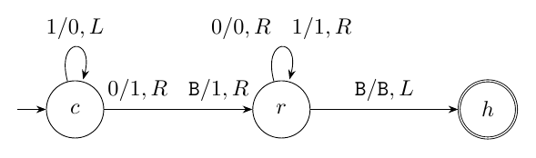

# Ejercicio 4: el contador binario en una máquina de Turing

## Enunciado

**Ejercicio 4 ($`\star\star`$; C1, C4).** El contador binario en una máquina de Turing, del ejercicio 7 de la conferencia 1. Demuestra con un potencial que $`m`$ incrementos desde $`0`$ cuestan $`O(m)`$ pasos en total, aunque uno solo pueda costar $`\Theta(\log m)`$. Es la pregunta que la conferencia 1 dejó abierta.

**Ejercicio 7 de la conferencia 1 (el que se cita).** Diseña una máquina de Turing de una cinta que sume $`1`$ a un número escrito en binario, con el cabezal empezando en el bit menos significativo y volviendo a él al terminar. ¿Cuántos pasos da en el peor caso? Si se aplica $`m`$ veces seguidas empezando desde $`0`$, ¿cuántos pasos da en total?

## Respuesta corta

- **Máquina:** $`3`$ estados y $`6`$ transiciones. Con $`t`$ unos finales, un incremento cuesta *exactamente* $`2(t+1)`$ pasos: $`t+1`$ de ida (acarreo) y $`t+1`$ de vuelta al bit menos significativo. Peor caso para $`c<m`$: $`2(\lfloor\log_2m\rfloor+1)`$, al pasar de $`2^k-1`$ a $`2^k`$.

- **Potencial:** $`\Phi=2\cdot(\text{número de unos en la cinta})`$, con $`\Phi_0=0`$ y $`\Phi\ge0`$. El costo amortizado de *cada* incremento es exactamente $`4`$.

- **Total:** $`m`$ incrementos desde $`0`$ cuestan $`4m-2\,s_2(m)\le4m`$ pasos, con $`s_2(m)`$ el número de unos de $`m`$ en binario. Verificado con un simulador de la máquina para todo $`m=1,\dots,2^{16}`$.

- **Por qué un potencial:** con decrementos, la secuencia $`2^k-1\leftrightarrow2^k`$ cuesta $`2(k+1)`$ *cada* operación, y ningún potencial puede evitarlo.

Modelo: máquina de Turing de una cinta (infinita a ambos lados), un paso $`=`$ una transición.

## Modelo

- **Cinta y símbolos.** Una cinta infinita hacia ambos lados, con símbolos $`\{0,1,\mathtt{B}\}`$ ($`\mathtt{B}`$ es el blanco). Que la cinta sea infinita a la izquierda importa: añadir un bit más significativo es escribir en una celda blanca que ya existe, *sin desplazar* el número.

- **Orientación.** Los bits van como se escriben: el más significativo (MSB) a la izquierda y el menos significativo (LSB) a la derecha. Si la cinta fuera infinita solo a la derecha se escribe el LSB primero, con una marca de fin en la celda $`0`$; el análisis es el mismo con izquierda y derecha intercambiadas.

- **Configuración.** El contador con valor $`c`$ está escrito en binario sin ceros a la izquierda (el $`0`$ se escribe como el único dígito “0”), con el resto de la cinta en blanco. **El cabezal está sobre el LSB al empezar y al terminar de cada incremento**, que es la convención del ejercicio 7 de C1.

- **Un paso** es una aplicación de la función de transición $`\delta(q,a)=(q',a',d)`$: lee $`a`$, escribe $`a'`$, se mueve una celda ($`d\in\{L,R\}`$) y cambia de estado. La transición que lleva al estado de parada cuenta como un paso; estar ya en el estado de parada no cuesta.

Lo que distingue este modelo de la RAM es que *el cabezal tiene que volver*. En una RAM, el acarreo toca $`t+1`$ bits y se termina; aquí hay que caminar de regreso, y eso cuesta otros $`t+1`$ pasos.

## La máquina

Estados: $`c`$ (acarreo, inicial), $`r`$ (regreso) y $`h`$ (parada). La tabla es completa: hay una transición para cada par (estado no final, símbolo).

|  |  |  |  |
|:---|:---|:---|:---|
| $`\delta(c,1)=(c,0,L)`$ | $`\delta(c,0)=(r,1,R)`$ | $`\delta(c,\mathtt B)=(r,1,R)`$ |  |
| $`\delta(r,0)=(r,0,R)`$ | $`\delta(r,1)=(r,1,R)`$ | $`\delta(r,\mathtt B)=(h,\mathtt B,L)`$ |  |



La etiqueta $`a/a',d`$ significa: lee $`a`$, escribe $`a'`$ y se mueve a $`d`$. La transición $`\delta(r,1)`$ no se usa en una cinta bien formada (a la derecha del bit que se acaba de poner solo hay ceros), pero completa la tabla.

**Un incremento paso a paso.**

De $`111`$ ($`c=7=2^3-1`$, $`t=3`$) a $`1000`$. Es el caso en que la cinta crece: en el paso $`3`$ el cabezal lee un blanco, que es la celda a la izquierda del MSB, y usa $`\delta(c,\mathtt B)`$.

| paso | estado | cabezal | cinta           | paso | estado | cabezal | cinta             |
|-----:|:------:|--------:|:----------------|-----:|:------:|--------:|:------------------|
|    0 | $`c`$  |       0 | `B 1 1 [1] B`   |    5 | $`r`$  |  $`-1`$ | `B 1 0 [0] 0 B`   |
|    1 | $`c`$  |  $`-1`$ | `B 1 [1] 0 B`   |    6 | $`r`$  |       0 | `B 1 0 0 [0] B`   |
|    2 | $`c`$  |  $`-2`$ | `B [1] 0 0 B`   |    7 | $`r`$  |       1 | `B 1 0 0 0 [B] B` |
|    3 | $`c`$  |  $`-3`$ | `B [B] 0 0 0 B` |    8 | $`h`$  |       0 | `B 1 0 0 [0] B`   |
|    4 | $`r`$  |  $`-2`$ | `B 1 [0] 0 0 B` |      |        |         |                   |

Son $`8=2(3+1)`$ pasos y el cabezal termina sobre el LSB (posición $`0`$). La cinta pasó de tres celdas escritas a cuatro, sin desplazar nada.

## Correctitud: invariantes

Sea $`c\ge0`$ con representación $`x\,0\,1^t`$ (con $`t`$ unos finales y $`x`$ el prefijo; si $`c=2^k-1`$ con $`k\ge1`$, no hay $`0`$ y la celda a la izquierda del MSB es blanca; $`c=0`$ es el caso $`x`$ vacío, $`t=0`$). Sea $`p`$ la posición del LSB. Entonces $`c=x\cdot2^{t+1}+(2^t-1)`$ y $`c+1=x\cdot2^{t+1}+2^t`$, es decir, $`c+1`$ se escribe $`x\,1\,0^t`$.

**Invariante de la fase $`c`$ (acarreo).** Tras $`j`$ pasos ($`0\le j\le t`$): estado $`c`$, cabezal en $`p-j`$, las celdas $`p-j+1,\dots,p`$ contienen $`0`$ y las celdas $`\le p-j`$ conservan su contenido original. *Inicialización* ($`j=0`$): cabezal en $`p`$, no hay celdas modificadas. *Mantenimiento*: con $`j<t`$ la celda $`p-j`$ contiene $`1`$, y $`\delta(c,1)=(c,0,L)`$ la pone en $`0`$ y baja el cabezal a $`p-j-1`$. *Conclusión*: tras $`t`$ pasos, el cabezal está en $`p-t`$, que contiene $`0`$ o blanco, y $`\delta(c,0)`$ o $`\delta(c,\mathtt B)`$ escribe $`1`$, pasa a $`r`$ y mueve a $`p-t+1`$. Ahora las celdas $`p-t,\dots,p`$ valen $`1\,0^t`$ y el prefijo $`x`$ no cambió.

**Invariante de la fase $`r`$ (regreso).** En el estado $`r`$ con el cabezal en $`q\in[p-t+1,\,p+1]`$, el contenido de las celdas $`p-t,\dots,p`$ es $`1\,0^t`$ y a la derecha de $`p`$ hay blancos. Cada paso en $`r`$ lee $`0`$ (si $`q\le p`$) y mueve a la derecha. Al llegar a $`q=p+1`$ lee blanco, pasa a $`h`$ y baja a $`p`$. *Conclusión*: la cinta contiene $`x\,1\,0^t=\mathrm{bin}(c+1)`$, sin ceros a la izquierda (si $`x`$ es vacío, el $`1`$ es el nuevo MSB), y el cabezal está sobre $`p`$, el LSB.

**Terminación (potencial de C3).** En la fase $`c`$, el potencial $`t-j`$ baja $`1`$ por paso. En la fase $`r`$, $`p+1-q`$ baja $`1`$ por paso. Los dos son enteros no negativos.

## Costo exacto de un incremento

**Teorema 1**. *Un incremento de $`c`$ cuesta exactamente $`2(t+1)`$ pasos, donde $`t`$ es el número de unos finales de $`c`$ ($`t=v_2(c+1)`$, la valuación $`2`$-ádica de $`c+1`$).*

*Demostración.* La fase $`c`$ da $`t`$ pasos sobre unos y uno más sobre el $`0`$ (o el blanco): $`t+1`$. En la fase $`r`$, el cabezal parte de $`p-t+1`$ y llega a $`p+1`$ en $`t`$ pasos, y un paso más lo devuelve a $`p`$: $`t+1`$. Total $`2(t+1)`$. ◻

**Peor caso.** Para $`c<m`$, $`c+1\le m`$ y $`v_2(c+1)\le\lfloor\log_2m\rfloor`$, con igualdad en $`c+1=2^k`$ cuando $`2^k\le m`$: es decir, el paso de $`2^k-1`$ a $`2^k`$. Entonces el peor incremento de los primeros $`m`$ cuesta $`2(\lfloor\log_2m\rfloor+1)=\Theta(\log m)`$. En ese incremento la cinta crece una celda a la izquierda; como la cinta ya es infinita, eso no cuesta nada (ver §1). El simulador da, para $`m=2^{16}`$, un máximo de $`34=2(16+1)`$ pasos.

## El potencial

**Definición.**

$`\Phi=2\cdot\mathrm{unos}`$, donde $`\mathrm{unos}`$ es el número de unos escritos en la cinta. *Qué deuda mide:* cada $`1`$ es trabajo pendiente: un acarreo futuro lo va a convertir en $`0`$, y va a obligar a caminar de ida y vuelta por su celda, $`2`$ pasos.

**Las tres condiciones de C4 §3.** $`\Phi_0=0`$ (la cinta es el único dígito $`0`$, sin unos). $`\Phi\ge0`$ siempre. Sube cuando se acumula deuda (un incremento con $`t=0`$ deja un $`1`$ nuevo) y baja cuando una operación la paga (un acarreo largo borra $`t`$ unos).

**Teorema 2**. *Con $`\Phi=2\cdot\mathrm{unos}`$, el costo amortizado $`\hat c=c_{\text{real}}+\Phi'-\Phi`$ de cada incremento es exactamente $`4`$.*

*Demostración.* Un incremento con $`t`$ unos finales convierte esos $`t`$ unos en ceros y escribe un $`1`$: $`\mathrm{unos}'=\mathrm{unos}-t+1`$, y $`\Phi'-\Phi=2(1-t)`$. Por el teorema <a href="#teo:costo" data-reference-type="ref" data-reference="teo:costo">1</a>, $`\hat c=2(t+1)+2(1-t)=4`$. ◻

**Por qué la constante $`2`$.**

Con $`\Phi=\gamma\cdot\mathrm{unos}`$, $`\hat c=2(t+1)+\gamma(1-t)=(2+\gamma)+(2-\gamma)\,t`$. Si $`\gamma<2`$, el costo amortizado crece con $`t`$ y no es una constante. Si $`\gamma\ge2`$, es $`\le2+\gamma`$, y el mínimo se alcanza en $`\gamma=2`$, donde $`\hat c=4`$ para todo $`t`$. Es el potencial más pequeño que sirve. En la contabilidad con crédito: cada $`1`$ guarda $`2`$ créditos, uno para el paso con que se lo convierte en $`0`$ durante el acarreo y otro para el paso con que el cabezal vuelve por su celda.

**Total.**

Sumando los $`m`$ incrementos desde $`0`$, los potenciales telescopian: $`\sum\hat c_i=\sum c_i+\Phi_m-\Phi_0`$, y como $`\Phi_0=0`$ y $`\Phi_m=2\,s_2(m)\ge0`$ (con $`s_2(m)`$ el número de unos de $`m`$ en binario, porque la cinta contiene $`\mathrm{bin}(m)`$),
``` math
\sum_{i=1}^m c_i\;=\;4m-\Phi_m\;=\;4m-2\,s_2(m)\;\le\;4m .
```
Es una fórmula *exacta*, con $`C=4`$ explícito. Como $`s_2(m)\le\lfloor\log_2m\rfloor+1`$, el total está entre $`4m-2(\lfloor\log_2m\rfloor+1)`$ y $`4m`$: la constante $`4`$ es ajustada.

**Segunda demostración, por el método del agregado.**

El incremento número $`i`$ cuesta $`2(v_2(i)+1)`$. La suma es $`2m+2\sum_{i=1}^mv_2(i)=2m+2\,v_2(m!)`$, y por la fórmula de Legendre $`v_2(m!)=m-s_2(m)`$. Da $`4m-2\,s_2(m)`$, igual que el potencial. Como cada método es la contabilidad de los otros (C4 §2), el acuerdo no es casualidad.

## Comprobación experimental con un simulador de la máquina

Código: `ej04_mt_contador.py`. Es un *simulador de máquina de Turing* genérico: recibe la tabla $`\delta`$ de arriba, tiene una cinta como diccionario (infinita a ambos lados) y cuenta una transición por paso. El costo *no* se calcula con una fórmula: se ejecuta la máquina. Para cada incremento verifica que el cabezal vuelve al LSB, que la cinta es $`\mathrm{bin}(c+1)`$, que el costo es $`2(t+1)`$, y que el costo amortizado con $`\Phi=2\cdot\mathrm{unos}`$ (leyendo los unos de la cinta real) es $`4`$. Salida real:

``` default
```

**Casos elegidos.**

*Típicos:* $`m=100`$ y $`1000`$. *Bordes:* $`m=1`$ (un solo incremento, $`t=0`$, $`2`$ pasos), $`m=2^k`$ y $`m=2^k-1`$ (donde el número de unos cambia más: $`s_2=1`$ y $`s_2=k`$), y $`m=2^{16}`$. *Adversarial para la demostración:* el incremento con $`t=16`$ (el $`34=2(16+1)`$ pasos), la secuencia $`2^k-1\leftrightarrow2^k`$ con decremento, y arrancar desde $`c_0=2^k-1`$ (sección <a href="#sec:fino" data-reference-type="ref" data-reference="sec:fino">7</a>).

## Por qué el potencial y no el promedio

**El promedio no es una demostración.**

Un argumento tentador es: “la mitad de los números termina en $`0`$ ($`t=0`$), una cuarta parte en $`01`$ ($`t=1`$), …, así que $`\mathbb E[t]=\sum_{j\ge1}2^{-j}=1`$ y el costo medio es $`4`$”. Ese promedio es sobre un contador en un estado *aleatorio*, y la secuencia ejecutada no tiene ningún estado aleatorio: va $`0,1,2,\dots`$ y los estados consecutivos están correlacionados (después de un acarreo caro el número termina en $`0`$, y el siguiente es barato). El potencial es exactamente esa correlación escrita como una cantidad, y por eso demuestra algo sobre *esta* secuencia y no sobre una distribución. Además da la garantía para cualquier arranque: desde $`c_0`$, $`m`$ incrementos cuestan exactamente $`4m+\Phi_0-\Phi_m=4m+2s_2(c_0)-2s_2(c_0+m)`$ (verificado en la sección 5 de la salida). Si $`c_0=2^{10}-1`$, el primer incremento cuesta $`22`$ (no $`4`$), $`m=2`$ cuestan $`24`$, y recién con $`m=1000`$ la media por operación baja a $`4{,}0`$. El método del potencial vale siempre: $`\sum c_i=\sum\hat c_i-\Phi_m+\Phi_0`$ es una identidad. Lo que necesita $`\Phi_m\ge\Phi_0`$ es la *cota* $`\sum c_i\le\sum\hat c_i=4m`$ (C4 §2: “un potencial que puede terminar por debajo de donde empezó no demuestra nada”). En general, como $`\Phi_m\ge0`$, la cota es $`\sum c_i\le4m+\Phi_0`$.

**Con decremento, $`\Theta(\log m)`$ por operación es posible.**

Añadimos la operación decrementar (tabla simétrica: $`\delta(c,0)=(c,1,L)`$, $`\delta(c,1)=(r,0,R)`$, y la misma fase de regreso). **Convención de esta sección:** un contador de *ancho fijo* $`k+1`$ (como el contador de $`k`$ bits del ejercicio 2 de C4), con ceros a la izquierda permitidos; la representación sin ceros de §1 se usa solo para el contador que crece. Con esa convención $`2^k-1`$ se escribe $`0\,1^k`$ y $`2^k`$ se escribe $`1\,0^k`$, y la cinta no crece. Alternamos incrementar y decrementar sobre $`2^k-1\leftrightarrow2^k`$: la cinta pasa de $`0\,1^k`$ a $`1\,0^k`$ y vuelta, y *cada* operación recorre los $`k`$ dígitos, escribe el dígito de parada y regresa: $`2(k+1)`$ pasos exactos (el incremento de $`0\,1^k`$ termina en el $`0`$ de la izquierda, $`t=k`$; el decremento de $`1\,0^k`$ pasa por $`k`$ ceros y termina en el $`1`$). El simulador usa esta convención (ancho $`k+1`$, sin borrar el cero inicial, que sumaría pasos). La sección 6 de la salida lo ejecuta con $`1000`$ operaciones y $`k=4,8,10,16`$: exactamente $`10,18,22,34`$ por operación, contra $`<4`$ por operación si solo se incrementara. Con $`k=\log_2m`$ es $`\Theta(\log m)`$ por operación.

**Ningún potencial lo arregla.**

Con $`\Phi=2\cdot\mathrm{unos}`$ el decremento cuesta de forma amortizada $`2(k+1)+2(k-1)=4k`$ (la salida da $`40`$ para $`k=10`$), porque baja de $`1`$ uno a $`k`$ unos. Y no es culpa de este potencial: en la secuencia alternada el estado de la cinta se repite cada dos operaciones, así que cualquier potencial $`\Phi`$, como función del estado, cumple $`\Phi_{\text{fin}}=\Phi_{\text{inicio}}`$ sobre cada ciclo y los términos telescopian. Entonces la suma de costos amortizados es igual a la suma de costos reales, $`4(k+1)`$ por ciclo, y el amortizado medio es $`2(k+1)`$ por operación (la salida: $`22`$ para $`k=10`$). Es lo que dice C4: la suma funciona solo si el potencial no termina por debajo de donde empezó, y aquí no se puede conseguir que baje nada a favor.

**Qué cambia si solo se incrementa**

(ejercicio 2 de C4). Cada incremento sube $`\mathrm{unos}`$ en a lo sumo $`1`$, así que el único camino hacia un acarreo largo es haber pagado antes cada uno de esos unos. En $`2^k-1\to2^k`$ el acarreo cuesta $`2(k+1)`$ pero se pagó con los $`k`$ incrementos anteriores. Con decremento, ese camino se recorre hacia atrás en un solo paso: un $`1`$ se vuelve $`k`$ unos.

## Por qué este enfoque

**Una analogía.**

Un cuentakilómetros mecánico: cuando una rueda pasa de 9 a 0, empuja a la siguiente. Un tramo de nueves hace girar muchas ruedas de golpe, pero el tramo se formó con muchos kilómetros baratos antes. Con la máquina de Turing hay un cargo más: después de empujar, hay que *caminar de vuelta* a la rueda de las unidades, que cuesta lo mismo que la ida. Los unos son monedas dejadas en las ruedas: cada una paga el viaje de ida y de vuelta cuando se cobra el acarreo.

**Otra visión.**

El número de unos de $`m`$ es $`s_2(m)`$ y la suma de valuaciones es $`v_2(m!)=m-s_2(m)`$: la deuda total que queda pendiente al final es $`2s_2(m)`$, y el costo total es $`4m`$ menos esa deuda. En la RAM del Tema 1 (palabras de $`w`$ bits) un incremento de una palabra cuesta $`O(1)`$ y el problema no se plantea; el costo $`\Theta(\log m)`$ por incremento solo existe en este modelo, o con números más grandes que una palabra. Es la lección de C1, “toda cota viene con un modelo”, aplicada al contador.

## Conclusión

- **Costo real:** $`2(t+1)`$ pasos para un incremento con $`t`$ unos finales (ida $`t+1`$, vuelta $`t+1`$), exacto. Peor caso entre los primeros $`m`$: $`2(\lfloor\log_2m\rfloor+1)=\Theta(\log m)`$.

- **Potencial:** $`\Phi=2\cdot\mathrm{unos}`$, $`\Phi_0=0`$, $`\Phi\ge0`$; amortizado exactamente $`4`$ por incremento.

- **Total:** $`m`$ incrementos desde $`0`$ cuestan exactamente $`4m-2\,s_2(m)\le4m`$ pasos, con $`C=4`$ ajustado (simulador, $`m\le2^{16}`$).

- **Límite del método:** con decremento, $`\Theta(\log m)`$ por operación es posible y ningún potencial lo evita (el estado se repite).

Modelo: máquina de Turing de una cinta, infinita en los dos sentidos, un paso por transición, cabezal sobre el LSB al empezar y al terminar.
