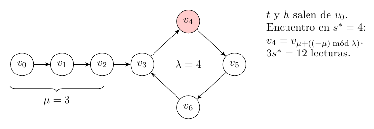

# Ejercicio 5: detección de ciclos de Floyd con dos punteros

## Enunciado

**Ejercicio 5 ($`\star\star`$; C3).** Detección de ciclos en una lista enlazada con dos punteros que avanzan a velocidades $`1`$ y $`2`$ (algoritmo de Floyd). Demuestra que se encuentran si y solo si hay un ciclo, con un invariante, y que termina, con un potencial. Da el costo.

## Respuesta corta

Sea $`\mu`$ el número de nodos antes del ciclo y $`\lambda`$ el largo del ciclo.

- **Invariante:** tras $`s`$ iteraciones, la tortuga $`t`$ está en el nodo de índice $`f(s)`$ y la liebre $`h`$ en el de índice $`f(2s)`$, donde $`f(s)`$ es el índice del nodo tras $`s`$ pasos desde la cabeza.

- **Si y solo si:** sin ciclo, $`h`$ va siempre por delante de $`t`$ (índice $`2s>s`$), así que nunca coinciden. Con ciclo, $`f(s)=f(2s)`$ con $`s\ge1`$ si y solo si $`s\ge\mu`$ y $`\lambda\mid s`$, y eso ocurre.

- **Terminación:** sin ciclo, $`n-1-\mathrm{pos}(h)`$ baja $`2`$ por iteración. Con ciclo, el par lexicográfico $`(\max(\mu-s,0),\,\text{pasos hasta el próximo múltiplo de }\lambda)`$ baja $`1`$ por iteración.

- **Costo exacto:** con ciclo, $`s^*=\lambda\lceil\mu/\lambda\rceil`$ pasos si $`\mu>0`$ y $`\lambda`$ si $`\mu=0`$ (siempre $`\le\mu+\lambda`$), con $`3s^*`$ lecturas de puntero. Sin ciclo, $`\lceil n/2\rceil`$ pasos. Memoria $`O(1)`$.

Modelo: word RAM, costo de lectura de un puntero $`=1`$; los nodos se comparan por identidad.

## Modelo, notación y definición de “se encuentran”

Una lista es una función sucesor sobre nodos. Los nodos alcanzables desde la cabeza son $`v_0,v_1,\dots`$.

- **Sin ciclo:** $`n\ge0`$ nodos $`v_0,\dots,v_{n-1}`$, y el sucesor de $`v_{n-1}`$ es `null`. Con $`n=0`$ la lista es vacía (la cabeza es `null`).

- **Con ciclo:** $`\mu\ge0`$ nodos antes del ciclo y $`\lambda\ge1`$ nodos en el ciclo. Hay $`\mu+\lambda`$ nodos distintos $`v_0,\dots,v_{\mu+\lambda-1}`$, y el sucesor de $`v_{\mu+\lambda-1}`$ es $`v_\mu`$.

Sea $`f(s)`$ el índice del nodo tras $`s`$ pasos desde la cabeza: $`f(s)=s`$ si $`s<\mu+\lambda`$ y $`f(s)=\mu+((s-\mu)\bmod\lambda)`$ si $`s\ge\mu`$ (las dos fórmulas coinciden en $`\mu\le s<\mu+\lambda`$). Sin ciclo, $`f(s)=s`$ para $`s<n`$ y vale `null` para $`s\ge n`$.

**“Se encuentran”** significa $`t=h`$ (el mismo nodo, por identidad) *después de un paso completo*. La coincidencia inicial $`t=h=`$ cabeza no cuenta. Casos límite que el algoritmo debe cubrir: lista vacía ($`n=0`$), un nodo sin ciclo ($`n=1`$) y un nodo con autolazo ($`\mu=0`$, $`\lambda=1`$).

## El algoritmo

``` python
def floyd(head):
    if head is None:
        return False
    t = h = head
    while True:
        t = t.next                 # lectura 1
        h = h.next                 # lectura 2
        if h is None: return False
        h = h.next                 # lectura 3
        if h is None: return False
        if t is h:    return True
```

Una *iteración* es una vuelta del `while`. Si no sale antes, hace exactamente tres lecturas de puntero. Cuando $`h`$ sigue sin ser `null`, $`t`$ no lo es tampoco, porque $`t`$ va por detrás: la lectura `t.next` es válida.

## El invariante

**Invariante $`I(s)`$:** tras $`s`$ iteraciones completas, sin haber retornado, $`t`$ es el nodo de índice $`f(s)`$ y $`h`$ el de índice $`f(2s)`$, y ninguno es `null`. Sin ciclo, esto dice $`\mathrm{pos}(h)=2\cdot\mathrm{pos}(t)`$.

*Inicialización* ($`s=0`$). $`t=h=v_0=v_{f(0)}=v_{f(2\cdot0)}`$, y la cabeza no es `null` (se retornó en la primera línea si lo era).

*Mantenimiento.* Supongamos $`I(s)`$ y que la iteración $`s+1`$ no retorna. $`t`$ avanza un nodo: pasa de $`v_{f(s)}`$ a $`v_{f(s+1)}`$, porque dar un paso desde el nodo de índice $`f(s)`$ lleva al de índice $`f(s+1)`$ (propiedad de $`f`$ como camino). $`h`$ avanza dos: de $`f(2s)`$ a $`f(2s+1)`$ y luego a $`f(2s+2)`$. Como no retornó, ninguno fue `null`. Entonces vale $`I(s+1)`$.

*Conclusión.* Si el algoritmo retorna `True` en la iteración $`s`$, entonces $`f(s)=f(2s)`$ con $`s\ge1`$. Si retorna `False`, algún $`h`$ intermedio fue `null`.

## Se encuentran si y solo si hay ciclo

**Lema 1**. *Con ciclo y $`s\ge1`$: $`f(s)=f(2s)\iff s\ge\mu\ \text{y}\ \lambda\mid s`$.*

*Demostración.* Si $`s<\mu`$: $`f(s)=s<\mu`$. Si $`2s<\mu+\lambda`$, $`f(2s)=2s\ne s`$ (pues $`s\ge1`$); si no, $`f(2s)\ge\mu>s`$. En ambos casos $`f(s)\ne f(2s)`$. Si $`s\ge\mu`$: los dos índices están en el ciclo y $`f(s)=\mu+((s-\mu)\bmod\lambda)`$, $`f(2s)=\mu+((2s-\mu)\bmod\lambda)`$. Son iguales si y solo si $`2s\equiv s\pmod\lambda`$, es decir, $`\lambda\mid s`$. ◻

**Teorema 1**. *`floyd(head)` retorna `True` si y solo si la lista tiene un ciclo.*

*Demostración.* ($`\Leftarrow`$, con ciclo retorna `True`.) Con ciclo nunca hay `null`, así que nunca retorna `False`. Por el lema 1 existe $`s\ge1`$ con $`f(s)=f(2s)`$ (por ejemplo, cualquier múltiplo de $`\lambda`$ que sea $`\ge\mu`$ y $`\ge1`$). Por $`I(s)`$, en la iteración $`s`$ se tiene $`t=h`$ y retorna `True`; el primer tal $`s`$ es $`s^*`$ (sección 6).

($`\Rightarrow`$, sin ciclo no retorna `True`.) Sin ciclo los nodos $`v_0,\dots,v_{n-1}`$ son distintos, y por $`I(s)`$ en cada iteración que llega al test, $`t=v_s`$ y $`h=v_{2s}`$ con $`s\ge1`$, luego $`2s>s`$ y $`t\ne h`$. El test $`t`$ is $`h`$ nunca es verdadero. Por la terminación (sección 5) el algoritmo retorna `False`. ◻

## Terminación: potenciales

**Sin ciclo.**

Al empezar la iteración $`s+1`$, $`h`$ está en el índice $`2s\le n-1`$. Sea $`\Phi=n-1-2s=n-1-\mathrm{pos}(h)\ge0`$. Cada iteración que no retorna baja $`\Phi`$ en exactamente $`2`$, y la iteración retorna cuando $`h`$ llega a `null`, esto es, cuando $`2(s+1)-1\ge n`$ o $`2(s+1)\ge n`$, o sea $`\Phi\le1`$. Un entero no negativo que baja de a $`2`$ no puede hacerlo para siempre.

**Con ciclo: dos fases, orden lexicográfico.**

Sea $`s`$ el número de iteraciones completas.

- **Fase 1** ($`s<\mu`$, $`t`$ en la cola): $`\Phi_1=\mu-\mathrm{pos}(t)=\mu-s`$. Baja exactamente $`1`$ por iteración.

- **Fase 2** ($`s\ge\mu`$, los dos en el ciclo): sea $`d(s)`$ la distancia de $`h`$ a $`t`$ medida hacia adelante por el ciclo. Como $`t`$ está en la posición $`(s-\mu)\bmod\lambda`$ del ciclo y $`h`$ en la $`(2s-\mu)\bmod\lambda`$, $`d(s)=(\mathrm{pos}(t)-\mathrm{pos}(h))\bmod\lambda=(-s)\bmod\lambda`$. En un paso, $`d(s+1)=(-s-1)\bmod\lambda=(d(s)-1)\bmod\lambda`$: $`d`$ baja exactamente $`1`$ mientras $`d>0`$, y $`d=0`$ significa $`t=h`$, es decir, el algoritmo retorna. Para tener un entero que siempre baja definimos $`\Phi_2(s)=\lambda\lceil(s+1)/\lambda\rceil-s\in\{1,\dots,\lambda\}`$, los pasos que faltan hasta el próximo múltiplo de $`\lambda`$. Coincide con $`d`$ salvo que vale $`\lambda`$ cuando $`d=0`$ (solo en $`s=0`$, con $`\mu=0`$, donde la coincidencia no cuenta), y baja exactamente $`1`$ por iteración.

El potencial es el par $`(\max(\Phi_1,0),\Phi_2)`$ con el orden lexicográfico: en la fase 1 baja la primera componente, y cuando llega a $`0`$ baja la segunda. Es un orden bien fundado sobre $`\mathbb N\times\mathbb N`$, y la segunda componente, que mide los pasos hasta el próximo múltiplo de $`\lambda`$, es la que anuncia el retorno. El invariante, la bajada exacta de $`1`$ por iteración y la igualdad con la fórmula $`s^*`$ están vigilados con `assert` en el programa (sección 10).

## Costo exacto

**Teorema 2**. *Con ciclo, `floyd` retorna `True` en la iteración $`s^*=\lambda\lceil\mu/\lambda\rceil`$ si $`\mu>0`$, y $`s^*=\lambda`$ si $`\mu=0`$. Siempre $`s^*\le\mu+\lambda`$, con igualdad si y solo si $`\mu=0`$. Hace $`3s^*`$ lecturas de puntero y se encuentra en el nodo $`v_{\mu+((-\mu)\bmod\lambda)}`$.*

*Demostración.* Por el lema 1, el primer encuentro es el menor $`s\ge\max(\mu,1)`$ con $`\lambda\mid s`$, que es $`\lambda\lceil\max(\mu,1)/\lambda\rceil`$ (igual a $`s^*`$ en los dos casos). Como $`s^*<\max(\mu,1)+\lambda`$, resulta $`s^*\le\mu+\lambda-1`$ si $`\mu\ge1`$ y $`s^*=\lambda=\mu+\lambda`$ si $`\mu=0`$. Cada iteración hace tres lecturas. El nodo es $`f(s^*)=\mu+((s^*-\mu)\bmod\lambda)=\mu+((-\mu)\bmod\lambda)`$, porque $`\lambda\mid s^*`$. ◻

**Sin ciclo.** Con $`n\ge1`$ nodos, `floyd` retorna `False` en la iteración $`\lceil n/2\rceil`$: si $`n=2s`$, $`h`$ llega a `null` en la segunda lectura de $`h`$ de la iteración $`s`$ (tres lecturas); si $`n=2s-1`$, en la primera lectura de $`h`$ (dos lecturas). Las lecturas son $`3n/2`$ si $`n`$ es par y $`(3n+1)/2`$ si $`n`$ es impar; con $`n=0`$ no hay iteraciones. **Memoria:** dos punteros, $`O(1)`$, en todos los casos.



La lista con $`\mu=3`$ y $`\lambda=4`$ (el nodo rojo es el encuentro). Traza, de la salida real:

| $`s`$ | $`t=v_{f(s)}`$ | $`h=v_{f(2s)}`$ | $`t=h`$             |
|:-----:|---------------:|----------------:|:--------------------|
|   0   |        $`v_0`$ |         $`v_0`$ | (inicio, no cuenta) |
|   1   |        $`v_1`$ |         $`v_2`$ | no                  |
|   2   |        $`v_2`$ |         $`v_4`$ | no                  |
|   3   |        $`v_3`$ |         $`v_6`$ | no                  |
|   4   |        $`v_4`$ |         $`v_4`$ | **sí**              |

## Más allá: encontrar el inicio $`\mu`$ y el largo $`\lambda`$ del ciclo

Tras el encuentro en el paso $`s^*=c\lambda`$, se pone un puntero $`p`$ en la cabeza y otro $`q`$ en el nodo del encuentro, y se avanzan *de a uno* hasta que coinciden.

**Teorema 3**. *$`p`$ y $`q`$ coinciden por primera vez tras exactamente $`\mu`$ pasos, en el nodo $`v_\mu`$.*

*Demostración.* $`q`$ está en $`v_{f(s^*)}`$, un nodo del ciclo. Tras $`j`$ pasos, $`q`$ está en el índice $`f(s^*+j)`$ y $`p`$ en $`f(j)`$. Para $`j<\mu`$, $`p`$ está en la cola y $`q`$ en el ciclo: son distintos. Para $`j=\mu`$: $`f(\mu)=\mu`$ y $`f(s^*+\mu)=\mu+((s^*+\mu-\mu)\bmod\lambda)=\mu+(s^*\bmod\lambda)=\mu`$, porque $`\lambda\mid s^*`$. Coinciden en $`v_\mu`$. ◻

Con $`\mu=0`$ la coincidencia es inmediata ($`j=0`$). Después, desde $`v_\mu`$ se avanza hasta volver a él: son $`\lambda`$ pasos. El costo total de este procedimiento es $`3s^*+2\mu+\lambda`$ lecturas (dos por paso de $`p,q`$). En la traza de arriba, $`p`$ y $`q`$ van $`(v_0,v_4),(v_1,v_5),(v_2,v_6),(v_3,v_3)`$: $`3=\mu`$ pasos, y el inicio del ciclo es $`v_3`$. El programa verifica la recuperación de $`(\mu,\lambda)`$ para las $`3600`$ listas con $`\mu\le60`$, $`\lambda\le60`$.

## Comparación con un conjunto de visitados

El algoritmo alternativo guarda cada nodo visto en una tabla y retorna `True` al ver uno repetido. Es correcto de forma evidente. Recorre $`\mu+\lambda`$ avances: guarda $`v_0,\dots,v_{\mu+\lambda-1}`$ y la lectura número $`\mu+\lambda`$ devuelve $`v_\mu`$, que ya está (son $`\mu+\lambda+1`$ visitas si se cuenta $`v_0`$ como una). Floyd hace $`s^*\le\mu+\lambda`$ iteraciones. La diferencia no es el tiempo ni el determinismo, porque un conjunto con una función hash fija también es determinista. Es de memoria y de la garantía:

- *Memoria:* el conjunto guarda $`\mu+\lambda`$ nodos, $`\Theta(\mu+\lambda)`$; Floyd guarda dos punteros, $`O(1)`$.

- *Cota de tiempo:* la del conjunto, $`O(\mu+\lambda)`$, es de tiempo *esperado* (o supone un hash universal); la de Floyd, $`3s^*\le3(\mu+\lambda)`$ lecturas, es de *peor caso* y no usa hash.

La ejecución (sección 6 de la salida) con $`\mu=\lambda=10^5`$ ($`2\cdot10^5`$ nodos) mide con `tracemalloc` un pico de $`72`$ bytes para Floyd y $`17\,616\,280`$ bytes para el conjunto ($`2\cdot10^5`$ nodos guardados). El valor absoluto depende de Python; la forma es la del análisis: constante contra lineal.

## Por qué velocidades $`1`$ y $`2`$: el caso $`(1,k)`$

Con velocidades $`1`$ y $`k`$ desde la misma cabeza, tras $`s`$ pasos $`t`$ está en $`f(s)`$ y $`h`$ en $`f(ks)`$. Con los dos en el ciclo, la distancia hacia adelante de $`h`$ a $`t`$ cambia en $`-(k-1)\pmod\lambda`$ en cada paso.

**Lema 2**. *Sea $`g=\gcd(k-1,\lambda)`$. Con los dos en el ciclo y distancia inicial $`d`$, se encuentran si y solo si $`g\mid d`$.*

*Demostración.* Tras $`j`$ pasos la distancia es $`(d-(k-1)j)\bmod\lambda`$, y vale $`0`$ si y solo si $`(k-1)j\equiv d\pmod\lambda`$. Esta congruencia tiene solución $`j`$ si y solo si $`g\mid d`$ (Bézout). Si $`g\mid d`$, las soluciones forman una clase módulo $`\lambda/g`$, así que hay soluciones $`j\ge1`$ (en particular la menor positiva) aunque $`j=0`$ sea una; el encuentro ocurre tras al menos un paso, que es lo que cuenta según la definición de “se encuentran”. ◻

**Con salida común ($`t=h`$ al inicio) siempre se encuentran, para todo $`k\ge2`$.** Al entrar $`t`$ al ciclo en el paso $`\mu`$, la distancia de $`h`$ a $`t`$ es $`d=(-(k-1)\mu)\bmod\lambda`$, que es un múltiplo de $`g`$ (pues $`g\mid k-1`$ y $`g\mid\lambda`$). Entonces $`g\mid d`$ y se encuentran. El primer encuentro es el menor $`s\ge\max(\mu,1)`$ con $`(k-1)s\equiv0\pmod\lambda`$, es decir, con $`(\lambda/g)\mid s`$: $`s_k=(\lambda/g)\lceil\max(\mu,1)/(\lambda/g)\rceil`$. Para $`k=2`$, $`g=\gcd(1,\lambda)=1`$ y $`s_2=s^*`$.

Esto *refuta* la intuición de que con $`k=3`$ “pueden saltarse” porque $`h`$ pasa por encima de $`t`$ en medio de una iteración: el test solo mira al final de cada iteración y, en ese momento, $`t=h`$ ocurre cuando las posiciones coinciden módulo $`\lambda`$, y eso siempre pasa. Lo que sí se rompe es la *salida común*.

**La variante que parece correcta.**

Una optimización plausible para evitar la comparación inicial es empezar la liebre $`\delta`$ nodos adelantada (con $`\delta=1`$: $`h=`$ `head.next`). Al entrar $`t`$ al ciclo, la distancia de $`h`$ a $`t`$ cumple $`d\equiv-\delta\pmod g`$ con $`g=\gcd(k-1,\lambda)`$, y el lema 2 da: **se encuentran si y solo si $`g\mid\delta`$.** Con $`k=2`$, $`g=1`$ y siempre; con $`k\ge3`$ depende de $`\delta`$ y de $`\lambda`$, no solo de la paridad. Ejemplos ejecutados (secciones 8 y 9 de la salida):

- $`k=3`$, $`\mu=0`$, $`\lambda=2`$, $`\delta=1`$ (**contraejemplo mínimo en nodos**: dos nodos que se apuntan entre sí): $`g=2\nmid1`$. Las posiciones $`(t,h)`$ son $`(0,1),(1,0),(0,1),\dots`$, la distancia vale siempre $`1`$ y nunca $`0`$: sin encuentro en $`3000`$ pasos. Con salida común se encuentran en $`1`$ paso.

- $`k=4`$, $`\mu=0`$, $`\lambda=3`$, $`\delta=2`$: $`g=3\nmid2`$ y no se encuentran, *aunque $`\delta`$ es par*. Con $`\delta=3`$ sí ($`g=3\mid3`$), en $`1`$ paso.

- $`k=5`$, $`\mu=0`$, $`\lambda=4`$, $`\delta=2`$: $`g=4\nmid2`$, no se encuentran.

La búsqueda sobre $`\mu,\lambda\le12`$ (sección 8) cuenta, de $`156`$ listas, las que no se encuentran: $`k=3`$: $`78`$ con $`\delta=1`$ y $`78`$ con $`\delta=3`$ (todas con $`\lambda`$ par), ninguna con $`\delta`$ par; $`k=4`$: $`52`$ con $`\delta=1,2,4`$ y ninguna con $`\delta=0,3`$ ($`3\mid\lambda`$ sin $`3\mid\delta`$); $`k=2`$: ninguna con ningún $`\delta`$. Las $`3\,120`$ pruebas concuerdan con “se encuentran $`\iff\gcd(k-1,\lambda)\mid\delta`$” (`assert`). Con $`\delta=1`$ ($`h=`$ `head.next`), la variante pasa las pruebas con $`\lambda`$ coprimo con $`k-1`$ y falla con $`\lambda`$ no coprimo (para otro $`\delta`$ el criterio es $`g\mid\delta`$, como arriba): justo la “variante que parece correcta” del tema 1, §3.

**Costo de usar otra velocidad.**

Cada iteración con velocidad $`k`$ hace $`k+1`$ lecturas, así que las lecturas hasta el encuentro son $`(k+1)s_k`$, con $`s_k\ge\max(\mu,1)`$ y $`s_k=(\lambda/g)\lceil\max(\mu,1)/(\lambda/g)\rceil`$. Resultados (sección 7 de la salida):

- **$`\mu=0`$:** $`s_k=\lambda/g`$ y las lecturas son $`(k+1)\lambda/g`$. Entre $`k=2`$ ($`3\lambda`$) y $`k=3`$ ($`4\lambda/g`$ con $`g=\gcd(2,\lambda)`$), $`k=3`$ gana si y solo si $`4/g<3`$, o sea $`g=2`$, o sea $`\lambda`$ par. Es lo que muestran las filas con $`\mu=0`$ ($`\lambda=12`$: $`24<36`$; $`\lambda=7`$: $`28>21`$), y con $`k=5`$ y $`\lambda=1000`$, $`g=4`$, baja a $`1500`$.

- **$`\mu`$ grande:** $`s_k\ge\mu`$, luego las lecturas de $`k\ge3`$ son al menos $`4\mu`$, mientras que las de $`k=2`$ son $`3s^*\le3(\mu+\lambda-1)`$. Si $`\mu\ge3\lambda-2`$, $`3(\mu+\lambda-1)<4\mu`$ y $`k=2`$ gana *estrictamente* a todo $`k\ge3`$ (comprobado con `assert` para $`630`$ pares con $`\mu,\lambda\le60`$). Es lo que pasa con $`\mu=100`$: con $`\lambda=30`$ (par), $`k=2`$ da $`s^*=120`$ y $`360`$ lecturas y $`k=3`$ da $`s_3=105`$ y $`420`$; con $`\lambda=31`$, $`372`$ contra $`496`$. Que $`\lambda`$ sea par no basta: el término $`\mu`$ domina.

| $`\mu`$ | $`\lambda`$ | $`k=2`$ | $`k=3`$ | $`k=4`$ | $`k=5`$ |
|--------:|------------:|--------:|--------:|--------:|--------:|
|       0 |          12 |      36 |      24 |      20 |      18 |
|       0 |           7 |      21 |      28 |      35 |      42 |
|       5 |          12 |      36 |      24 |      40 |      36 |
|     100 |          30 |     360 |     420 |     500 |     630 |
|     100 |          31 |     372 |     496 |     620 |     744 |
|       0 |        1000 |    3000 |    2000 |    5000 |    1500 |

Como $`\mu`$ y $`\lambda`$ no se conocen de antemano, ninguna $`k>2`$ gana siempre, y $`k=2`$ es la que no depende de nada: $`\gcd(1,\lambda)=1`$, así que funciona incluso con cualquier desfase inicial. Además su invariante es el más simple ($`\mathrm{pos}(h)=2\,\mathrm{pos}(t)`$). Sin ciclo, la velocidad $`k`$ termina en $`\lceil n/k\rceil`$ iteraciones, con $`\approx(k+1)n/k`$ lecturas: baja hacia $`n`$, pero con ciclo puede subir mucho.

## Comprobación experimental

Código: `ej05_floyd.py`. Cada lectura de `.next` se cuenta con una propiedad de la clase `Nodo`. Verifica con `assert` el invariante $`I(s)`$ (comparando los $`\texttt{id}`$ de $`t`$ y $`h`$ con $`f(s)`$ y $`f(2s)`$), la bajada exacta de $`1`$ de los dos potenciales, y compara los pasos, las lecturas y el nodo del encuentro contra las fórmulas para todo $`0\le\mu\le60`$, $`1\le\lambda\le60`$. Salida real:

<details>
<summary><code>ej05_salida.txt</code></summary>

```text
=== 1. Casos limite ===
  lista vacia:                 hay_ciclo=False, pasos=0
  un nodo sin ciclo (n=1):     hay_ciclo=False, pasos=1
  un nodo con autolazo (0,1):  hay_ciclo=True, pasos=1, lecturas=3
  mu=0, lam=2: hay_ciclo=True, pasos=2 (formula 2), encuentro en el nodo 0
  mu=1, lam=1: hay_ciclo=True, pasos=1 (formula 1), encuentro en el nodo 1
  mu=3, lam=4: hay_ciclo=True, pasos=4 (formula 4), encuentro en el nodo 4
  mu=5, lam=3: hay_ciclo=True, pasos=6 (formula 6), encuentro en el nodo 6

=== 2. Con ciclo: pasos exactos, lecturas y nodo de encuentro, mu en 0..60, lam en 1..60 ===
  3600 listas; casos donde falla alguna comprobacion: 0
  max(pasos - (mu+lam)) = 0  (cota pasos <= mu+lam; igualdad solo con mu=0)
  igualdad pasos = mu+lam solo cuando mu = 0: True  (60 casos)
  invariante t=f(s), h=f(2s) y potenciales (fase1, fase2) vigilados en 21582 pasos, mu,lam <= 30: sin fallos

=== 3. Sin ciclo: pasos y lecturas exactos para n = 0..300 ===
  n=0..300: fallos = 0  (pasos = ceil(n/2); lecturas = 3n/2 si n par, (3n+1)/2 si impar)
    n=  0: pasos=  0, lecturas=  0
    n=  1: pasos=  1, lecturas=  2
    n=  2: pasos=  1, lecturas=  3
    n=  3: pasos=  2, lecturas=  5
    n=  4: pasos=  2, lecturas=  6
    n=  5: pasos=  3, lecturas=  8
    n=100: pasos= 50, lecturas=150
    n=101: pasos= 51, lecturas=152

=== 4. Traza: mu=3, lam=4  (nodos v0 v1 v2 | v3 v4 v5 v6 -> v3) ===
  paso s   t=f(s)   h=f(2s)   t==h
       0   v0       v0        True
       1   v1       v2        False
       2   v2       v4        False
       3   v3       v6        False
       4   v4       v4        True
  Floyd: hay_ciclo=True, pasos=4, encuentro en v4
  fase 2: p desde la cabeza, q desde el encuentro, avanzan de a 1
     j   p    q
     0  v0  v4
     1  v1  v5
     2  v2  v6
     3  v3  v3
  se encuentran en v3 tras 3 pasos = mu; luego se recorre el ciclo desde v3

=== 5. Fase 2: mu y lam, mu en 0..60, lam en 1..60 ===
  3600 listas; fallos al recuperar (mu, lam): 0
  mu=1000, lam=70: lecturas totales = 5220 (= 3*1050 + 2*1000 + 70 = 5220)

=== 6. Memoria: Floyd (2 punteros) contra conjunto de visitados ===
  mu=100000, lam=100000 (200000 nodos): Floyd hay_ciclo=True en 100000 pasos, pico de memoria 72 bytes;
  visitados hay_ciclo=True, 200000 nodos guardados, pico de memoria 17616280 bytes (x244670)

=== 7. Velocidades (1, k): siempre se encuentran, con la misma salida de partida ===
  k=2: mu,lam <= 40 (1600 listas): se encuentran siempre y pasos = (lam/g)*ceil(max(mu,1)/(lam/g)), g=gcd(k-1,lam): fallos = 0
  k=3: mu,lam <= 40 (1600 listas): se encuentran siempre y pasos = (lam/g)*ceil(max(mu,1)/(lam/g)), g=gcd(k-1,lam): fallos = 0
  k=4: mu,lam <= 40 (1600 listas): se encuentran siempre y pasos = (lam/g)*ceil(max(mu,1)/(lam/g)), g=gcd(k-1,lam): fallos = 0
  k=5: mu,lam <= 40 (1600 listas): se encuentran siempre y pasos = (lam/g)*ceil(max(mu,1)/(lam/g)), g=gcd(k-1,lam): fallos = 0
  k=6: mu,lam <= 40 (1600 listas): se encuentran siempre y pasos = (lam/g)*ceil(max(mu,1)/(lam/g)), g=gcd(k-1,lam): fallos = 0
  k=7: mu,lam <= 40 (1600 listas): se encuentran siempre y pasos = (lam/g)*ceil(max(mu,1)/(lam/g)), g=gcd(k-1,lam): fallos = 0
  Lecturas de puntero hasta el encuentro, (k+1) * pasos:
    mu  lam |       k=2       k=3       k=4       k=5
     0   12 |        36        24        20        18
     0    7 |        21        28        35        42
     5   12 |        36        24        40        36
   100   30 |       360       420       500       630
   100   31 |       372       496       620       744
     0 1000 |      3000      2000      5000      1500
  1000 1000 |      3000      4000      5000      6000
  Quien gana en lecturas (assert en mu,lam <= 60):
    mu = 0: k=3 gana a k=2 si y solo si lam es par (4*lam/g < 3*lam  <=>  g = gcd(2,lam) = 2)
    mu >= 3*lam - 2: k=2 gana estrictamente a todo k=3..7 (630 pares): 3(mu+lam-1) < 4mu <= (k+1)*s_k
    mu=100, lam=30: k=2: s=120, lecturas 360;  k=3: g=2, s=105, lecturas 420  (mu >= 88)
    mu=100, lam=31: k=2: s=124, lecturas 372;  k=3: g=1, s=124, lecturas 496

=== 8. La variante que parece correcta: la liebre sale delta nodos adelantada ===
  (al entrar al ciclo, la distancia d de h a t cumple d = -delta (mod g), g = gcd(k-1, lam);
   se encuentran  sii  g divide a delta)
  k=2: listas (de 156) donde NO se encuentran:  delta=0: 0,  delta=1: 0,  delta=2: 0,  delta=3: 0,  delta=4: 0
  k=3: listas (de 156) donde NO se encuentran:  delta=0: 0,  delta=1: 78,  delta=2: 0,  delta=3: 78,  delta=4: 0
  k=4: listas (de 156) donde NO se encuentran:  delta=0: 0,  delta=1: 52,  delta=2: 52,  delta=3: 0,  delta=4: 52
  k=5: listas (de 156) donde NO se encuentran:  delta=0: 0,  delta=1: 78,  delta=2: 39,  delta=3: 78,  delta=4: 0
  (assert: en cada una de las 4*5*156 pruebas, se encuentran  <=>  gcd(k-1, lam) | delta)
  Ejemplos ejecutados:
    k=3, mu=0, lam=2, delta=1: gcd(k-1,lam)=2, encuentro=None (sin encuentro en 3000 pasos)
    k=4, mu=0, lam=3, delta=2: gcd(k-1,lam)=3, encuentro=None (sin encuentro en 3000 pasos)
    k=4, mu=0, lam=3, delta=3: gcd(k-1,lam)=3, encuentro=True en 1 pasos
    k=5, mu=0, lam=4, delta=2: gcd(k-1,lam)=4, encuentro=None (sin encuentro en 3000 pasos)

=== 9. Contraejemplo minimo real (ciclo de largo 2, k=3, liebre adelantada 1 nodo) ===
  la lista mas pequena (menos nodos) que rompe (1,3) con desfase 1: mu=0, lam=2 (2 nodos)
  posiciones (t, h) en el ciclo de 2 nodos, k=3: [(0, 1), (1, 0), (0, 1), (1, 0), (0, 1), (1, 0)]  -> la distancia h-t vale siempre 1 (impar), nunca 0
  con salida comun (desfase 0): encuentro en 1 paso;  (1,2) con desfase 1: (True, 1)
```

</details>

**Casos elegidos.**

*Límite:* lista vacía ($`0`$ pasos), un nodo sin ciclo ($`1`$ paso, $`2`$ lecturas), un nodo con autolazo ($`\mu=0`$, $`\lambda=1`$: $`1`$ paso, $`3`$ lecturas). *Típicos:* todas las listas con $`\mu\le60`$, $`\lambda\le60`$ (3600) y $`n\le300`$ sin ciclo. *Adversariales para la demostración:* $`\mu=0`$ (única con $`s^*=\mu+\lambda`$, el peor caso de la cota), $`\lambda\mid\mu`$ (sin pasos de sobra) y $`\lambda=1`$; y, para el caso $`(1,k)`$, el desfase $`1`$ con $`\lambda`$ par.

## Por qué este enfoque

**Una analogía.**

Dos corredores salen del mismo punto de una pista con una rampa de entrada que desemboca en una pista circular. Uno corre al doble de velocidad. Mientras estén en la rampa, el rápido va delante y no pueden cruzarse. Cuando los dos están en la pista circular, el rápido *le saca una vuelta* al lento y lo alcanza: la ventaja crece de a una posición por paso, y como la pista tiene $`\lambda`$ posiciones, tarda a lo sumo $`\lambda`$ pasos en alcanzarlo. Sin pista circular (sin ciclo), el rápido simplemente se cae por el borde de la lista. Con velocidad $`k`$ la ventaja crece de a $`k-1`$ posiciones por paso. Desde la salida común la ventaja es siempre múltiplo de $`\gcd(k-1,\lambda)`$ y llega a $`0`$ módulo $`\lambda`$. Pero si el rápido sale con $`\delta`$ posiciones de ventaja y $`\gcd(k-1,\lambda)`$ no divide a $`\delta`$, la ventaja salta de casillero en casillero sin caer nunca en el cero: lo “salta” siempre.

**Otra visión.**

Es la búsqueda de una colisión $`f(s)=f(2s)`$ en la secuencia de nodos, que es el método $`\rho`$ de Pollard. La condición $`\lambda\mid s`$ dice que el encuentro ocurre en el primer *múltiplo del período* que ya está dentro del ciclo.

**Por qué estos invariantes y potenciales.**

El invariante $`t=f(s)`$, $`h=f(2s)`$ separa las dos direcciones: sin ciclo da una desigualdad de índices (imposibilidad de encuentro); con ciclo da una congruencia ($`\lambda\mid s`$). El potencial lexicográfico existe porque hay dos regímenes (cola y ciclo) y en cada uno baja una cantidad distinta, y es lo que da el costo exacto.

## Conclusión

- **Correctitud:** invariante $`t=v_{f(s)}`$, $`h=v_{f(2s)}`$; con ciclo hay encuentro si y solo si $`s\ge\mu`$ y $`\lambda\mid s`$; sin ciclo $`h`$ siempre va delante y nunca coinciden.

- **Terminación:** sin ciclo $`n-1-\mathrm{pos}(h)`$ baja $`2`$; con ciclo el par lexicográfico baja $`1`$.

- **Costo exacto:** con ciclo, $`s^*=\lambda\lceil\mu/\lambda\rceil`$ ($`\lambda`$ si $`\mu=0`$) $`\le\mu+\lambda`$ pasos y $`3s^*`$ lecturas; sin ciclo, $`\lceil n/2\rceil`$ pasos; memoria $`O(1)`$.

- **Extras:** el inicio $`\mu`$ y el largo $`\lambda`$ en $`3s^*+2\mu+\lambda`$ lecturas; contra el conjunto de visitados, $`O(1)`$ contra $`\Theta(\mu+\lambda)`$ de memoria; con velocidades $`(1,k)`$, se encuentran siempre desde la salida común, y con la liebre adelantada $`\delta`$ nodos se encuentran si y solo si $`\gcd(k-1,\lambda)\mid\delta`$.

Modelo: word RAM, identidad de nodos comparable en $`O(1)`$, lectura de puntero de costo $`1`$.
