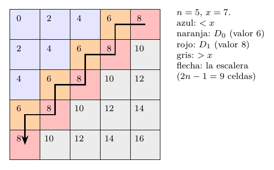

# Ejercicio 6: búsqueda en una matriz con filas y columnas ordenadas

## Enunciado

**Ejercicio 6 ($`\star\star`$; C3, C5).** Una matriz $`n\times n`$ tiene filas y columnas ordenadas de forma creciente. Diseña un algoritmo que decida si contiene un valor $`x`$ en $`O(n)`$ comparaciones, demuestra su correctitud con un invariante, y demuestra con un adversario que no se puede en $`o(n)`$.

## Respuesta corta

- **Algoritmo (escalera).** Empezar en la esquina superior derecha $`(0,n-1)`$: si $`x<A[i][j]`$ se descarta la columna $`j`$, y si $`x>A[i][j]`$ se descarta la fila $`i`$. Invariante: si $`x`$ está, está en $`A[i..n-1][0..j]`$. Potencial $`(n-i)+(j+1)`$, que baja $`1`$ por comparación: a lo sumo $`\mathbf{2n-1}`$ comparaciones, y esa cifra se alcanza.

- **Cota mínima.** Con la matriz $`N[i][j]=2(i+j)`$ y $`x=2n-3`$, las $`2n-1`$ celdas de las diagonales $`i+j=n-1`$ y $`i+j=n-2`$ pueden alojar a $`x`$ una por una. Un adversario que contesta según $`N`$ obliga a consultarlas todas: **todo algoritmo necesita $`2n-1`$ comparaciones.** Es una cota exacta, no solo $`\Omega(n)`$.

- **Información.** $`\log_2(n^2+1)\approx2\log_2n`$ no dice casi nada: la salida es una sola respuesta, pero justificarla exige certificar toda una frontera, y hay $`\binom{2n}{n}`$ fronteras posibles ($`\log_2\binom{2n}{n}\approx2n`$).

- **Extra.** Para $`m\times n`$ con $`m\le n`$ basta $`O(m\log(1+n/m))`$ (galopar por filas), y hacen falta $`m\lceil\log_2(\lfloor n/m\rfloor+1)\rceil`$.

Modelo: la única operación es comparar $`x`$ con una entrada $`A[i][j]`$ (tres resultados); se cuentan las comparaciones.

## Modelo y convenciones

**Entrada:** una matriz $`A[0..n-1][0..n-1]`$ y un valor $`x`$. **Orden:** las filas y las columnas son *no decrecientes*: $`A[i][j]\le A[i][j+1]`$ y $`A[i][j]\le A[i+1][j]`$ (se admiten duplicados). Para la cota inferior se usan matrices *estrictamente* crecientes por filas y columnas ($`A[i][j]<A[i][j+1]`$ y $`A[i][j]<A[i+1][j]`$); aun así puede haber entradas repetidas en celdas no alineadas, por ejemplo $`A[0][2]=A[1][1]=A[2][0]`$ en $`A[i][j]=i+j`$. **Salida:** sí/no, según $`x`$ aparezca en $`A`$.

**Operación y costo.** Una *consulta* compara $`x`$ con $`A[i][j]`$ y devuelve $`<`$, $`=`$ o $`>`$; el costo es el número de consultas. *No* se permite comparar dos entradas de la matriz entre sí. Las cotas de este ejercicio valen en ese modelo; con comparaciones entre entradas, el adversario de la sección 3 tendría que contestarlas también, y no afirmo nada sobre ese modelo.

**Relación entre las clases.** Un algoritmo correcto para matrices no decrecientes lo es para las estrictas (son un caso particular). Una cota inferior probada con matrices estrictas vale también para las no decrecientes. El algoritmo vale para las dos y la cota se prueba con las estrictas: la cota exacta $`2n-1`$ vale en ambas clases.

## El algoritmo: la escalera

``` python
def escalera(A, x):
    n = len(A)
    i, j = 0, n - 1                 # esquina superior derecha
    while i < n and j >= 0:
        if x == A[i][j]:  return True
        if x <  A[i][j]:  j -= 1    # A[i'][j] >= A[i][j] > x para i' >= i
        else:             i += 1    # A[i][j'] <= A[i][j] < x para j' <= j
    return False
```

**Por qué esa esquina.**

$`A[0][n-1]`$ es el *mayor de su fila* y el *menor de su columna*. Por eso cada resultado de la comparación descarta una fila entera o una columna entera: si $`x<A[0][n-1]`$, nada de la columna $`n-1`$ puede ser $`x`$ (todos son $`\ge A[0][n-1]`$); si $`x>A[0][n-1]`$, nada de la fila $`0`$ (todos son $`\le`$). La esquina inferior izquierda $`(n-1,0)`$ es igual por simetría. En $`(0,0)`$ la entrada es la menor de su fila *y* de su columna: si $`x>A[0][0]`$ solo se sabe que esa celda no es $`x`$ (quedan $`n^2-1`$ candidatos) y si $`x<A[0][0]`$ se termina. La comparación no descarta ninguna línea, así que el potencial de arriba no baja y no hay un invariante que se achique de a una línea por consulta. Una escalera que empezara allí no funcionaría; para avanzar habría que saltar a otra esquina. El programa ilustra la falta de regla de descarte con el recorrido por filas ($`n^2`$ consultas). Lo mismo vale para $`(n-1,n-1)`$, que es el mayor de su fila y de su columna.

**Invariante $`I`$.**

Sea $`S(i,j)`$ la submatriz de las filas $`i,\dots,n-1`$ y las columnas $`0,\dots,j`$. **$`I`$:** $`0\le i\le n`$, $`-1\le j\le n-1`$ y *si $`x`$ aparece en $`A`$, aparece en $`S(i,j)`$.*

*Inicialización.* Con $`i=0`$, $`j=n-1`$, $`S(0,n-1)=A`$.

*Mantenimiento.* Supongamos $`I`$ y que se entra al cuerpo ($`i<n`$, $`j\ge0`$). Si $`x=A[i][j]`$ se retorna. Si $`x<A[i][j]`$: toda entrada de la columna $`j`$ en las filas $`\ge i`$ es $`\ge A[i][j]>x`$, así que $`x`$ no está en esa parte de $`S(i,j)`$. Por $`I`$, si $`x`$ está en $`A`$, está en $`S(i,j-1)`$. Si $`x>A[i][j]`$: toda entrada de la fila $`i`$ en las columnas $`\le j`$ es $`\le A[i][j]<x`$, luego si $`x`$ está, está en $`S(i+1,j)`$. En los dos casos $`I`$ vale con los nuevos $`i,j`$.

*Conclusión.* Si se retorna dentro del ciclo, $`x=A[i][j]`$ y la respuesta es correcta. Si el ciclo termina, $`i=n`$ o $`j=-1`$, es decir $`S(i,j)=\varnothing`$, y por $`I`$, $`x`$ no está en $`A`$.

**Terminación y costo: el potencial.**

Sea $`\Phi=(n-i)+(j+1)`$, la suma de las filas y las columnas que quedan. Empieza en $`2n`$. Cada vuelta que no retorna hace una comparación y baja $`\Phi`$ en exactamente $`1`$. El ciclo corre mientras $`n-i\ge1`$ y $`j+1\ge1`$, es decir $`\Phi\ge2`$: la comparación número $`k`$ ocurre con $`\Phi=2n-k+1\ge2`$, luego $`k\le2n-1`$.
``` math
\text{comparaciones}\ \le\ 2n-1 .
```
**Esta cota se alcanza.** Con $`A[i][j]=2(i+j)`$ y $`x=2n-3`$ (impar, ausente): en $`(i,n-1-i)`$ el valor es $`2n-2>x`$, así que baja $`j`$; en $`(i,n-2-i)`$ el valor es $`2n-4<x`$, así que sube $`i`$. El recorrido zigzaguea sobre las dos diagonales hasta la celda $`(n-1,0)`$ y consulta exactamente $`2n-1`$ celdas. Para $`n=5`$ el programa da el orden $`(0,4),(0,3),(1,3),(1,2),(2,2),(2,1),(3,1),(3,0),(4,0)`$.

**Costo.**

$`O(n)`$ comparaciones, $`O(1)`$ de memoria, y $`O(n)`$ de tiempo en el word RAM (cada vuelta hace $`O(1)`$ operaciones).

## Cota mínima por adversario: $`2n-1`$

Sea $`x=2n-3`$ y $`N[i][j]=2(i+j)`$. $`N`$ tiene filas y columnas estrictamente crecientes, y $`x\notin N`$ (es impar). Sean
``` math
\begin{aligned}
  D_1&=\{(i,j):i+j=n-1\}\quad(n\text{ celdas}),\\
  D_0&=\{(i,j):i+j=n-2\}\quad(n-1\text{ celdas}),\qquad P=D_0\cup D_1,\quad |P|=2n-1 .
\end{aligned}
```
En $`N`$, las celdas de $`D_0`$ valen $`2n-4<x`$ y las de $`D_1`$ valen $`2n-2>x`$; las celdas con $`i+j\le n-3`$ valen menos que $`x`$ y las con $`i+j\ge n`$ valen más que $`x`$.



**Familia de matrices.**

Para cada $`p\in P`$ sea $`N_p`$ la matriz $`N`$ con la celda $`p`$ cambiada a $`x`$.

**Lema 1**. *Cada $`N_p`$ tiene filas y columnas estrictamente crecientes y contiene a $`x`$.*

*Demostración.* Contiene a $`x`$ por construcción. Solo cambia la celda $`p`$, así que basta mirar a sus vecinos. Si $`p\in D_1`$, su valor pasa de $`2n-2`$ a $`2n-3`$; sus vecinos izquierdo y superior están en $`D_0`$ y valen $`2n-4<x`$, y sus vecinos derecho e inferior están en $`i+j=n`$ y valen $`2n>x`$. Si $`p\in D_0`$, su valor pasa de $`2n-4`$ a $`2n-3`$; sus vecinos izquierdo y superior valen $`2n-6<x`$ y sus vecinos derecho e inferior están en $`D_1`$ y valen $`2n-2>x`$. En ambos casos $`x`$ queda estrictamente entre los vecinos que lo anteceden y los que lo suceden, y las demás comparaciones entre celdas no cambian. (Los vecinos que faltan en los bordes no imponen nada.) ◻

**El adversario.**

Contesta cada consulta a $`x`$ contra $`(i,j)`$ según $`N`$: $`x>A[i][j]`$ si $`i+j\le n-2`$ y $`x<A[i][j]`$ si $`i+j\ge n-1`$. Es consistente: $`N`$ da todas las respuestas.

**Teorema 1**. *Todo algoritmo correcto en el modelo de comparaciones de $`x`$ con entradas hace al menos $`2n-1`$ consultas en el peor caso, incluso restringido a matrices estrictamente crecientes.*

*Demostración.* Contra el adversario, sea $`T`$ el conjunto de celdas que el algoritmo consulta antes de responder. Supongamos que existe $`p\in P\setminus T`$. La matriz $`N`$ y la matriz $`N_p`$ dan las mismas respuestas a todas las consultas de $`T`$ (difieren solo en la celda $`p`$, que no se consultó). El algoritmo es determinista, así que con ambas matrices recorre el mismo camino y da la misma respuesta. Pero $`x\notin N`$ y $`x\in N_p`$ (lema 1). Se equivoca en una de las dos, contradicción. Entonces $`P\subseteq T`$ y $`|T|\ge|P|=2n-1`$. ◻

**Cuál de las cotas se demuestra.**

Se demuestra $`2n-1`$, que con el algoritmo de la sección anterior da la cota *exacta*: el peor caso de la escalera es $`2n-1`$ y ningún algoritmo lo mejora. En particular “no se puede en $`o(n)`$” sale como corolario (más fuerte: ni siquiera $`2n-2`$). Una versión más modesta, que da solo $`\ge n`$, usa el mismo $`x`$ y solo las matrices $`N_p`$ con $`p\in D_1`$; pero el programa muestra que el algoritmo natural “mirar solo la antidiagonal” ($`n`$ consultas) es *incorrecto*: la celda $`p\in D_0`$ lo engaña. La diagonal vecina $`D_0`$ es la que aporta los $`n-1`$ restantes.

## La información no alcanza (C5 §4)

El argumento de información cuenta salidas. Aquí hay $`n^2+1`$ salidas si pedimos la posición (o $`2`$ si solo se pide sí/no), y un árbol de decisión da $`\log_2(n^2+1)\approx2\log_2n`$ comparaciones: $`13{,}3`$ para $`n=100`$, contra $`199`$ exactas (salida 4 del programa). Es el caso de C5 §4, *cuando la salida es pequeña pero el trabajo para justificarla es grande*: como en el máximo ($`n-1`$ contra $`\log_2n`$) o el segundo mayor. El árbol cuenta respuestas, no el trabajo de descartar a los demás candidatos.

**Qué se está certificando.** La clave es que “$`x`$ no está” obliga a probar algo sobre $`n^2`$ celdas. El conjunto $`\{(i,j):A[i][j]<x\}`$ es cerrado hacia arriba y hacia la izquierda: es una región escalonada, y su frontera es un camino monótono de la esquina inferior izquierda a la superior derecha. Hay $`\binom{2n}{n}`$ fronteras posibles (caminos monótonos en la rejilla), con $`\log_2\binom{2n}{n}=2n-\tfrac12\log_2(\pi n)+o(1)`$ (cifras: $`17{,}5`$ para $`n=10`$ y $`1994{,}2`$ para $`n=1000`$, contra $`19`$ y $`1999`$). Si en lugar de contar la salida contamos las fronteras que un algoritmo tiene que *distinguir* para estar seguro, la información queda a una distancia $`O(\log n)`$ de $`2n-1`$. No lo uso como demostración (el problema de decisión no pide la frontera) pero explica el resultado: la escalera recorre la frontera, y el adversario fuerza a recorrerla entera.

## Comprobación experimental

Código: `ej06_matriz.py`. Las consultas pasan por un objeto `Oraculo` que cuenta y registra cada una. Salida real:

<details>
<summary><code>ej06_salida.txt</code></summary>

```text
=== 1. Escalera contra fuerza bruta en matrices aleatorias con duplicados ===
  58473 pares (matriz, x), n = 1..30: la escalera coincide con la fuerza bruta y usa <= 2n-1 comparaciones
  maximo observado por n (aleatorias): {1: 1, 2: 3, 3: 5, 5: 9, 10: 19, 20: 39, 30: 55}

=== 2. Peor caso exacto: A[i][j] = 2(i+j), x = 2n-3 ===
  n = 1..100: comparaciones == 2n-1 en todos salvo 0
  n=5: celdas consultadas en orden: [(0, 4), (0, 3), (1, 3), (1, 2), (2, 2), (2, 1), (3, 1), (3, 0), (4, 0)]
  Exhaustivo para n = 2 (entradas 0..4) y n = 3 (entradas 0..3): maximo de comparaciones sobre toda matriz ordenada y todo x
    n=2: 105 matrices ordenadas, maximo = 3 (2n-1 = 3)
    n=3: 980 matrices ordenadas, maximo = 5 (2n-1 = 5)

=== 3. El adversario como programa: x = 2n-3, responde segun N[i][j] = 2(i+j) ===
  escalera:
    n= 3:   5 comparaciones; celdas de las 2n-1 sin consultar: 0; correcto (consulto las 2n-1 celdas)
    n= 6:  11 comparaciones; celdas de las 2n-1 sin consultar: 0; correcto (consulto las 2n-1 celdas)
    n=12:  23 comparaciones; celdas de las 2n-1 sin consultar: 0; correcto (consulto las 2n-1 celdas)
  omite (n-1,0):
    n= 3:   4 comparaciones; celdas de las 2n-1 sin consultar: 1; ERROR en N_p con p=(2, 0)
    n= 6:  10 comparaciones; celdas de las 2n-1 sin consultar: 1; ERROR en N_p con p=(5, 0)
    n=12:  22 comparaciones; celdas de las 2n-1 sin consultar: 1; ERROR en N_p con p=(11, 0)
  solo antidiagonal:
    n= 3:   3 comparaciones; celdas de las 2n-1 sin consultar: 2; ERROR en N_p con p=(0, 1)
    n= 6:   6 comparaciones; celdas de las 2n-1 sin consultar: 5; ERROR en N_p con p=(0, 4)
    n=12:  12 comparaciones; celdas de las 2n-1 sin consultar: 11; ERROR en N_p con p=(0, 10)
  esquina (0,0), n^2:
    n= 3:   9 comparaciones; celdas de las 2n-1 sin consultar: 0; correcto (consulto las 2n-1 celdas)
    n= 6:  36 comparaciones; celdas de las 2n-1 sin consultar: 0; correcto (consulto las 2n-1 celdas)
    n=12: 144 comparaciones; celdas de las 2n-1 sin consultar: 0; correcto (consulto las 2n-1 celdas)
  Matriz del adversario para 'solo antidiagonal', n=3 (x = 3, celda p = (0, 1) puesta a x):
     [0, 3, 4]
     [2, 4, 6]
     [4, 6, 8]

=== 4. Informacion contra el adversario (n x n) ===
      n  log2(n^2+1)  log2 C(2n,n)  2n-1 (exacto)
      1          1.0           1.0              1
      2          2.3           2.6              3
      5          4.7           8.0              9
     10          6.7          17.5             19
     50         11.3          96.3             99
    100         13.3         195.9            199
   1000         19.9        1994.2           1999
  C(2n,n) = numero de fronteras monotonas posibles {A < x}; cada comparacion da 2 respuestas utiles

=== 5. Matriz m x n con m <= n: escalera contra galopar por filas ===
  m= 4, n=   4: escalera peor=   7 (m+n-1=   7);  galope peor medido=   9; cota 2m(log2(1+n/m)+2)+m =    28.0;  cota inferior m*ceil(log2(n/m+1)) = 4
  m= 4, n=  64: escalera peor=  67 (m+n-1=  67);  galope peor medido=  31; cota 2m(log2(1+n/m)+2)+m =    52.7;  cota inferior m*ceil(log2(n/m+1)) = 20
  m= 8, n= 512: escalera peor= 519 (m+n-1= 519);  galope peor medido=  68; cota 2m(log2(1+n/m)+2)+m =   136.4;  cota inferior m*ceil(log2(n/m+1)) = 56
  m=16, n=4096: escalera peor=4111 (m+n-1=4111);  galope peor medido= 155; cota 2m(log2(1+n/m)+2)+m =   336.2;  cota inferior m*ceil(log2(n/m+1)) = 144
  m=64, n=  64: escalera peor= 127 (m+n-1= 127);  galope peor medido= 143; cota 2m(log2(1+n/m)+2)+m =   448.0;  cota inferior m*ceil(log2(n/m+1)) = 64

=== 6. Familia de bloques (cota inferior m x n): cada fila tiene su bloque, bloques disjuntos ===
  familia valida (filas y columnas estrictamente crecientes, x=0 ausente) en 600 matrices aleatorias: True
  m= 8, n= 512, s=64: el galope hace hasta 105 comparaciones; cota inferior m*ceil(log2(s+1)) = 56
  m=16, n=4096, s=256: el galope hace hasta 273 comparaciones; cota inferior m*ceil(log2(s+1)) = 144
```

</details>

**Casos elegidos.**

*Típicos:* $`58\,473`$ pares (matriz, $`x`$) con $`n\le30`$ y matrices con duplicados (incrementos $`0..k`$ con $`k\in\{0,1,2,5\}`$, incluida la matriz constante). *Bordes:* $`n=1`$ ($`1`$ comparación) y $`n=2,3`$, donde se enumeran *todas* las matrices ordenadas con entradas pequeñas ($`105`$ y $`980`$) y todo $`x`$ (también semienteros): el máximo es exactamente $`2n-1`$. *Adversarial:* $`A=2(i+j)`$, $`x=2n-3`$, que da $`2n-1`$ para $`n=1..100`$. *El adversario ejecutable* (sección 3 de la salida): corre cualquier algoritmo contra $`N`$; si el algoritmo termina sin consultar alguna celda de $`P`$, construye $`N_p`$, verifica que sea estrictamente creciente y que contenga $`x`$, vuelve a correr el algoritmo y comprueba que la transcripción y la respuesta sean idénticas, o sea que se equivoca en $`N_p`$. La escalera consulta las $`2n-1`$ celdas de $`P`$ y pasa; el algoritmo que omite la celda $`(n-1,0)`$ y el que mira solo la antidiagonal ($`n`$ consultas, $`2n-1-n=n-1`$ celdas sin consultar) fallan, con $`N_p`$ explícita (para $`n=3`$ y $`p=(0,1)`$: la matriz $`[[0,3,4],[2,4,6],[4,6,8]]`$, que contiene $`x=3`$ y que ese algoritmo declara sin $`x`$).

## Algo más fino: la matriz $`m\times n`$ con $`m\ll n`$

Con $`m\le n`$ filas la escalera hace hasta $`m+n-1`$ comparaciones, y eso es mucho cuando $`n\gg m`$. Se puede *galopar*: en la fila $`i`$, desde la columna $`j`$ de la derecha, se compara $`A[i][j]`$; si $`x<A[i][j]`$ se prueban las columnas $`j-1,\,j-3,\,j-7,\dots`$ (distancias $`2^k-1`$) hasta encontrar un valor $`<x`$ (o llegar a la columna $`0`$ y parar con “no”), y se busca por bisección entre las dos últimas sondas. Se descartan todas las columnas a la derecha del hallazgo para esta fila y las siguientes. Con $`d_i`$ las columnas descartadas en la fila $`i`$, la fila cuesta $`O(1+\log(d_i+1))`$ comparaciones, y como $`\sum d_i\le n`$ y el logaritmo es cóncavo, el total es
``` math
O\!\left(m\log\!\left(1+\tfrac nm\right)\right).
```
Con $`m=n`$ da $`O(n)`$ (la constante es peor que la de la escalera: el programa mide $`143>127`$ para $`m=n=64`$); con $`m\ll n`$ es mucho mejor que $`m+n-1`$: para $`m=16`$, $`n=4096`$ el programa mide $`155`$ comparaciones contra $`4111`$ de la escalera. (La salida 5 verifica con `assert` que se cumple $`\le2m(\log_2(1+n/m)+2)+m`$.)

**Cota inferior.**

Se necesitan $`m\lceil\log_2(\lfloor n/m\rfloor+1)\rceil`$ comparaciones. Sea $`s=\lfloor n/m\rfloor`$. La fila $`i`$ tiene un *bloque* de $`s`$ columnas, $`[(m-1-i)s,\,(m-i)s-1]`$, y los bloques son disjuntos. A la izquierda del bloque los valores son muy negativos y a la derecha muy positivos, de modo que cada columna tiene, de arriba abajo, valores negativos, a lo sumo una celda de bloque y valores positivos: la matriz es estrictamente creciente (el programa lo verifica en $`600`$ matrices). Dentro de cada bloque hay $`s`$ valores crecientes alrededor de $`x=0`$, con $`x`$ en un hueco arbitrario, y cualquiera de los dos vecinos del hueco puede cambiarse a $`x`$. Las consultas fuera de los bloques tienen respuesta fija, y cada bloque es una búsqueda en un arreglo ordenado de $`s`$ elementos distintos, independiente de los demás: por el lema 2 del ejercicio 2 (C5 §3), decidir si $`x`$ está en el bloque requiere $`\lceil\log_2(s+1)\rceil`$ consultas *dentro de ese bloque*. (El lema 2 del ejercicio 2 está enunciado con el arreglo fijo y $`x`$ variando entre los huecos; aquí $`x=0`$ es fijo y el contenido del bloque varía, pero es lo mismo: un algoritmo de comparaciones solo ve el orden relativo entre $`x`$ y las entradas, y lo único que cuenta es en qué hueco del bloque queda $`x`$.) Si en un bloque se hacen menos, el adversario del ejercicio 2 deja dos contenidos del bloque consistentes con las respuestas, uno con $`x`$ y otro sin $`x`$; combinados con el contenido fijo de los demás bloques dan dos matrices de la familia con las mismas respuestas y distinta salida. Total: $`m\lceil\log_2(s+1)\rceil`$. Para $`m=n`$ ($`s=1`$) da $`n`$, menos que los $`2n-1`$ de la sección 3: las dos construcciones se complementan. No afirmo que $`m\log(n/m)`$ sea exacto en las constantes (la salida 6 muestra, para $`m=16`$, $`n=4096`$, que el galope hace $`273`$ consultas en el peor de las familias medidas, contra $`144`$ de cota inferior).

## Por qué este enfoque

**Una analogía.**

Imagina un mapa de alturas donde cada fila sube hacia el este y cada columna sube hacia el sur, y buscas la curva de nivel $`x`$. Las celdas por debajo de $`x`$ forman una región escalonada, y buscar $`x`$ es recorrer *su frontera*, un camino de $`2n-1`$ pasos. Las celdas dentro de la región o fuera de ella no hacen falta: solo cuenta la frontera. La escalera la sigue a pie, un paso por consulta. El adversario es un cartógrafo tramposo que dibuja una frontera pegada a las dos diagonales y deja un metro sin medir: allí puede esconder la curva.

**Otra visión.**

La matriz es un orden parcial (el orden producto de $`[n]\times[n]`$), y las celdas de una antidiagonal son incomparables: su valor no está acotado por el de ninguna otra de la antidiagonal. Buscar en un orden parcial de anchura $`w`$ obliga a mirar al menos $`w`$ celdas porque $`x`$ puede esconderse en cualquiera de ellas. Aquí la anchura es $`n`$, y el argumento de $`D_0\cup D_1`$ añade las $`n-1`$ celdas de la diagonal vecina, que se pueden activar una por una, para llegar a $`2n-1`$.

**Por qué el invariante.**

“Si $`x`$ está, está en la submatriz” es la forma más simple de que cada comparación descarte una línea entera. Es una implicación y no una igualdad porque la submatriz puede contener o no a $`x`$; solo se exige que las celdas descartadas no lo tengan.

## Conclusión

- **Algoritmo:** escalera desde $`(0,n-1)`$; invariante “si $`x`$ está, está en $`A[i..n-1][0..j]`$”; potencial $`(n-i)+(j+1)`$ baja $`1`$ por comparación; a lo sumo $`2n-1`$ comparaciones, alcanzadas con $`A=2(i+j)`$, $`x=2n-3`$.

- **Cota mínima:** $`2n-1`$ por adversario, con las diagonales $`D_0\cup D_1`$ y la familia $`N_p`$ (matrices estrictamente crecientes). La cota es exacta. Vale en el modelo de comparaciones de $`x`$ con entradas, con matrices estrictas y no decrecientes.

- **Información:** $`\log_2(n^2+1)`$ es muy débil; contar fronteras da $`\log_2\binom{2n}{n}\approx2n`$.

- **Matriz $`m\times n`$:** $`O(m\log(1+n/m))`$ por galope y $`\Omega(m\log(n/m))`$ por bloques.
