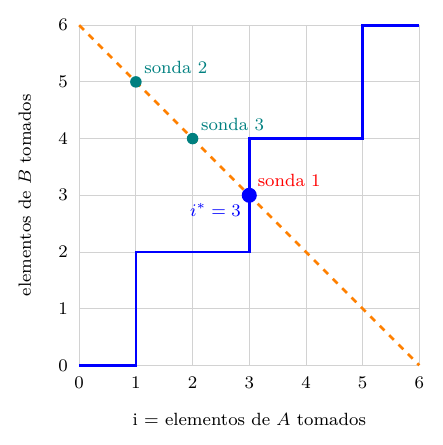

# Ejercicio 7: la mediana de dos arreglos ordenados

## Enunciado

**Ejercicio 7 ($`\star\star\star`$; C2, C3, C5).** Mediana de dos arreglos ordenados de largo $`n`$: el $`n`$-ésimo menor de los $`2n`$ elementos. Diseña un algoritmo $`O(\log n)`$, demuestra su correctitud y da la cota de información.

## Respuesta corta

- **Algoritmo:** buscar la *partición* que toma $`i`$ elementos de $`A`$ y $`n-i`$ de $`B`$ con todo lo de la izquierda $`\le`$ todo lo de la derecha. Se busca por bisección el menor $`i\in[0,n]`$ con $`P(i)\equiv A[i]\ge B[n-i-1]`$ (con $`A[n]=+\infty`$), y la respuesta es $`\max(A[i-1],B[n-i-1])`$ con centinelas $`-\infty`$.

- **Correctitud:** $`P`$ es monótona, el menor $`i`$ con $`P`$ es una partición correcta, y el invariante “ese $`i`$ está en $`[lo,hi]`$” con el potencial $`hi-lo`$ da $`\lceil\log_2(n+1)\rceil`$ iteraciones, una comparación cada una.

- **Costo exacto:** $`\lceil\log_2(n+1)\rceil+1`$ comparaciones en el peor caso para $`n\ge2`$ ($`1`$ si $`n=1`$).

- **Cota de información:** la respuesta puede estar en $`2n`$ posiciones distintas, así que hacen falta $`\lceil\log_2(2n)\rceil=\lceil\log_2n\rceil+1`$ comparaciones. El algoritmo la alcanza (es óptimo) cuando $`n`$ *no* es potencia de $`2`$. Cuando lo es ($`n\ge2`$), **el algoritmo es el que está flojo**: una búsqueda minimax exhaustiva muestra que para $`n=1,\dots,10`$ existe un árbol con exactamente $`\lceil\log_2 2n\rceil`$ comparaciones, y el algoritmo de la partición gasta una más en $`n=2,4,8`$. No sé si el óptimo exacto es $`\lceil\log_2 2n\rceil`$ para todo $`n`$; queda abierto aquí.

Modelo: comparaciones entre elementos de $`A\cup B`$, acceso $`O(1)`$ a $`A[i]`$ y $`B[j]`$.

## Problema exacto y modelo

**Entrada:** $`A[0..n-1]`$ y $`B[0..n-1]`$ ordenados de forma no decreciente, $`n\ge1`$. **Salida:** el $`n`$-ésimo menor del *multiconjunto* $`A\uplus B`$, es decir $`M[n-1]`$ donde $`M`$ es la lista ordenada de los $`2n`$ valores. Con duplicados el *valor* está bien definido aunque haya empates: es el único $`v`$ con $`\#\{x<v\}\le n-1`$ y $`\#\{x\le v\}\ge n`$.

**Modelo:** comparaciones entre dos elementos, con acceso $`O(1)`$ a cualquier $`A[i]`$ o $`B[j]`$. El algoritmo devuelve una de las entradas (no puede crear valores). Para la cota inferior los elementos serán distintos; esa clase es un caso de la general, así que la cota vale también para ella.

## El algoritmo, y por qué este enfoque

Una *partición* es un $`i\in\{0,\dots,n\}`$: la izquierda $`L_i`$ toma $`A[0..i-1]`$ y $`B[0..n-i-1]`$ ($`n`$ elementos en total), la derecha $`R_i`$ el resto. Con centinelas $`A[-1]=B[-1]=-\infty`$ y $`A[n]=B[n]=+\infty`$, la partición $`i`$ es *correcta* si $`\max L_i\le\min R_i`$, o sea
``` math
A[i-1]\le B[n-i]\quad\text{y}\quad B[n-i-1]\le A[i]
```
(las otras dos desigualdades, $`A[i-1]\le A[i]`$ y $`B[n-i-1]\le B[n-i]`$, son la hipótesis de orden).

``` python
def mediana(A, B):                       # n-esimo menor de A u B, n = len(A) = len(B) >= 1
    n = len(A)
    lo, hi = 0, n                        # i* esta en [lo, hi]; P(i) := A[i] >= B[n-i-1], P(n) = verdadero
    while lo < hi:
        mid = (lo + hi) // 2             # 0 <= mid <= n-1: A[mid] y B[n-mid-1] existen
        if A[mid] >= B[n - mid - 1]:     # P(mid)
            hi = mid
        else:
            lo = mid + 1
    i = lo
    a = A[i - 1] if i > 0 else -inf      # centinelas explicitos
    b = B[n - i - 1] if n - i > 0 else -inf
    return max(a, b)
```

**Por qué la partición y no descartar mitades.**

La alternativa de C2 (“dividir y descartar”) compara $`A[k/2-1]`$ con $`B[k/2-1]`$ y tira el prefijo del menor, bajando $`k`$. Funciona y cuesta igual en el caso $`n\times n`$, pero lo que se mantiene cambia en cada paso ($`k`$ y los dos arreglos) y hay que reabrir casos (arreglo agotado, $`k=1`$, $`k/2`$ impar). La búsqueda sobre la partición mantiene una sola cosa, un *predicado monótono* sobre $`n+1`$ candidatos y un intervalo $`[lo,hi]`$, así que el invariante, el potencial y el costo son los de la búsqueda binaria del ejercicio 2. El ciclo de C2 se cumple limpio: el problema (la partición), el algoritmo (bisección), la correctitud (el invariante), el costo (la mitad en cada vuelta) y la cota (la información).

## Correctitud

**Lema 1** (la partición da la respuesta). *Si la partición $`i`$ es correcta, el $`n`$-ésimo menor de $`A\uplus B`$ es $`\max L_i=\max(A[i-1],B[n-i-1])`$.*

*Demostración.* Sea $`\ell=\max L_i`$. Todo elemento de $`L_i`$ es $`\le\ell`$, así que $`\#\{x\le\ell\}\ge|L_i|=n`$. Todo elemento de $`R_i`$ es $`\ge\ell`$ (porque $`\max L_i\le\min R_i`$), luego los únicos elementos $`<\ell`$ están en $`L_i`$, y como $`\ell\in L_i`$ no es $`<\ell`$, $`\#\{x<\ell\}\le n-1`$. Son las dos condiciones que caracterizan al $`n`$-ésimo menor, también con duplicados. El máximo de $`L_i`$ es $`\max(A[i-1],B[n-i-1])`$, porque cada arreglo está ordenado y los centinelas $`-\infty`$ cubren $`i=0`$ y $`i=n`$. ◻

**Lema 2** (existencia y monotonía). *Sea $`P(i)\equiv A[i]\ge B[n-i-1]`$ para $`0\le i\le n-1`$, y $`P(n)`$ verdadero (porque $`A[n]=+\infty`$). Entonces:*

1.  *$`P`$ es monótona: si $`P(i)`$ y $`i<j`$ entonces $`P(j)`$.*

2.  *$`i^*=\min\{i\in[0,n]:P(i)\}`$ existe, y la partición $`i^*`$ es correcta.*

*Demostración.* (1) Con $`i<j\le n-1`$: $`A[j]\ge A[i]\ge B[n-i-1]\ge B[n-j-1]`$, la primera y la última porque los arreglos son ordenados ($`j>i`$ y $`n-j-1<n-i-1`$). Si $`j=n`$ es verdadero por el centinela. (2) $`P(n)`$ es verdadero, así que el conjunto no es vacío. $`P(i^*)`$ da $`B[n-i^*-1]\le A[i^*]`$. Si $`i^*=0`$, $`A[-1]=-\infty\le B[n]`$. Si $`i^*>0`$, $`P(i^*-1)`$ es falso: $`A[i^*-1]<B[n-(i^*-1)-1]=B[n-i^*]`$. Las dos desigualdades de partición correcta valen. ◻

El bit que se evalúa es una sola comparación, $`A[mid]\ge B[n-mid-1]`$, y el ciclo nunca necesita centinelas: $`mid\le hi-1\le n-1`$ y $`n-mid-1\in[0,n-1]`$. Los centinelas solo se usan al final.

**Invariante (tres pasos).**

$`I`$: $`lo\le i^*\le hi`$.

- *Inicialización:* $`lo=0`$, $`hi=n`$, y $`i^*\in[0,n]`$ por el lema 2.

- *Mantenimiento:* con $`lo\le mid<hi`$. Si $`P(mid)`$, entonces $`i^*\le mid`$ (es el mínimo) y $`i^*\in[lo,mid]`$: se asigna $`hi=mid`$. Si no $`P(mid)`$, por monotonía $`P(i)`$ es falso para todo $`i\le mid`$, luego $`i^*>mid`$ y $`i^*\in[mid+1,hi]`$: $`lo=mid+1`$.

- *Conclusión:* al terminar $`lo=hi`$, así que $`lo=i^*`$. Por el lema 2, la partición $`i=lo`$ es correcta, y por el lema 1 la respuesta es $`\max(A[i-1],B[n-i-1])`$.

**Potencial.**

$`\Phi=hi-lo\in\mathbb N`$, con $`\Phi_0=n`$. Con $`s=hi-lo\ge1`$ y $`mid=lo+\lfloor s/2\rfloor`$: la rama $`hi=mid`$ da $`\Phi'=\lfloor s/2\rfloor`$, y la rama $`lo=mid+1`$ da $`\Phi'=s-\lfloor s/2\rfloor-1=\lceil s/2\rceil-1\le\lfloor s/2\rfloor`$. En los dos casos $`\Phi'\le\lfloor\Phi/2\rfloor<\Phi`$. Hay $`n+1`$ candidatos ($`i=0,\dots,n`$), pero el ciclo corre mientras $`\Phi\ge1`$, y $`\Phi_0=n`$: por el mismo argumento que la búsqueda binaria (ejercicio 2) hay a lo sumo $`\lfloor\log_2n\rfloor+1=\lceil\log_2(n+1)\rceil`$ iteraciones.

**Bordes ($`i^*=0`$ y $`i^*=n`$).**

Si $`i^*=0`$, toda la izquierda sale de $`B`$: $`B[n-1]`$ es la respuesta si $`B[n-1]\le A[0]`$ (es decir, $`B`$ está entera por debajo de $`A`$); el código usa $`A[-1]=-\infty`$ explícito, no el índice $`-1`$ de Python (que sería $`A[n-1]`$). Si $`i^*=n`$, toda la izquierda sale de $`A`$ y $`B[-1]=-\infty`$. Son los dos casos donde se rompen las versiones con un error de una unidad (sección 7). Con duplicados la demostración no cambia: todas las desigualdades son $`\le`$ o $`\ge`$, y el lema 1 usa los conteos $`\#\{x<\ell\}`$ y $`\#\{x\le\ell\}`$.

## Costo exacto en comparaciones

Cada iteración hace una comparación. Al final hace falta una más para el máximo $`\max(A[i-1],B[n-i-1])`$ *solo si* $`0<i<n`$ (si $`i\in\{0,n\}`$, un solo término). Entonces
``` math
\text{comparaciones}\ \le\ \lceil\log_2(n+1)\rceil+1 .
```

**Teorema 1**. *El peor caso es exactamente $`\lceil\log_2(n+1)\rceil+1`$ para $`n\ge2`$, y $`1`$ para $`n=1`$.*

*Demostración.* La cota superior ya está. *Se alcanza* para $`n\ge2`$. El ciclo es una búsqueda binaria sobre el árbol de intervalos $`[lo,hi]`$: la raíz es $`[0,n]`$ y un nodo interno $`[lo,hi]`$ con $`lo<hi`$ tiene los hijos $`[lo,mid]`$ y $`[mid+1,hi]`$, ambos *no vacíos* (porque $`lo\le mid<hi`$). Las hojas son los intervalos con $`lo=hi`$, uno por candidato $`i^*\in[0,n]`$: el árbol binario tiene $`n+1`$ hojas, así que su profundidad es al menos $`\lceil\log_2(n+1)\rceil`$ (un árbol binario de profundidad $`h`$ tiene a lo sumo $`2^h`$ hojas). Junto con la cota superior que da el potencial, la profundidad máxima es exactamente $`\lceil\log_2(n+1)\rceil`$ iteraciones. Ahora, las hojas más profundas vienen en *parejas de hermanas*: la hermana de una hoja de profundidad máxima no puede ser un nodo interno (tendría hojas aún más profundas), así que es una hoja, y los dos hijos de un mismo $`[lo,hi]`$ que son hojas cumplen $`lo=mid`$ y $`mid+1=hi`$: son candidatos consecutivos $`(j,j+1)`$ a profundidad máxima. Como $`n\ge2`$, al menos uno está en $`[1,n-1]`$ (si $`j=0`$, $`j+1=1\le n-1`$; si $`j+1=n`$, $`j=n-1\ge1`$). Para una entrada con ese $`i^*`$ interior el costo es $`\lceil\log_2(n+1)\rceil+1`$. Para $`n=1`$: $`i^*\in\{0,1\}`$, una iteración y ninguna comparación final. ◻

El costo solo depende de $`i^*`$, porque $`P(mid)\iff mid\ge i^*`$. La salida 2 lo cuenta: para $`n\le10`$ sobre *todas* las $`\binom{2n}{n}`$ entradas, y hasta $`n=4096`$ sobre todos los $`i^*=0,\dots,n`$ (confirmado con entradas reales). El peor caso coincide con la fórmula en todos los casos (para $`n=1000`$, $`11`$; para $`n=1024`$, $`12`$).

## Cota de información

**Teorema 2**. *Todo algoritmo de comparaciones que halle el $`n`$-ésimo menor de dos arreglos ordenados de largo $`n`$ con elementos distintos hace al menos $`\lceil\log_2(2n)\rceil=\lceil\log_2n\rceil+1`$ comparaciones en el peor caso.*

*Demostración.* *La respuesta puede estar en $`2n`$ posiciones.* Para cada $`i\in[0,n-1]`$ hay una entrada con elementos distintos donde $`A[i]`$ es el $`n`$-ésimo menor: se asignan los rangos $`1,\dots,n-1`$ a $`A[0..i-1]`$ y a $`B[0..n-2-i]`$ (son $`i+(n-1-i)=n-1`$ elementos, y $`n-1-i\ge0`$), el rango $`n`$ a $`A[i]`$ y los rangos $`n+1,\dots,2n`$ al resto, respetando el orden en cada arreglo. Igual para $`B[j]`$. Son $`2n`$ posiciones distintas.

*Hojas distintas.* Un algoritmo de comparaciones no crea valores: cada hoja de su árbol de decisión devuelve una posición fija, $`A[i]`$ o $`B[j]`$. Si dos entradas con respuestas en posiciones distintas llegaran a la misma hoja, la hoja devolvería la misma posición en las dos, pero en una de ellas la respuesta correcta es otra (con elementos distintos, valores distintos). Entonces el árbol tiene al menos $`2n`$ hojas. Como los elementos son distintos, cada comparación tiene dos resultados (no hay empates), el árbol es binario y su altura es al menos $`\lceil\log_2(2n)\rceil`$. ◻

La salida 3 comprueba, para $`n\le7`$, que sobre todas las entradas hay exactamente $`2n`$ posiciones posibles para la respuesta, y que el algoritmo tiene al menos $`2n`$ hojas distintas.

**Cuánto coincide con el algoritmo, y cuál de los dos está flojo.**

Cota inferior $`\lceil\log_2n\rceil+1`$; algoritmo $`\lceil\log_2(n+1)\rceil+1`$ (para $`n\ge2`$). Cuando $`n`$ *no* es potencia de $`2`$, $`\lceil\log_2(n+1)\rceil=\lceil\log_2n\rceil`$ y las dos son iguales: el algoritmo es óptimo, y esto está demostrado. Cuando $`n=2^k`$ ($`k\ge1`$) difieren en una comparación, y la pregunta es cuál de los dos está flojo: la cota o el algoritmo. La respuesta, comprobada: **el algoritmo**. Para $`n=2`$ hay un algoritmo con $`2`$ comparaciones: se compara $`A[0]`$ con $`B[0]`$; si $`A[0]<B[0]`$ la respuesta es $`\min(B[0],A[1])`$, y si no, $`\min(A[0],B[1])`$. La cota $`\lceil\log_2 4\rceil=2`$ se alcanza, y el algoritmo de la partición, con $`3`$, no es óptimo.

**Búsqueda minimax del árbol óptimo (salida 6).**

Para no quedarse en el ejemplo de $`n=2`$, el programa calcula el árbol de decisión *óptimo*. Las entradas son los intercalados posibles de $`2n`$ valores distintos (los $`\binom{2n}{n}`$ subconjuntos de rangos que ocupa $`A`$); un estado es el conjunto de intercalados consistentes con las respuestas dadas; una consulta es $`A[i]<B[j]`$?; un estado es hoja cuando todos sus intercalados tienen la misma posición de respuesta. Se busca por profundización iterativa la menor profundidad $`d`$ tal que el estado inicial se resuelve en $`d`$ consultas, podando con la cota de información (un estado con $`c`$ posiciones de respuesta posibles necesita $`c\le2^d`$). El árbol que sale se *verifica* luego, independientemente, ejecutándolo sobre las $`\binom{2n}{n}`$ entradas. Resultado:

| $`n`$ | entradas | cota $`\lceil\log_2 2n\rceil`$ | óptimo (minimax) | algoritmo de la partición | 1a consulta óptima |
|---:|---:|---:|---:|---:|:---|
| 1 | 2 | 1 | 1 | 1 | $`A[0]<B[0]`$ |
| 2 | 6 | 2 | 2 | **3** | $`A[0]<B[0]`$ |
| 3 | 20 | 3 | 3 | 3 | $`A[0]<B[0]`$ |
| 4 | 70 | 3 | 3 | **4** | $`A[1]<B[1]`$ |
| 5 | 252 | 4 | 4 | 4 | $`A[0]<B[0]`$ |
| 6 | 924 | 4 | 4 | 4 | $`A[1]<B[1]`$ |
| 7 | 3432 | 4 | 4 | 4 | $`A[2]<B[2]`$ |
| 8 | 12870 | 4 | 4 | **5** | $`A[3]<B[3]`$ |
| 9 | 48620 | 5 | 5 | 5 | $`A[0]<B[0]`$ |
| 10 | 184756 | 5 | 5 | 5 | $`A[1]<B[1]`$ |

Conclusiones, solo sobre lo comprobado: (i) **la cota de información es exacta para todo $`n\le10`$**: el óptimo es $`\lceil\log_2 2n\rceil`$. (ii) El algoritmo de la partición pierde una comparación exactamente en $`n=2,4,8`$, las potencias de $`2`$ del rango. (iii) Los árboles óptimos de la salida (para $`n=2`$ y $`n=4`$) empiezan con $`A[n/2-1]<B[n/2-1]`$?, una consulta *fuera de la diagonal* $`i+j=n-1`$ de la partición.

**De dónde sale el desperdicio (el ejemplo $`n=2`$).**

El algoritmo de la partición busca $`i^*`$ entre $`n+1`$ candidatos con sondas $`A[mid]`$ contra $`B[n-mid-1]`$ (la diagonal $`i+j=n-1`$) y después gasta una comparación más en el máximo. Para $`n=2`$: la primera sonda ($`mid=1`$) separa las $`2n=4`$ posiciones de la respuesta en $`3`$ y $`1`$, y las profundidades de sus hojas son $`1,2,3,3`$ (suma de Kraft $`\tfrac12+\tfrac14+\tfrac18+\tfrac18=1`$: el árbol es completo pero desbalanceado), mientras que el árbol óptimo las deja en $`2,2,2,2`$. En general, la sonda $`mid`$ separa las $`2n`$ posiciones en $`2\,mid+1`$ y $`2n-2\,mid-1`$, *dos números impares*, y con $`n`$ par nunca son $`n`$ y $`n`$ (la salida 6 lo imprime: $`n=2`$: $`3`$ y $`1`$; $`n=4`$: $`5`$ y $`3`$; $`n=8`$: $`9`$ y $`7`$; $`n=1024`$: $`1025`$ y $`1023`$). Con $`n=2^k`$ hay $`2^{k+1}`$ posiciones y cabrían exactamente $`k+1`$ comparaciones si cada una repartiera por igual; la sonda de la diagonal manda $`n+1>2^k`$ posiciones a un lado, que necesitan $`k+1`$ comparaciones más: $`k+2`$ en total, que es $`\lceil\log_2(n+1)\rceil+1`$. Las hojas se desperdician porque localizar $`i^*`$ entre $`n+1`$ candidatos (más una comparación para el máximo) no reparte las posiciones de la respuesta, que es lo que cuenta la cota.

**Lo que no está resuelto aquí.**

No encontré un algoritmo general con $`\lceil\log_2 2n\rceil`$ comparaciones para todo $`n`$, por ejemplo uno que busque directamente entre las $`2n`$ posiciones de la respuesta. Lo que está demostrado es: cota inferior $`\lceil\log_2n\rceil+1`$ para todo $`n`$; algoritmo con $`\lceil\log_2(n+1)\rceil+1`$, óptimo si $`n`$ no es potencia de $`2`$; y, por búsqueda exhaustiva, óptimo $`=\lceil\log_2 2n\rceil`$ para $`n\le10`$. Para $`n=2^k\ge16`$ no sé si el óptimo es $`k+1`$ o $`k+2`$: el espacio de entradas ($`\binom{32}{16}`$ ya es más de $`6\cdot10^8`$) no se puede enumerar con este método. Dejo la pregunta abierta y no afirmo nada más sobre el óptimo exacto en general.

## Comprobación experimental

Código: `ej07_mediana.py`. Cuenta las comparaciones de elementos, vigila el invariante $`lo\le i^*\le hi`$ (con $`i^*`$ calculado por fuerza bruta) y el potencial con `assert`, y comprueba que $`\max L\le\min R`$ al terminar. Además calcula el árbol de decisión óptimo por búsqueda minimax y lo verifica sobre todas las entradas. Salida real:

<details>
<summary><code>ej07_salida.txt</code></summary>

```text
=== 1. Correctitud contra sorted(A+B)[n-1] ===
  n=1: todos los pares ordenados con valores en 0..5 (con duplicados): 36 entradas, correcto, invariante y potencial vigilados
  n=2: todos los pares ordenados con valores en 0..4 (con duplicados): 225 entradas, correcto, invariante y potencial vigilados
  n=3: todos los pares ordenados con valores en 0..3 (con duplicados): 400 entradas, correcto, invariante y potencial vigilados
  n=4: todos los pares ordenados con valores en 0..3 (con duplicados): 1225 entradas, correcto, invariante y potencial vigilados
  n=5: todos los pares ordenados con valores en 0..2 (con duplicados): 441 entradas, correcto, invariante y potencial vigilados
  n = 1..9: todas las particiones de 0..2n-1 en dos arreglos (distintos): correcto y vigilado
  aleatorios distintos                249 entradas (n = 1..79, 200, 1000, 4096, 5000): correcto
  aleatorios con muchos duplicados    249 entradas (n = 1..79, 200, 1000, 4096, 5000): correcto
  A toda menor que B                   83 entradas (n = 1..79, 200, 1000, 4096, 5000): correcto
  B toda menor que A                   83 entradas (n = 1..79, 200, 1000, 4096, 5000): correcto
  intercalados a1<b1<a2<...            83 entradas (n = 1..79, 200, 1000, 4096, 5000): correcto
  intercalados b1<a1<b2<...            83 entradas (n = 1..79, 200, 1000, 4096, 5000): correcto
  todos iguales                        83 entradas (n = 1..79, 200, 1000, 4096, 5000): correcto
  108523 entradas en total hasta aqui (exhaustivas + aleatorias): sin fallos

=== 2. Costo: comparaciones del peor caso, contadas ===
       n  peor medido  ceil(log2(n+1))+1  cota inf: ceil(log2 2n)  iteraciones max
       1            1                  2                        1                1
       2            3                  3                        2                2
       3            3                  3                        3                2
       4            4                  4                        3                3
       5            4                  4                        4                3
       6            4                  4                        4                3
       7            4                  4                        4                3
       8            5                  5                        4                4
       9            5                  5                        5                4
      10            5                  5                        5                4
      15            5                  5                        5                4
      16            6                  6                        5                5
      17            6                  6                        6                5
      31            6                  6                        6                5
      32            7                  7                        6                6
      63            7                  7                        7                6
      64            8                  8                        7                7
     100            8                  8                        8                7
     127            8                  8                        8                7
     128            9                  9                        8                8
    1000           11                 11                       11               10
    1023           11                 11                       11               10
    1024           12                 12                       11               11
    4096           14                 14                       13               13
  (el costo solo depende de i*, la particion correcta: n <= 10, todas las C(2n,n) entradas; n mayor, simulacion sobre todo i* = 0..n y ~44 entradas reales por n que la confirman)

=== 3. Cota inferior: 2n posiciones distintas para la respuesta, y hojas distintas ===
  n=1: posiciones distintas de la respuesta = 2 (= 2n = 2); hojas distintas del algoritmo = 2 (>= 2n); cota ceil(log2 2n) = 1; profundidad del algoritmo = 1
  n=2: posiciones distintas de la respuesta = 4 (= 2n = 4); hojas distintas del algoritmo = 4 (>= 2n); cota ceil(log2 2n) = 2; profundidad del algoritmo = 3
  n=3: posiciones distintas de la respuesta = 6 (= 2n = 6); hojas distintas del algoritmo = 6 (>= 2n); cota ceil(log2 2n) = 3; profundidad del algoritmo = 3
  n=4: posiciones distintas de la respuesta = 8 (= 2n = 8); hojas distintas del algoritmo = 8 (>= 2n); cota ceil(log2 2n) = 3; profundidad del algoritmo = 4
  n=5: posiciones distintas de la respuesta = 10 (= 2n = 10); hojas distintas del algoritmo = 10 (>= 2n); cota ceil(log2 2n) = 4; profundidad del algoritmo = 4
  n=6: posiciones distintas de la respuesta = 12 (= 2n = 12); hojas distintas del algoritmo = 12 (>= 2n); cota ceil(log2 2n) = 4; profundidad del algoritmo = 4
  n=7: posiciones distintas de la respuesta = 14 (= 2n = 14); hojas distintas del algoritmo = 14 (>= 2n); cota ceil(log2 2n) = 4; profundidad del algoritmo = 4

=== 4. Versiones equivocadas (errores de una unidad) y quien las atrapa ===
  defecto                         aleatorios distint  aleatorios con muc  A toda menor que B  B toda menor que A  intercalados a1<b1  intercalados b1<a1
  hi=n-1                                          1%                  3%                100%                  0%                  3%                  0%
  lo=1                                            2%                  1%                  0%                100%                  0%                  3%
  A[i-1] sin centinela                            2%                  3%                  0%                100%                  0%                  3%
  indice de B corrido en el max final                100%                 58%                100%                100%                100%                100%
  entrada mas chica que rompe 'hi=n-1': A=[0], B=[1], correcto 0
      devuelve 1
  entrada mas chica que rompe 'lo=1': A=[1], B=[0], correcto 0
      devuelve 1
  entrada mas chica que rompe 'A[i-1] sin centinela': A=[1], B=[0], correcto 0
      devuelve 1
  entrada mas chica que rompe 'indice de B corrido en el max final': A=[0], B=[0], correcto 0
      devuelve -inf

=== 5. k-esimo menor con largos distintos m y n: O(log min(m,n)) ===
  75691 casos exhaustivos pequenos (m 1..4, n 1..5, valores con duplicados, todo k): errores = 0
      m       n       k  comp. particion (peor)  ceil(log2(min+1))+1  comp. descarte (peor)
      8       8  varios                       4                    5                      5
      8    1000  varios                       4                    5                     11
     64   20000  varios                       7                    8                     16
   1000    1000  varios                      11                   11                     12
      3   50000  varios                       3                    3                     17
  posiciones que pueden ser la respuesta (cota de informacion) con m=3, n=6, todos los k:
    k=1: 2 posiciones posibles -> al menos ceil(log2 2) = 1 comparaciones
    k=2: 4 posiciones posibles -> al menos ceil(log2 4) = 2 comparaciones
    k=3: 6 posiciones posibles -> al menos ceil(log2 6) = 3 comparaciones
    k=4: 7 posiciones posibles -> al menos ceil(log2 7) = 3 comparaciones
    k=5: 7 posiciones posibles -> al menos ceil(log2 7) = 3 comparaciones
    k=6: 7 posiciones posibles -> al menos ceil(log2 7) = 3 comparaciones
    k=7: 6 posiciones posibles -> al menos ceil(log2 6) = 3 comparaciones
    k=8: 4 posiciones posibles -> al menos ceil(log2 4) = 2 comparaciones
    k=9: 2 posiciones posibles -> al menos ceil(log2 2) = 1 comparaciones

=== 6. Busqueda minimax: el arbol de decision OPTIMO, n = 1..10 ===
  Estados = conjuntos de intercalados consistentes; consultas = A[i] < B[j]?; hoja cuando todos dan la misma posicion de respuesta.
    n  entradas  cota ceil(log2 2n)  optimo (minimax)  algoritmo de la particion  arbol verificado en todas  1a consulta del arbol
    1         2                   1                 1                          1         si (profundidad 1)            A[0] < B[0]
    2         6                   2                 2                          3         si (profundidad 2)            A[0] < B[0]
    3        20                   3                 3                          3         si (profundidad 3)            A[0] < B[0]
    4        70                   3                 3                          4         si (profundidad 3)            A[1] < B[1]
    5       252                   4                 4                          4         si (profundidad 4)            A[0] < B[0]
    6       924                   4                 4                          4         si (profundidad 4)            A[1] < B[1]
    7      3432                   4                 4                          4         si (profundidad 4)            A[2] < B[2]
    8     12870                   4                 4                          5         si (profundidad 4)            A[3] < B[3]
    9     48620                   5                 5                          5         si (profundidad 5)            A[0] < B[0]
   10    184756                   5                 5                          5         si (profundidad 5)            A[1] < B[1]
  El optimo coincide con la cota de informacion ceil(log2 2n) en todos los n calculados; el algoritmo de la particion pierde una
  comparacion exactamente cuando n es potencia de 2 (n = 2, 4, 8).

  Arbol optimo para n = 2 (2 comparaciones):
    A[0] < B[0]?  si:
        A[1] < B[0]?  si:
            -> la respuesta es A[1]
                         no:
            -> la respuesta es B[0]
                     no:
        A[0] < B[1]?  si:
            -> la respuesta es A[0]
                         no:
            -> la respuesta es B[1]

  Arbol optimo para n = 4 (3 comparaciones):
    A[1] < B[1]?  si:
        A[2] < B[0]?  si:
            A[3] < B[0]?  si:
                -> la respuesta es A[3]
                             no:
                -> la respuesta es B[0]
                         no:
            A[2] < B[1]?  si:
                -> la respuesta es A[2]
                             no:
                -> la respuesta es B[1]
                     no:
        A[0] < B[2]?  si:
            A[1] < B[2]?  si:
                -> la respuesta es A[1]
                             no:
                -> la respuesta es B[2]
                         no:
            A[0] < B[3]?  si:
                -> la respuesta es A[0]
                             no:
                -> la respuesta es B[3]

  Reparto de las 2n posiciones de la respuesta que hace la primera consulta del algoritmo de la particion, A[mid] vs B[n-mid-1]:
    n=   2: mid=1: se parten en 3 y 1 (dos numeros IMPARES: nunca 2 y 2)
    n=   4: mid=2: se parten en 5 y 3 (dos numeros IMPARES: nunca 4 y 4)
    n=   8: mid=4: se parten en 9 y 7 (dos numeros IMPARES: nunca 8 y 8)
    n=  16: mid=8: se parten en 17 y 15 (dos numeros IMPARES: nunca 16 y 16)
    n=1024: mid=512: se parten en 1025 y 1023 (dos numeros IMPARES: nunca 1024 y 1024)

=== 7. La figura: A=[1, 4, 5, 8, 9, 12], B=[2, 3, 6, 7, 10, 11]: la mezcla pasa por la antidiagonal en i*=3; sondas (i, P(i)): [(3, True), (1, False), (2, False)]; mediana = 6 ===
```

</details>

**Casos elegidos.**

*Bordes:* $`n=1`$, todos los de $`A`$ menores que los de $`B`$ ($`i^*=n`$) y viceversa ($`i^*=0`$), todos iguales, y los dos intercalados. *Exhaustivos:* todos los pares ordenados con valores en $`\{0,\dots,V-1\}`$ para $`n\le5`$ (con duplicados) y todas las particiones de $`\{0,\dots,2n-1\}`$ para $`n\le9`$. *Aleatorios:* distintos y con muchos duplicados, hasta $`n=5000`$. *Adversariales:* las versiones con un error de una unidad (sección 7).

## Algo más fino

**La mezcla completa contra un solo punto.**

La mezcla de $`A`$ y $`B`$ es un camino monótono de $`(0,0)`$ a $`(n,n)`$ en la rejilla de los pares (elementos de $`A`$ tomados, elementos de $`B`$ tomados): un paso a la derecha toma de $`A`$ y un paso hacia arriba toma de $`B`$. Ese camino cruza la antidiagonal $`x+y=n`$ en exactamente un punto, $`(i^*,n-i^*)`$: es la partición correcta. Mezclar todo recorre el camino entero y cuesta $`2n-1`$ comparaciones (ejercicio 9, C5 §6); aquí solo hace falta *localizar un punto* del camino, y como $`P(mid)`$ dice de qué lado de ese punto cae la sonda $`(mid,n-mid)`$ (es verdadero si $`mid\ge i^*`$), cada comparación parte por la mitad las posiciones posibles del cruce: $`\log n`$ en lugar de $`n`$. Es la diferencia entre mezclar y buscar un lugar en la mezcla.



Ejemplo de la salida 7: $`A=[1,4,5,8,9,12]`$, $`B=[2,3,6,7,10,11]`$. La mezcla (azul) cruza la antidiagonal naranja en $`i^*=3`$. Las sondas (puntos) caen en $`i=3`$ ($`P`$ verdadero, rojo), $`i=1`$ ($`P`$ falso, verde azulado) e $`i=2`$ ($`P`$ falso): tres comparaciones localizan el cruce. El $`6`$-ésimo menor es $`\max(A[2],B[2])=\max(5,6)=6`$.

**Las versiones equivocadas típicas y quién las atrapa.**

Cuatro variantes con un error de una unidad, medidas sobre seis generadores (salida 4):

| defecto | aleatorios | $`A<B`$ | $`B<A`$ | intercalados |
|:---|---:|---:|---:|---:|
| `hi=n-1` (nunca $`i=n`$) | $`\approx2`$ % | **100 %** | 0 % | $`\approx3`$ % ($`a`$ primero) |
| `lo=1` (nunca $`i=0`$) | $`\approx2`$ % | 0 % | **100 %** | $`\approx3`$ % ($`b`$ primero) |
| `A[i-1]` sin centinela | $`\approx3`$ % | 0 % | **100 %** | $`\approx3`$ % ($`b`$ primero) |
| índice de $`B`$ corrido (final) | $`66`$–$`100`$ % | 100 % | 100 % | 100 % |

Los tres primeros son los errores que la demostración señala: los *bordes* $`i^*=n`$ y $`i^*=0`$ (sección 3). Con listas al azar casi nunca llegan a esos bordes, así que fallan el $`2`$–$`3`$ % de las pruebas; los casos “todos los de $`A`$ menores” y “todos los de $`B`$ menores” los atrapan siempre. El tercero es un error típico de Python: `A[i-1]` con $`i=0`$ es `A[-1]`, el *último* elemento de $`A`$, y no el centinela $`-\infty`$; devuelve un valor válido pero equivocado. La entrada más chica que rompe cada uno es de $`n=1`$: $`A=[0]`$, $`B=[1]`$ rompe `hi=n-1`; $`A=[1]`$, $`B=[0]`$ rompe `lo=1` y la versión sin centinela. El cuarto, que mira $`B[n-i]`$ en vez de $`B[n-i-1]`$, es burdo y lo atrapa casi cualquier prueba. La lección es la de C3: los casos que hay que probar los dice la demostración (los bordes de la partición).

**El $`k`$-ésimo menor con largos distintos $`m`$ y $`n`$.**

El mismo algoritmo, con $`m\le n`$ y la partición $`(i,k-i)`$ con $`i\in[\max(0,k-n),\min(k,m)]`$, devuelve el $`k`$-ésimo menor en $`\le\lceil\log_2(m+1)\rceil+1`$ comparaciones: $`O(\log\min(m,n))`$. El programa lo verifica contra la ordenación en $`75\,691`$ casos exhaustivos pequeños (con duplicados, todo $`k`$) y mide los costos: para $`m=3`$, $`n=50\,000`$ hace $`3`$ comparaciones, mientras que la versión de descartar mitades hace $`17`$ (crece como $`\log k`$); para $`m=8`$, $`n=1000`$, $`4`$ contra $`11`$. La cota de información acompaña: el número de posiciones que pueden ser la respuesta es $`\approx2\min(m,n)`$ en el rango medio de $`k`$ (con $`m=3`$, $`n=6`$ hay $`2,4,6,7,7,7,6,4,2`$ posiciones para $`k=1,\dots,9`$), de modo que hacen falta $`\Omega(\log\min(m,n))`$ comparaciones. Aquí no afirmo la constante exacta.

## Por qué este enfoque

**Una analogía.**

Dos filas de personas ordenadas por estatura, de $`n`$ cada una, y hay que encontrar a la persona que quedaría en el puesto $`n`$ de la fila fundida. No hace falta fundirlas: basta decidir cuántas del frente de la primera fila entran al grupo de las $`n`$ más bajas. Cada pregunta (“¿la persona $`mid`$ de la primera es al menos tan alta como la que cerraría el grupo en la segunda?”) parte por la mitad las cantidades posibles. Es una búsqueda del *punto de cruce* de una escalera, no una mezcla.

**Por qué el invariante y no otro.**

“La $`i`$ correcta está en $`[lo,hi]`$” (con $`i^*`$ definida como el menor $`i`$ con $`P`$) es inductivo gracias a la monotonía: una sola comparación basta para saber de qué lado está $`i^*`$. La alternativa “la mediana está en $`A[lo..hi]\cup B[\dots]`$” obligaría a mantener las dos mitades a la vez.

## Conclusión

- **Algoritmo:** bisección sobre la partición $`i\in[0,n]`$ con $`P(i)\equiv A[i]\ge B[n-i-1]`$; respuesta $`\max(A[i-1],B[n-i-1])`$ con centinelas $`-\infty`$.

- **Correctitud:** lema de la partición, monotonía de $`P`$, invariante $`lo\le i^*\le hi`$, potencial $`hi-lo\le\lfloor\cdot/2\rfloor`$; bordes $`i^*\in\{0,n\}`$ explícitos; vale con duplicados.

- **Costo:** exactamente $`\lceil\log_2(n+1)\rceil+1`$ comparaciones en el peor caso ($`n\ge2`$).

- **Cota:** $`\lceil\log_2n\rceil+1`$ por $`2n`$ posiciones distintas de la respuesta. El algoritmo la alcanza si $`n`$ no es potencia de $`2`$; si lo es, pierde una comparación (comprobado para $`n=2,4,8`$ por minimax, donde el óptimo es $`\lceil\log_2 2n\rceil`$). El óptimo exacto en general queda abierto.

- **Más fino:** la mezcla cuesta $`2n-1`$ y aquí solo se localiza un punto del camino; el $`k`$-ésimo con largos $`m`$, $`n`$ cuesta $`O(\log\min(m,n))`$.

Modelo: comparaciones entre elementos de las dos listas, con acceso $`O(1)`$ a cualquier posición.
