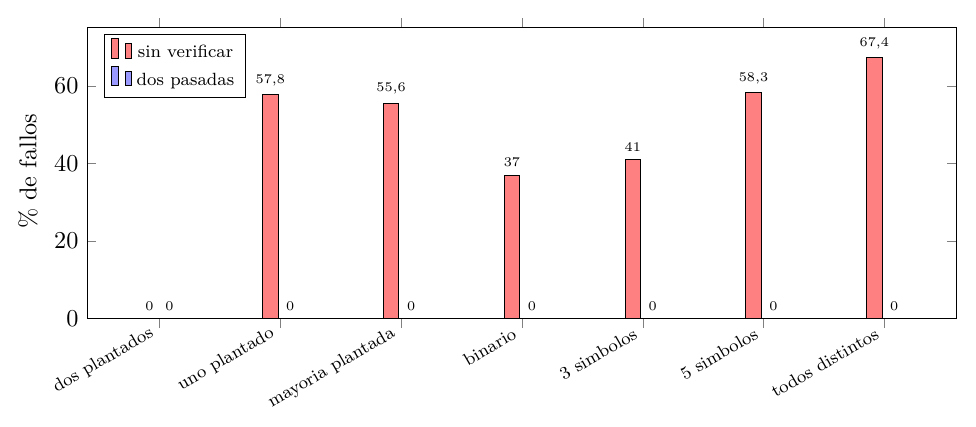

# Ejercicio 8: los elementos que aparecen más de $`n/3`$ veces

## Enunciado

**Ejercicio 8 ($`\star\star`$; C3).** El elemento que aparece más de $`n/3`$ veces. Generaliza Boyer-Moore con dos candidatos, enuncia el invariante reforzado y demuéstralo. Después escribe la versión que devuelve los candidatos con contador positivo sin verificarlos, y busca un generador de pruebas que no la atrape. Cuidado: el análogo del generador binario de la conferencia 3 sí la atrapa.

## Respuesta corta

- **Algoritmo.** Dos pares (candidato, contador). Si $`x`$ es un candidato activo, su contador sube; si hay un contador en $`0`$, $`x`$ ocupa ese lugar; si no, $`x`$ forma una *terna* con los dos candidatos y los dos contadores bajan. Una segunda pasada verifica.

- **Invariante.** El prefijo se parte en *ternas de tres valores distintos* más $`k_1`$ copias de $`c_1`$ y $`k_2`$ copias de $`c_2`$. Con $`T\le n/3`$ ternas y a lo sumo una copia de cada valor por terna, un valor con más de $`n/3`$ copias tiene que ser un candidato.

- **Costo.** Dos pasadas, $`O(n)`$ tiempo, $`O(1)`$ memoria; cota de lectura $`\lceil2n/3\rceil`$.

- **Sin verificar.** Es correcta la mitad “todo valor con más de $`n/3`$ copias está entre los candidatos” y falsa la recíproca. Un generador que *no la atrapa*: **“dos valores plantados con más de $`n/3`$ copias”**, porque entonces los dos candidatos tienen que ser exactamente esos dos. Los generadores binario y de $`3`$ símbolos *sí* la atrapan (entrada mínima: `AAB`).

Modelo: los elementos solo se comparan por igualdad; word RAM.

## Problema y modelo

**Entrada:** un arreglo $`A[0..n-1]`$ de elementos que solo se pueden comparar por igualdad (no hay orden ni hash). **Salida:** el conjunto $`H`$ de los valores que aparecen *más de* $`n/3`$ veces. Como tres valores con más de $`n/3`$ copias suman más de $`n`$, $`|H|\le2`$. La condición es $`3\cdot\mathrm{cuenta}(v)>n`$.

## El algoritmo

``` python
def primera_pasada(A):
    c1, k1, c2, k2 = None, 0, None, 0
    for x in A:
        if k1 > 0 and x == c1:   k1 += 1             # x es el candidato 1
        elif k2 > 0 and x == c2: k2 += 1             # x es el candidato 2
        elif k1 == 0:            c1, k1 = x, 1       # lugar 1 libre
        elif k2 == 0:            c2, k2 = x, 1       # lugar 2 libre
        else:                    k1 -= 1; k2 -= 1    # terna (x, c1, c2)
    return c1, k1, c2, k2

def con_verificacion(A):
    c1, k1, c2, k2 = primera_pasada(A)
    cuenta = {}
    for x in A:                                      # segunda pasada
        if (k1 > 0 and x == c1) or (k2 > 0 and x == c2):
            cuenta[x] = cuenta.get(x, 0) + 1
    return {v for v, k in cuenta.items() if 3 * k > len(A)}
```

Los *candidatos* son $`c_i`$ con $`k_i>0`$. El **orden de los `if` importa**: las dos coincidencias con candidato *activo* se miran antes que los contadores en $`0`$ (sección 5). El algoritmo solo usa igualdad entre elementos.

## Un lema de partición en ternas

Es el análogo del lema de C3 §4 para parejas.

**Lema 1**. *Un multiconjunto $`S`$ se parte en ternas de tres valores distintos si y solo si $`|S|`$ es múltiplo de $`3`$ y ningún valor aparece más de $`|S|/3`$ veces.*

*Demostración.* ($`\Rightarrow`$) $`|S|=3T`$ con $`T`$ ternas, y un valor tiene a lo sumo una copia por terna: a lo sumo $`T=|S|/3`$. ($`\Leftarrow`$) Sea $`|S|=3T`$. Lista los elementos de $`S`$ en una sucesión $`s_0,s_1,\dots,s_{3T-1}`$ con los valores iguales *contiguos* (agrupados por valor, en cualquier orden de grupos). Es un argumento matemático, no un paso del algoritmo: no usa ningún orden entre valores, solo que los iguales queden juntos. Forma las ternas $`(s_j,s_{j+T},s_{j+2T})`$ para $`j=0,\dots,T-1`$. Si $`s_j=s_{j+T}`$, ese valor ocupa las posiciones $`j,\dots,j+T`$ (los iguales son contiguos), o sea $`T+1`$ copias, más de $`|S|/3`$: imposible. Igual con $`s_{j+T}=s_{j+2T}`$. Y $`s_j=s_{j+2T}`$ implicaría $`s_j=s_{j+T}`$. Los tres de cada terna son distintos. ◻

El programa verifica el criterio contra una búsqueda por fuerza bruta en los $`715`$ multiconjuntos de tamaño $`\le9`$ sobre $`4`$ valores (salida 1).

## El invariante reforzado

Como en C3 §4, la frase que queremos (“si hay un valor con más de $`n/3`$ copias en el prefijo, es un candidato”) es cierta pero no es inductiva. Se refuerza: después de procesar el prefijo $`A[0..i-1]`$, con $`(c_1,k_1,c_2,k_2)`$ el estado,

**Invariante $`I`$:** $`k_1,k_2\ge0`$; si $`k_1>0`$ y $`k_2>0`$ entonces $`c_1\ne c_2`$; y el prefijo se parte en $`T`$ *ternas de tres valores distintos* más $`k_1`$ copias de $`c_1`$ y $`k_2`$ copias de $`c_2`$ (las copias de $`c_i`$ solo se cuentan si $`k_i>0`$). En particular $`i=3T+k_1+k_2`$.

*Inicialización.* Con el prefijo vacío, $`k_1=k_2=0`$ y $`T=0`$.

*Mantenimiento.* Supongamos $`I`$ para el prefijo de largo $`i`$ y procesemos $`x`$. Hay cinco casos, uno por rama (en el orden del código):

1.  $`k_1>0`$ y $`x=c_1`$: $`k_1`$ sube en $`1`$ y $`x`$ es una copia más de $`c_1`$. La partición es la misma más esa copia.

2.  $`k_2>0`$ y $`x=c_2`$ (y no se dio (a)): igual con $`c_2`$.

3.  $`k_1=0`$ y $`x`$ no es un candidato activo: se asigna $`c_1:=x`$, $`k_1:=1`$, y $`x`$ es la primera copia. Falta ver que $`c_1\ne c_2`$ si $`k_2>0`$: como (b) no se dio, $`x\ne c_2`$ cuando $`k_2>0`$.

4.  $`k_1>0`$, $`k_2=0`$ y $`x\ne c_1`$ (porque (a) no se dio): se asigna $`c_2:=x`$, $`k_2:=1`$, y $`c_1\ne c_2`$.

5.  $`k_1>0`$ y $`k_2>0`$ y $`x\ne c_1`$, $`x\ne c_2`$ (no se dieron (a), (b)), con $`c_1\ne c_2`$ por $`I`$: los tres valores $`x,c_1,c_2`$ son distintos. Se forma una terna con $`x`$ y una copia de cada candidato; quedan $`k_1-1`$ y $`k_2-1`$ copias, que es lo que dejan los contadores ($`\ge0`$).

En los cinco casos vale $`I`$.

*Conclusión.* Al terminar, $`A`$ se parte en $`T`$ ternas de distintos más $`k_1`$ copias de $`c_1`$ y $`k_2`$ de $`c_2`$, con $`T=(n-k_1-k_2)/3\le n/3`$.

**Teorema 1**. *Si $`v`$ aparece más de $`n/3`$ veces en $`A`$, entonces $`v`$ es un candidato: $`v=c_1`$ con $`k_1>0`$, o $`v=c_2`$ con $`k_2>0`$.*

*Demostración.* Si $`v`$ no fuera candidato, solo aparecería en las ternas, y a lo sumo una vez por terna (sus tres valores son distintos): a lo sumo $`T\le n/3`$ veces. Contradicción con $`3\cdot\mathrm{cuenta}(v)>n`$. ◻

Hay que guardar la forma exacta de este teorema, con su “si”, porque la sección 7 depende de ella. La segunda pasada completa el algoritmo: cuenta cada candidato y deja los que pasan $`3k>n`$, y por el teorema no se pierde ninguno.

**Traza (salida 3)**

sobre $`A=\texttt{B A C A B A D A C}`$, $`n=9`$ ($`n/3=3`$). La terna que se forma en el paso $`i`$ está marcada:

| $`i`$ | $`x`$ | caso                | $`c_1`$ | $`k_1`$ | $`c_2`$ | $`k_2`$ |
|------:|:-----:|:--------------------|:-------:|:-------:|:-------:|:-------:|
|     1 |   B   | $`c_1`$ libre       |    B    |    1    |    –    |    0    |
|     2 |   A   | $`c_2`$ libre       |    B    |    1    |    A    |    1    |
|     3 |   C   | **terna** (C, B, A) |    –    |    0    |    –    |    0    |
|     4 |   A   | $`c_1`$ libre       |    A    |    1    |    –    |    0    |
|     5 |   B   | $`c_2`$ libre       |    A    |    1    |    B    |    1    |
|     6 |   A   | $`x=c_1`$           |    A    |    2    |    B    |    1    |
|     7 |   D   | **terna** (D, A, B) |    A    |    1    |    –    |    0    |
|     8 |   A   | $`x=c_1`$           |    A    |    2    |    –    |    0    |
|     9 |   C   | $`c_2`$ libre       |    A    |    2    |    C    |    1    |

Al final $`A`$ se parte en $`T=2`$ ternas $`(C,B,A)`$ y $`(D,A,B)`$, más $`2`$ copias de $`A`$ y $`1`$ de $`C`$. El único valor con más de $`3`$ copias es `A` (cuatro), y es candidato. `C` es candidato pero tiene solo $`2`$ copias: la segunda pasada lo elimina.

## El orden de los `if` importa

Si se miran los contadores en $`0`$ *antes* de las coincidencias,

``` python
if k1 == 0:        c1, k1 = x, 1
elif k2 == 0:      c2, k2 = x, 1          # x puede ser igual a c1!
elif x == c1: ...  elif x == c2: ...  else: k1 -= 1; k2 -= 1
```

un $`x=c_1`$ con $`k_2=0`$ cae en la rama de $`c_2`$ y se obtiene $`c_1=c_2`$. Entonces el caso de la terna ya no tiene tres valores distintos ($`x`$, $`c_1=c_2`$) y $`I`$ deja de valer. La entrada más corta que lo rompe (búsqueda exhaustiva sobre $`\{A,B,C\}`$, largo $`\le7`$, salida 5) es `AAB`:

| $`i`$ | $`x`$ | $`c_1`$ | $`k_1`$ | $`c_2`$ | $`k_2`$ |
|------:|:-----:|--------:|--------:|--------:|--------:|
|     1 |   A   |       A |       1 |       – |       0 |
|     2 |   A   |       A |       1 |   **A** |       1 |
|     3 |   B   |       – |       0 |       – |       0 |

En el paso $`2`$, $`c_1=c_2=\texttt{A}`$. En el paso $`3`$, $`\texttt{B}\ne c_1,c_2`$ y los dos contadores bajan, como si `B`, `A`, `A` fueran una terna de distintos. Al final no queda ningún candidato, pero `A` aparece $`2`$ veces de $`3`$ ($`>3/3`$). Con el orden correcto los candidatos son `A` (con $`2`$) y `B` (con $`1`$). El orden equivocado pierde un valor frecuente en $`570`$ de los $`3279`$ arreglos sobre $`\{A,B,C\}`$ de largo $`\le7`$.

## Costo y cota mínima de lectura

**Costo.** Una pasada de cancelación y una de verificación: $`2n`$ lecturas y $`O(n)`$ tiempo ($`O(1)`$ comparaciones por lectura). **Memoria:** cuatro variables $`(c_1,k_1,c_2,k_2)`$ más a lo sumo dos contadores de verificación: $`O(1)`$.

**Cota mínima.** Todo algoritmo tiene que leer al menos $`\lceil2n/3\rceil`$ posiciones (para $`n\ge3`$). Sea $`t=\lfloor n/3\rfloor`$ y tomemos un arreglo con $`t`$ copias de `a` y el resto de elementos distintos entre sí y distintos de `a`. Ningún valor tiene más de $`n/3`$ copias (`a` tiene $`t\le n/3`$, los demás $`1\le n/3`$). Si un algoritmo termina sin leer alguna posición $`p`$ que no tiene `a`, cambiar esa posición por `a` da un arreglo con $`t+1>n/3`$ copias de `a`, sobre el que el algoritmo hace exactamente lo mismo y responde lo mismo. Se equivoca en uno de los dos. Entonces tiene que leer las $`n-t=\lceil2n/3\rceil`$ posiciones sin `a`. El algoritmo hace $`2n`$ lecturas: óptimo salvo un factor constante, entre $`2n/3`$ y $`2n`$.

## La versión sin verificar

Se puede intentar ahorrar la segunda pasada devolviendo los candidatos con contador positivo:

``` python
def sin_verificar(A):
    c1, k1, c2, k2 = primera_pasada(A)
    return {c for c, k in ((c1, k1), (c2, k2)) if k > 0}
```

**La mitad correcta.**

Por el teorema 1, todo valor con más de $`n/3`$ copias está entre los candidatos. La salida 4 lo comprueba en *todos* los arreglos de largo $`\le8`$ sobre $`4`$ símbolos y en $`20\,000`$ aleatorios.

**La mitad falsa.**

La recíproca (“candidato implica frecuente”) es falsa: *un candidato puede ser un falso positivo*. Contraejemplo mínimo (salida 6): con $`2`$ símbolos, `AAB`, candidatos $`\{\mathtt A,\mathtt B\}`$ y solo `A` es frecuente (`B` tiene $`1`$, y $`1>3/3`$ es falso). En la traza de arriba, `C` es un falso positivo. Con exactamente $`3`$ símbolos, la más corta es `AAABBC` (candidatos $`\{\mathtt A,\mathtt B\}`$, frecuente solo `A`; $`\mathtt B`$ tiene $`2`$ y $`2>6/3`$ es falso); con $`4`$ símbolos, `ABCD` (candidato `D`, ninguno frecuente). En términos del invariante, un candidato $`v`$ con contador $`k`$ tiene $`\mathrm{cuenta}(v)=k+(\text{copias en ternas})`$, y nada obliga a que eso supere $`n/3`$.

**Cómo ven las pruebas el error.**

Se compara contra un oráculo que cuenta todo, con $`4000`$ arreglos de largo $`4..15`$ por generador (salida 6):

| generador                   | sin verificar | dos pasadas |
|:----------------------------|--------------:|------------:|
| **dos plantados**           |     **0,0 %** |       0,0 % |
| uno plantado                |        57,8 % |       0,0 % |
| mayoría plantada ($`>n/2`$) |        55,6 % |       0,0 % |
| binario                     |        37,0 % |       0,0 % |
| 3 símbolos                  |        41,0 % |       0,0 % |
| 5 símbolos                  |        58,3 % |       0,0 % |
| todos distintos             |        67,4 % |       0,0 % |



Porcentaje de arreglos en que cada versión se equivoca, según el generador de las pruebas. Con “dos plantados” la versión sin verificar es indistinguible de la correcta.

**Por qué “dos plantados” no la atrapa.**

El generador planta dos valores con $`\lfloor n/3\rfloor+1`$ copias cada uno (y rellena con otros símbolos). Todos sus arreglos tienen exactamente dos valores frecuentes. Por el teorema 1, los dos son candidatos. Pero hay a lo sumo dos candidatos ($`c_1`$ y $`c_2`$). Entonces el conjunto de candidatos *es* el conjunto de frecuentes, y no queda un lugar libre para un falso positivo. Es la misma estructura que en C3 §5: “el de mayoría plantada no puede encontrarlo: todos sus arreglos tienen mayoría”; aquí, todos los arreglos llenan los dos lugares con frecuentes. Con *un solo* valor plantado queda un lugar libre, que casi siempre ocupa un falso positivo ($`57{,}8`$ %); con mayoría plantada, lo mismo ($`55{,}6`$ %): por ejemplo, `AAAB` tiene candidatos $`\{\mathtt A,\mathtt B\}`$ y `B` ($`1`$ copia, $`1>4/3`$ es falso) es un falso positivo. El programa lo verifica en $`20\,000`$ arreglos con exactamente dos frecuentes (salida 6): acierta siempre.

**Cuál es el análogo del generador binario, y por qué la razón de C3 no se traslada.**

En C3 hay *un* candidato, y el generador binario usa un alfabeto de $`1+1=2`$ símbolos: con dos símbolos el contador final es la diferencia de las dos cuentas (C3, ejercicio 3), así que “contador positivo” equivale a “un símbolo aparece más que el otro”, que con dos símbolos es ser mayoría, y el atajo es *exacto*. Aquí hay *dos* candidatos y el análogo natural es un alfabeto de $`2+1=3`$ símbolos. Hay una caracterización exacta que dice qué pasa:

**Lema 2**. *Con un alfabeto de $`3`$ símbolos, sea $`(c_1,k_1,c_2,k_2)`$ el estado final y $`T=(n-k_1-k_2)/3`$. Entonces $`\mathrm{cuenta}(c_i)=k_i+T`$ para cada candidato activo, $`\mathrm{cuenta}(v)=T`$ para todo $`v`$ que no sea candidato, y
``` math
c_i\ (k_i>0)\ \text{es frecuente}\iff 2k_i>k_j\qquad(j\ne i;\ k_j=0\text{ si el otro no está activo}).
```
*

*Demostración.* Una terna de tres valores distintos sobre un alfabeto de tres símbolos tiene exactamente una copia de cada símbolo. Por el invariante, el arreglo se parte en $`T`$ ternas más $`k_1`$ copias de $`c_1`$ y $`k_2`$ de $`c_2`$, de modo que cada símbolo tiene $`T`$ copias en las ternas, más $`k_i`$ si es el candidato $`c_i`$. Entonces $`c_i`$ es frecuente si y solo si $`3(k_i+T)>n=3T+k_1+k_2`$, es decir $`3k_i>k_1+k_2`$, o sea $`2k_i>k_j`$. Un símbolo que no es candidato tiene $`T`$ copias y $`3T>3T+k_1+k_2`$ es falso: nunca es frecuente. ◻

Es el análogo exacto de “contador $`=`$ diferencia” de C3. Pero ahora *el atajo “$`k_i>0`$” no es exacto*: basta $`2k_i\le k_j`$ para que $`c_i`$ sea un falso positivo. En `AAABBC` el estado final es $`k_{\mathtt A}=2`$, $`k_{\mathtt B}=1`$ y $`T=1`$: $`2\cdot1\le2`$, así que `B` (que tiene $`T+k_{\mathtt B}=2`$ copias, y $`3\cdot2=6\le n=6`$) no es frecuente. De paso, el lema da una versión del atajo *correcta con tres símbolos*: devolver $`c_i`$ solo si $`2k_i>k_j`$. El programa la verifica con `assert` en los $`88\,573`$ arreglos sobre $`\{A,B,C\}`$ de largo $`\le10`$ (salida 7): $`\mathrm{cuenta}(v)=T+k_i`$ y la regla coincide con el oráculo. También es exacta con $`1`$ y $`2`$ símbolos (son casos de $`3`$ con alguna cuenta en $`0`$), y con ellos el atajo “$`k_i>0`$” falla en $`35{,}4`$ % de los arreglos con $`2`$ símbolos y en $`41{,}4`$ % con $`3`$.

**Con cuatro o más símbolos la regla ya no es exacta.**

La hipótesis del lema es que toda terna lleva *todos* los símbolos, y con cuatro símbolos una terna puede dejar fuera a uno. La entrada más corta donde la regla $`2k_i>k_j`$ falla es `ABCD`: la terna $`(\mathtt A,\mathtt B,\mathtt C)`$ no contiene a `D`, el estado deja a `D` como candidato con $`k=1`$ y el otro contador en $`0`$, y la regla ($`2\cdot1>0`$) lo devuelve aunque tiene $`1`$ copia de $`4`$. Falla en $`25{,}1`$ % de los arreglos con $`4`$ símbolos, $`40{,}0`$ % con $`5`$ y $`59{,}3`$ % con $`8`$ (salida 7). Es la lección del tema: con dos candidatos, el atajo parece correcto para el alfabeto *pequeño* (con la regla refinada) y deja de serlo al agrandarlo, y la demostración dice dónde buscar: C3 §5 cierra con “leer la hipótesis de un teorema es leer la lista de casos que hay que probar”, y el resumen del tema (§3) con “la demostración verifica que pensaste bien, y además te dice qué probar”. La hipótesis del teorema 1 es “si $`v`$ tiene más de $`n/3`$ copias”; lo que no cubre es el candidato *sin* esa propiedad.

**El generador binario sí atrapa el atajo ingenuo.**

Con dos símbolos nunca se forma una terna, así que los candidatos son *todos* los símbolos presentes y el atajo declara frecuente a un símbolo con $`1`$ copia en $`3`$: `AAB`. Los generadores binario y de $`3`$ símbolos de la tabla fallan en $`37{,}0`$ % y $`41{,}0`$ % de los casos.

## Comprobación experimental

Código: `ej08_misra_gries.py`. Vigila el invariante $`I`$ con `assert` en cada prefijo: las copias existen, $`c_1\ne c_2`$ si ambos activos, y el resto se parte en ternas (por el lema 1). Salida real:

<details>
<summary><code>ej08_salida.txt</code></summary>

```text
=== 1. Lema: un multiconjunto se parte en ternas de distintos  <=>  |S| multiplo de 3 y ningun valor > |S|/3 ===
  715 multiconjuntos de tamano <= 9 sobre 4 valores: criterio == fuerza bruta

=== 2. Invariante vigilado con assert (primera pasada, orden correcto) ===
  6000 arreglos aleatorios (alfabetos de 2 a 5 simbolos): invariante comprobado en 44906 prefijos, sin fallos
  exhaustivo: todos los arreglos sobre 4 simbolos de largo <= 8: 669924 prefijos, sin fallos

=== 3. Traza de un ejemplo: A = B A C A B A D A C ===
  i  x  caso      c1 k1  c2 k2
  1  B  c1 libre   B  1   -  0
  2  A  c2 libre   B  1   A  1
  3  C  terna      -  0   -  0
  4  A  c1 libre   A  1   -  0
  5  B  c2 libre   A  1   B  1
  6  A  x = c1     A  2   B  1
  7  D  terna      A  1   -  0
  8  A  x = c1     A  2   -  0
  9  C  c2 libre   A  2   C  1
  n = 9, terna = 3 copias distintas; pesados (> n/3 = 3.00): ['A']; candidatos: ['A', 'C']; con verificacion: ['A']

=== 4. Correctitud contra el oraculo (con verificacion) y mitad buena del algoritmo sin verificar ===
  todos los arreglos sobre 4 simbolos de largo <= 8: con_verificacion == oraculo; pesados contenidos en candidatos
  20000 arreglos aleatorios mas (alfabetos de 2 a 10 simbolos, largo hasta 40): sin fallos

=== 5. El orden equivocado de los if produce c1 == c2 y falla ===
  entrada mas corta (alfabeto ABC) donde falta un pesado entre los candidatos: AAB
  i  x   c1 k1  c2 k2   (orden equivocado)
  1  A   A  1   -  0
  2  A   A  1   A  1
  3  B   -  0   -  0
  candidatos finales: []; pesados: ['A']; con el orden correcto: ['A', 'B']
  arreglos sobre ABC de largo <= 7 donde el orden equivocado pierde un pesado: 570 de 3279

=== 6. La version sin verificar: falsos positivos y generadores de prueba ===
  Entrada mas corta con falso positivo, por tamano de alfabeto (arreglos que usan EXACTAMENTE ese numero de simbolos):
    2 simbolos: AAB  candidatos ['A', 'B'], pesados ['A']
    3 simbolos: AAABBC  candidatos ['A', 'B'], pesados ['A']
    4 simbolos: ABCD  candidatos ['D'], pesados []

          generador  sin verificar  dos pasadas   (4000 arreglos de largo 4..15 por generador)
      dos plantados           0.0%         0.0%
       uno plantado          57.8%         0.0%
   mayoria plantada          55.6%         0.0%
            binario          37.0%         0.0%
         3 simbolos          41.0%         0.0%
         5 simbolos          58.3%         0.0%
    todos distintos          67.4%         0.0%

  Para los generadores de 'dos plantados': candidatos = pesados por cardinalidad (<= 2 candidatos, 2 pesados):
    20000 arreglos con exactamente dos pesados: la version sin verificar acierta siempre

=== 7. Alfabeto de 3 simbolos (el analogo del binario de C3): caracterizacion exacta ===
  Toda terna de distintos sobre 3 simbolos tiene una copia de cada uno; luego cuenta(c_i) = k_i + T,
  cuenta(v) = T para v no candidato, n = 3T + k1 + k2, y  c_i (k_i > 0) es frecuente  <=>  2 k_i > k_j.
  assert en los 88573 arreglos sobre {A,B,C} de largo <= 10: cuenta(v) = T + k_i, y regla '2 k_i > k_j' == oraculo
  (tambien exacta con 1 y 2 simbolos: son casos de 3 simbolos con alguna cuenta en 0)
  AAABBC: estado A:2, B:1, T = 1;  B: 2*1 > 2? False -> falso positivo del atajo; regla 2k: ['A']; oraculo ['A']
  Con 4 o mas simbolos la regla deja de ser exacta (las ternas ya no llevan todos los simbolos):
    regla 2k: entrada mas corta sobre 4 simbolos donde falla: ABCD  (estado ('D', 1, 'B', 0), devuelve ['D'], oraculo [])

   simbolos  atajo (k>0)  regla 2k_i>k_j   (4000 arreglos de largo 4..15 por tamano de alfabeto)
          1         0.0%            0.0%
          2        35.4%            0.0%
          3        41.4%            0.0%
          4        52.6%           25.1%
          5        57.8%           40.0%
          8        65.2%           59.3%
```

</details>

**Casos elegidos.**

*Típicos:* $`6000`$ arreglos aleatorios con alfabetos de $`2`$ a $`5`$ símbolos ($`44\,906`$ prefijos) y $`20\,000`$ más con largo hasta $`40`$. *Exhaustivos:* todos los arreglos sobre $`4`$ símbolos de largo $`\le8`$ ($`669\,924`$ prefijos). *Bordes:* arreglos de largo $`1,2,3`$, un solo símbolo, todos distintos (el invariante con $`T`$ grande y contadores en $`0`$). *Adversariales:* `AAB` (orden equivocado), `AAABBC` y `ABCD` (falsos positivos), y el generador de dos plantados.

## Por qué este enfoque

**Una analogía.**

Boyer-Moore es un duelo de a dos: cada elemento que no es el candidato cancela una copia. Aquí es una partida de a tres: un elemento nuevo, distinto de los dos candidatos, forma una terna con ellos y los tres *se descartan juntos*. El valor frecuente no puede perder: en cada terna aporta a lo sumo una copia, y como hay a lo sumo $`n/3`$ ternas, sobrevive. Un valor con más de $`n/3`$ copias es como un equipo de más de un tercio de los jugadores: no puede entrar a cada terna de tres jugadores distintos más de una vez.

**Otra visión.**

Es el algoritmo de resumen de frecuencias de Misra y Gries con $`k-1=2`$ contadores: el contador de cada candidato subestima su cuenta real en a lo sumo $`T\le n/3`$ (cada terna se “lleva” una copia de cada uno). Con $`k-1`$ contadores y ternas $`k`$-tuplas se encuentran los valores con más de $`n/k`$ copias, y la misma demostración vale con partición en $`k`$-tuplas de valores distintos.

**Por qué el invariante así.**

Como en C3 §4, “si hay un valor frecuente en el prefijo, es candidato” es cierto pero no es inductivo: si el prefijo no tiene frecuente, no dice nada del estado. El invariante refuerza la frase hablando de *toda* la partición del prefijo. La condición “$`c_1\ne c_2`$ si ambos están activos” no es decorativa: es lo que hace que la terna tenga tres valores distintos, y es lo que el orden equivocado de los `if` rompe.

## Conclusión

- **Correctitud:** invariante “el prefijo se parte en ternas de distintos más $`k_1`$ copias de $`c_1`$ y $`k_2`$ de $`c_2`$”; con la segunda pasada, la salida es exactamente el conjunto de valores con más de $`n/3`$ copias.

- **Costo:** $`2n`$ lecturas, $`O(n)`$ tiempo, $`O(1)`$ memoria. Cota mínima $`\lceil2n/3\rceil`$ lecturas (óptimo salvo constante).

- **Sin verificar:** la mitad “frecuente $`\Rightarrow`$ candidato” es correcta; “candidato $`\Rightarrow`$ frecuente” es falsa. Los generadores binario y de $`3`$ símbolos la atrapan; el de “dos plantados” no puede, porque llena los dos lugares con frecuentes.

- **Orden de los `if`:** coincidencias activas antes que contadores en $`0`$; si no, $`c_1=c_2`$ y `AAB` falla.

Modelo: word RAM; los elementos solo se comparan por igualdad.
