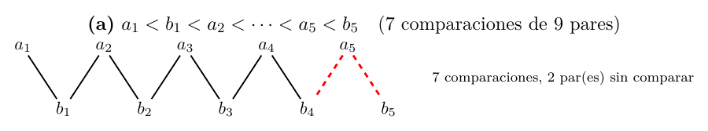
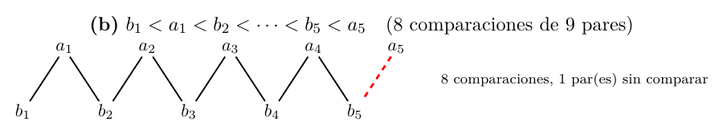

# Ejercicio 9: una mezcla “optimizada” que no puede estar bien

## Enunciado

**Ejercicio 9 ($`\star\star`$; C5).** Una mezcla “optimizada” de dos listas ordenadas de largo $`n`$ deja de comparar cuando a la primera lista le queda un solo elemento, y lo pone al final. Cuenta cuántas comparaciones hace en el peor caso. Sin probarla, usa la sección 6 de la conferencia 5 para decidir si es correcta, y construye con el adversario la entrada en la que falla.

## Respuesta corta

- **Peor caso exacto:** $`2n-2`$ comparaciones (contra $`2n-1`$ de la mezcla normal), para todo $`n\ge1`$.

- **Sin probarla:** por el teorema de C5 §6, toda mezcla correcta de dos listas de largo $`n`$ necesita $`2n-1`$ comparaciones en el peor caso. La variante hace a lo sumo $`2n-2`$, así que **no es correcta**.

- **Entrada en que falla (adversario):** con la intercalada $`a_1<b_1<a_2<\dots<a_n<b_n`$, el par de vecinos $`(a_n,b_n)`$ nunca se compara y la variante saca $`b_n`$ antes que $`a_n`$. Con la otra intercalada, $`b_1<a_1<\dots<b_n<a_n`$, la variante acierta, y el par sin comparar $`(b_n,a_n)`$ obliga a intercambiar sus valores para producir la entrada que la rompe.

- **Cuándo falla exactamente:** si y solo si $`b_n>a_n`$, es decir, si el máximo de los $`2n`$ está en la segunda lista. Con listas al azar, la probabilidad es exactamente $`1/2`$, de modo que las pruebas al azar la ven enseguida; los generadores con el máximo en $`A`$ no la ven nunca.

Modelo: comparaciones entre elementos distintos de las dos listas.

## Modelo y especificación exacta de la variante

**Entrada:** dos listas $`A[0..n-1]`$ y $`B[0..n-1]`$, ordenadas de forma creciente, con los $`2n`$ elementos distintos. **Salida:** la lista ordenada de los $`2n`$. **Costo:** comparaciones entre un elemento de $`A`$ y uno de $`B`$.

``` python
def mezclar(A, B):                         # la mezcla normal (C5 sec. 6)
    R, i, j = [], 0, 0
    while i < len(A) and j < len(B):
        if A[i] < B[j]: R.append(A[i]); i += 1
        else:           R.append(B[j]); j += 1
    return R + A[i:] + B[j:]

def mezclar_opt(A, B):                     # la variante
    R, i, j = [], 0, 0
    while len(A) - i >= 2 and j < len(B):  # A tiene >= 2 restantes y B no esta vacia
        if A[i] < B[j]: R.append(A[i]); i += 1
        else:           R.append(B[j]); j += 1
    return R + B[j:] + A[i:]               # volcar el resto de B, y al final lo que quede de A
```

Casos que el código fija:

- **A queda con un solo elemento y B no está vacía:** se deja de comparar, se vuelca todo el resto de $`B`$ y ese elemento va al final. Es la “optimización”.

- **B se agota antes** (con $`A`$ aún con $`\ge2`$ elementos): el ciclo termina porque $`j=|B|`$, y `A[i:]` es el resto normal de $`A`$. Ahí el código es exactamente la mezcla normal.

- **A queda con un elemento cuando B ya está vacía:** el ciclo no corre (o termina) y `A[i:]` ese elemento: sin comparar, y es lo correcto.

- **$`n=1`$:** $`|A|-0=1`$, el ciclo no corre y la variante hace *cero* comparaciones, sacando $`B`$ y luego $`A`$. Es correcta si $`b<a`$ y incorrecta si $`a<b`$.

Cuando el ciclo corre, el cuerpo es el de la mezcla normal: las primeras $`c`$ salidas de la variante son los $`c`$ elementos más chicos de la unión.

## Peor caso exacto de comparaciones

**Teorema 1**. *La variante hace a lo sumo $`2n-2`$ comparaciones, y existe una entrada con exactamente $`2n-2`$, para todo $`n\ge1`$. La mezcla normal hace hasta $`2n-1`$.*

*Demostración.* *Cota superior.* Cada vuelta hace una comparación y saca un elemento. Si hubo $`c\ge1`$ vueltas, antes de la última el ciclo seguía, luego quedaban $`\ge2`$ elementos de $`A`$ y $`\ge1`$ de $`B`$: se habían sacado a lo sumo $`n-2`$ de $`A`$ y $`n-1`$ de $`B`$, o sea $`c-1\le(n-2)+(n-1)=2n-3`$, de donde $`c\le2n-2`$. Para $`n=1`$ no hay vueltas: $`0=2n-2`$.

*Una entrada que la alcanza* ($`n\ge2`$). Sea $`b_1<a_1<b_2<a_2<\dots<b_n<a_n`$. La mezcla saca $`b_1,a_1,\dots,b_{n-2},a_{n-2},b_{n-1}`$, que son $`2n-3`$ elementos, en $`2n-3`$ vueltas. En ese momento quedan $`a_{n-1},a_n`$ ($`\ge2`$) y $`b_n`$ ($`\ge1`$): hay una vuelta más, que compara $`a_{n-1}`$ con $`b_n`$ y saca $`a_{n-1}`$; entonces a $`A`$ le queda uno y el ciclo termina. Total $`2n-2`$. ◻

La mezcla normal hace $`2n-1`$ en esta entrada (C5 §6). La variante ahorra *una* comparación en el peor caso.

## Sin probarla: la cota de C5 §6 dice que está mal

El teorema de C5 §6 dice: *mezclar dos listas ordenadas de largo $`n`$ requiere $`2n-1`$ comparaciones en el peor caso*, en el modelo de comparaciones. La variante es un algoritmo de comparaciones (solo compara elementos de $`A`$ con elementos de $`B`$) y, por el teorema 1, hace a lo sumo $`2n-2<2n-1`$ comparaciones en *todas* las entradas. Entonces **no puede ser correcta**: ningún algoritmo correcto puede hacer menos que la cota. Esta conclusión no usó ninguna ejecución.

La demostración de C5 §6 dice además *dónde* falla. El adversario contesta como si la entrada fuera la intercalada perfecta, que tiene $`2n-1`$ pares de vecinos. La variante compara a lo sumo $`2n-2`$ de ellos, así que deja alguno sin comparar. Si intercambiamos los valores de los dos elementos de ese par, las dos listas siguen ordenadas (son vecinos en la cadena y nada queda entre ellos), todas las comparaciones hechas dan la misma respuesta, y la salida correcta cambió. La variante da la misma salida para las dos entradas, así que se equivoca en una.

## Construcción con el adversario: las dos intercaladas

Hay dos intercaladas perfectas (con las listas $`A`$ y $`B`$ intercambiadas la una en la otra). Corremos la variante sobre cada una con $`n=5`$ (salida 3 del programa) y miramos qué pares de vecinos no se compararon. Cada línea de las figuras es una comparación hecha de verdad; las líneas rojas discontinuas son los pares sin comparar.





**La intercalada (a) falla directamente.**

$`A=[1,3,5,7,9]`$, $`B=[2,4,6,8,10]`$. La variante hace $`7`$ comparaciones y sale con $`[1,2,3,4,5,6,7,8,10,9]`$ (el resultado correcto es $`[1,\dots,10]`$): a $`A`$ le queda $`a_5=9`$, la variante vuelca el resto de $`B`$ ($`b_4=8`$ y $`b_5=10`$) y pone $`9`$ al final, detrás del $`10`$. Los pares sin comparar son $`(a_5,b_4)`$ y $`(a_5,b_5)`$. El intercambio de $`a_5\leftrightarrow b_5`$ da $`A=[1,3,5,7,10]`$, $`B=[2,4,6,8,9]`$ y la salida $`[1,\dots,10]`$, correcta; el de $`a_5\leftrightarrow b_4`$ da $`A=[1,3,5,7,8]`$, $`B=[2,4,6,9,10]`$ y la variante vuelve a fallar. En los tres casos la transcripción de respuestas es la misma.

**La intercalada (b) necesita el intercambio.**

$`A=[2,4,6,8,10]`$, $`B=[1,3,5,7,9]`$. La variante hace $`8`$ comparaciones y *acierta*: $`[1,\dots,10]`$. El único par sin comparar es $`(b_5,a_5)`$. Intercambiando sus valores, $`A=[2,4,6,8,9]`$ y $`B=[1,3,5,7,10]`$ (las dos siguen ordenadas), se obtienen las mismas respuestas en las mismas comparaciones y la salida real es $`[1,2,3,4,5,6,7,8,10,9]`$: **incorrecta**. Es la entrada concreta en que la variante falla, construida con el adversario: la intercalada (b) con su último par intercambiado, es decir, la cadena $`b_1<a_1<\dots<b_4<a_4<a_5<b_5`$.

En ambos casos el programa comprueba que la transcripción de respuestas es idéntica, que la salida es la misma como orden de casillas, y que a lo sumo una de las dos entradas es correcta.

## Cuándo falla exactamente

Las dos intercaladas sugieren la regla: falla cuando $`b_n>a_n`$.

**Teorema 2**. *Con elementos distintos, la variante es incorrecta si y solo si $`b_n>a_n`$, es decir, si el máximo de los $`2n`$ elementos está en $`B`$.*

*Demostración.* Mientras el ciclo corre, el cuerpo es el de la mezcla normal, así que $`R`$ siempre es el prefijo de la lista ordenada de la unión. El ciclo termina de una de dos formas.

\(i\) *$`B`$ se agotó.* La salida es $`R+A[i{:}]`$, que es la mezcla normal y es correcta.

\(ii\) *A $`A`$ le queda un solo elemento, $`a_n`$, y $`B`$ no está vacía.* Lo que falta ordenar es $`B_{\text{resto}}\cup\{a_n\}`$, y la salida es $`R+B_{\text{resto}}+[a_n]`$. Es correcta si y solo si $`a_n`$ es mayor que todo $`B_{\text{resto}}`$, o sea mayor que $`b_n`$ (que está en $`B_{\text{resto}}`$ por ser el último de $`B`$).

Si $`a_n>b_n`$ (el máximo está en $`A`$), en el caso (i) acierta y en el (ii) acierta. Si $`b_n>a_n`$ (el máximo está en $`B`$): $`b_n`$ es el último de la lista ordenada y no sale mientras falte algún otro elemento, en particular $`a_n`$. Entonces el ciclo no puede terminar por (i) (que exige haber sacado $`b_n`$, y con él todo $`A`$); termina por (ii), con $`a_n<b_n`$ y $`b_n\in B_{\text{resto}}`$, y la salida pone $`a_n`$ detrás de $`b_n`$: incorrecta. ◻

Con $`n=1`$ la regla dice: falla si $`a<b`$, como en el caso de borde de la sección 1.

**Qué ven las pruebas al azar.**

Con dos listas ordenadas elegidas al azar, el máximo de los $`2n`$ está en $`B`$ con probabilidad exactamente $`n/2n=1/2`$. El programa lo cuenta de forma exhaustiva: de las $`\binom{2n}{n}`$ entradas posibles, la variante falla en $`\binom{2n-1}{n}=\tfrac12\binom{2n}{n}`$ (salida 4, $`n\le8`$), y la regla del teorema 2 se verifica con `assert` en todas. Al azar (salida 5):

| $`n`$ | pruebas | fallos medidos |  exacta |
|------:|--------:|---------------:|--------:|
|     2 |   20000 |        49,09 % | 50,00 % |
|     4 |   20000 |        50,35 % | 50,00 % |
|    16 |   20000 |        49,74 % | 50,00 % |
|    64 |   20000 |        49,58 % | 50,00 % |
|  1024 |    4000 |        50,77 % | 50,00 % |

A diferencia del torneo de C5 §8, donde el atajo falla con probabilidad $`1/(n-1)`$ ($`0{,}12`$ % con $`1024`$ elementos), aquí *las pruebas al azar sí lo ven*: una de cada dos. Pero depende del generador, y un generador natural puede no verlo nunca (salida 5, $`n=16`$):

| generador | falla en |
|:---|---:|
| aleatoria (todas las particiones) | 50,8 % |
| intercalada $`a_1<b_1<\dots`$ | 100,0 % |
| **intercalada $`b_1<a_1<\dots`$** (la cadena del adversario, de este lado) | **0,0 %** |
| $`A`$ entera menor que $`B`$ | 100,0 % |
| **$`B`$ entera menor que $`A`$** | **0,0 %** |
| $`A`$ con el máximo plantado | **0,0 %** |

Una batería que pruebe la mezcla con listas “crecientes por bloques” ($`B<A`$), con el máximo en $`A`$ o con la intercalada $`b`$-primero pasa limpia y no encuentra nada. La demostración dice dónde está: en $`b_n>a_n`$.

## Comprobación experimental

Código: `ej09_mezcla.py`. Corre la variante y la mezcla normal contando las comparaciones y registrando los pares comparados, sobre todas las entradas de $`2n`$ valores distintos con $`n\le8`$ (las $`\binom{2n}{n}`$ particiones) y sobre las dos intercaladas. Salida real:

<details>
<summary><code>ej09_salida.txt</code></summary>

```text
=== 1. Especificacion en codigo y casos de borde ===
  mientras len(A)-i >= 2 y j < len(B): comparar;  al salir: R += B[j:] + A[i:]
  n=1, A=[5], B=[3]                variante: [3, 5] (0 comp.)   normal: [3, 5] (1 comp.)   correcta: True
  n=1, A=[3], B=[5]                variante: [5, 3] (0 comp.)   normal: [3, 5] (1 comp.)   correcta: False
  B no se agota antes: A < B       variante: [1, 3, 4, 2] (1 comp.)   normal: [1, 2, 3, 4] (2 comp.)   correcta: False
  B se agota antes: B < A          variante: [1, 2, 3, 4] (2 comp.)   normal: [1, 2, 3, 4] (2 comp.)   correcta: True
  B vacia, A con un elemento       variante: [2] (0 comp.)   normal: [2] (0 comp.)   correcta: True
  A vacia                          variante: [1, 2] (0 comp.)   normal: [1, 2] (0 comp.)   correcta: True

=== 2. Peor caso EXACTO de comparaciones, sobre TODAS las entradas ===
   n  entradas  variante: max  2n-2  normal: max  2n-1  entrada que alcanza 2n-2 (primera)
   1         2              0     0            1     1  A=[0] B=[1]
   2         6              2     2            3     3  A=[1, 2] B=[0, 3]
   3        20              4     4            5     5  A=[0, 3, 4] B=[1, 2, 5]
   4        70              6     6            7     7  A=[0, 1, 5, 6] B=[2, 3, 4, 7]
   5       252              8     8            9     9  A=[0, 1, 2, 7, 8] B=[3, 4, 5, 6, 9]
   6       924             10    10           11    11  A=[0, 1, 2, 3, 9, 10] B=[4, 5, 6, 7, 8, 11]
   7      3432             12    12           13    13  A=[0, 1, 2, 3, 4, 11, 12] B=[5, 6, 7, 8, 9, 10, 13]
   8     12870             14    14           15    15  A=[0, 1, 2, 3, 4, 5, 13, 14] B=[6, 7, 8, 9, 10, 11, 12, 15]

=== 3. Las dos intercaladas del adversario, n = 5 ===
  a-primero: a1 < b1 < a2 < b2 < a3 < b3 < a4 < b4 < a5 < b5
    A = [1, 3, 5, 7, 9]  B = [2, 4, 6, 8, 10]
    variante: 7 comparaciones (de 9 pares vecinos), salida [1, 2, 3, 4, 5, 6, 7, 8, 10, 9]  correcta: False
    normal:   9 comparaciones, salida correcta: True
    pares vecinos NUNCA comparados: [('a5', 'b4'), ('a5', 'b5')]
    intercambio a5<->b4: A=[1, 3, 5, 7, 8] B=[2, 4, 6, 9, 10]
      misma transcripcion de respuestas: True; misma salida como orden de casillas: True
      salida con valores: [1, 2, 3, 4, 5, 6, 7, 9, 10, 8] (original: [1, 2, 3, 4, 5, 6, 7, 8, 10, 9]) -> correcta en la original: False, en la intercambiada: False
    intercambio a5<->b5: A=[1, 3, 5, 7, 10] B=[2, 4, 6, 8, 9]
      misma transcripcion de respuestas: True; misma salida como orden de casillas: True
      salida con valores: [1, 2, 3, 4, 5, 6, 7, 8, 9, 10] (original: [1, 2, 3, 4, 5, 6, 7, 8, 10, 9]) -> correcta en la original: False, en la intercambiada: True
  b-primero: b1 < a1 < b2 < a2 < b3 < a3 < b4 < a4 < b5 < a5
    A = [2, 4, 6, 8, 10]  B = [1, 3, 5, 7, 9]
    variante: 8 comparaciones (de 9 pares vecinos), salida [1, 2, 3, 4, 5, 6, 7, 8, 9, 10]  correcta: True
    normal:   9 comparaciones, salida correcta: True
    pares vecinos NUNCA comparados: [('a5', 'b5')]
    intercambio a5<->b5: A=[2, 4, 6, 8, 9] B=[1, 3, 5, 7, 10]
      misma transcripcion de respuestas: True; misma salida como orden de casillas: True
      salida con valores: [1, 2, 3, 4, 5, 6, 7, 8, 10, 9] (original: [1, 2, 3, 4, 5, 6, 7, 8, 9, 10]) -> correcta en la original: True, en la intercambiada: False

=== 4. Cuando falla: exactamente cuando el maximo de los 2n esta en B (b_n > a_n) ===
  n=1: 2 entradas, la variante falla en 1 = C(2n-1,n) = la mitad exacta; falla <=> b_n > a_n (assert)
  n=2: 6 entradas, la variante falla en 3 = C(2n-1,n) = la mitad exacta; falla <=> b_n > a_n (assert)
  n=3: 20 entradas, la variante falla en 10 = C(2n-1,n) = la mitad exacta; falla <=> b_n > a_n (assert)
  n=4: 70 entradas, la variante falla en 35 = C(2n-1,n) = la mitad exacta; falla <=> b_n > a_n (assert)
  n=5: 252 entradas, la variante falla en 126 = C(2n-1,n) = la mitad exacta; falla <=> b_n > a_n (assert)
  n=6: 924 entradas, la variante falla en 462 = C(2n-1,n) = la mitad exacta; falla <=> b_n > a_n (assert)
  n=7: 3432 entradas, la variante falla en 1716 = C(2n-1,n) = la mitad exacta; falla <=> b_n > a_n (assert)
  n=8: 12870 entradas, la variante falla en 6435 = C(2n-1,n) = la mitad exacta; falla <=> b_n > a_n (assert)

=== 5. Pruebas al azar: frecuencia de fallo contra la probabilidad exacta (1/2) ===
      n  pruebas   fallos   exacta
      2    20000   49.09%   50.00%
      4    20000   50.35%   50.00%
     16    20000   49.74%   50.00%
     64    20000   49.58%   50.00%
   1024     4000   50.77%   50.00%

  Por generador (n = 16, 2000 entradas; las intercaladas y las separadas son deterministas):
    aleatoria (todas las particiones)                              falla en  50.8%
    intercalada a1<b1<a2<...                                       falla en 100.0%
    intercalada b1<a1<b2<... (la del adversario, pegada al reves)  falla en   0.0%
    A entera menor que B                                           falla en 100.0%
    B entera menor que A                                           falla en   0.0%
    A con el maximo plantado                                       falla en   0.0%

=== 6. Informacion: log2 C(2n,n) contra el peor caso de la variante (2n-2) ===
     n  log2 C(2n,n)  ceil  2n-2  2n-1  la informacion sola refuta a la variante?
     1          1.00     1     0     1  SI (2n-2 < ceil(info))
     2          2.58     3     2     3  SI (2n-2 < ceil(info))
     3          4.32     5     4     5  SI (2n-2 < ceil(info))
     4          6.13     7     6     7  SI (2n-2 < ceil(info))
     5          7.98     8     8     9  no
     6          9.85    10    10    11  no
     7         11.74    12    12    13  no
     8         13.65    14    14    15  no
     9         15.57    16    16    17  no
    10         17.50    18    18    19  no
    16         29.16    30    30    31  no
    64        124.17   125   126   127  no
   256        507.17   508   510   511  no
  1024       2042.17  2043  2046  2047  no
  primer n en que ceil(log2 C(2n,n)) <= 2n-2 (la informacion deja de detectarla): n = 5

=== 7. La version correcta: ubicar el ultimo elemento de A por biseccion en lo que queda de B ===
   n  correcta en todas  peor caso  2n-1
   1               True          1     1
   2               True          3     3
   3               True          5     5
   4               True          7     7
   5               True          9     9
   6               True         11    11
   7               True         13    13
```

</details>

**Casos elegidos.**

*Bordes:* $`n=1`$ (cero comparaciones; falla con $`a<b`$), $`B`$ que se agota antes ($`B<A`$), $`A`$ con un elemento y $`B`$ vacía, $`A`$ vacía. *Típicas:* $`\binom{2n}{n}`$ entradas para $`n\le8`$ (exhaustivo) y listas al azar hasta $`n=1024`$. *Adversariales:* las dos intercaladas y los pares sin comparar; $`b_n>a_n`$ y su negación.

## Algo más fino

**(a) La versión correcta de la “optimización”.**

Dejar de comparar *sí* se puede cuando una lista *se agota*: el resto de la otra ya está ordenado y es mayor que lo sacado. Eso es la mezcla normal, y no contradice la cota, porque su peor caso sigue siendo $`2n-1`$ (la intercalada obliga a comparar cada par de vecinos). Lo que la variante hace mal es suponer que, con un solo elemento $`a_n`$ en $`A`$, su lugar es el final. Para ubicar $`a_n`$ en el resto de $`B`$ hay que comparar. Se puede hacer mejor que recorrer: ubicarlo por *búsqueda binaria* en $`B_{\text{resto}}`$ cuesta $`\lceil\log_2(m+1)\rceil`$ comparaciones, con $`m=|B_{\text{resto}}|`$. La salida 7 comprueba, sobre todas las entradas con $`n\le7`$, que esa versión es correcta y que su peor caso es exactamente $`2n-1`$: no se burla la cota. Con $`i`$ comparaciones hechas antes, $`m=2n-1-i`$ y el total es $`i+\lceil\log_2(2n-i)\rceil`$, que vale $`2n-1`$ en $`i=2n-3`$ y en $`i=2n-2`$, cuando quedan $`m=2`$ o $`m=1`$ elementos en $`B`$: justo donde el adversario guarda sus pares de vecinos.

**(b) La información sola no la habría detectado.**

Para mezclar hay $`\binom{2n}{n}`$ resultados posibles y $`\log_2\binom{2n}{n}=2n-\tfrac12\log_2(\pi n)+O(1)`$ (C5 §4: “cerca, pero no llega”). El peor caso de la variante es $`2n-2`$. Como $`\lceil\log_2\binom{2n}{n}\rceil\le2n-2`$ si y solo si $`n\ge5`$ (salida 6: para $`n=1,\dots,4`$ la cota de información es $`1,3,5,7>2n-2=0,2,4,6`$; para $`n=5`$ es $`8\le8`$), *para $`n\ge5`$ el argumento de información no refuta a la variante*: hace tantas comparaciones como pide la información. Solo el adversario, con $`2n-1`$, la detecta. Es lo que C5 §4 anunciaba: cuando el trabajo se va en verificar la respuesta y no en elegirla, hace falta otra herramienta. Aquí lo que se verifica es que cada par de vecinos de la salida está en orden, y eso son $`2n-1`$ comparaciones.

## Por qué este enfoque

**Una analogía.**

Una fila de $`2n`$ personas que tiene que quedar ordenada por estatura, formada con dos filas ya ordenadas. Para *certificar* el orden hay que preguntar a cada pareja de vecinos “¿quién es más alta?”: son $`2n-1`$ parejas, y si se salta una, esa pareja podría estar al revés sin que nadie se entere. La variante se salta la última pareja, $`(a_n,b_n)`$, porque supone que la persona más alta de la primera fila es la más alta de todas. Eso es verdad la mitad de las veces.

**Otra visión.**

Es la idea de *certificado* de C5: el trabajo de mezclar es el de verificar la salida, y la salida de una mezcla de la entrada adversaria es una cadena de $`2n-1`$ comparaciones forzadas. Una cota inferior demostrada es también una especificación (C5 §8): un algoritmo que dice hacer menos que ella está mal, aunque pase pruebas.

**Por qué el adversario y no la información.**

El adversario construye la entrada que falla (el par sin comparar y su intercambio). La información da un número ($`\log_2\binom{2n}{n}`$) que ya no alcanza para $`n\ge5`$.

## Conclusión

- **Peor caso:** $`2n-2`$ comparaciones, exacto (contra $`2n-1`$ de la mezcla normal).

- **Incorrecta, sin probarla:** la cota $`2n-1`$ de C5 §6 es mayor que $`2n-2`$.

- **Entrada que falla:** con la intercalada $`a`$-primero falla directamente; con la $`b`$-primero hay que intercambiar los valores del par $`(b_n,a_n)`$ que nunca se compara. Salida real: $`[1,\dots,8,10,9]`$ en lugar de $`[1,\dots,10]`$.

- **Cuándo falla:** si y solo si $`b_n>a_n`$; con listas al azar, la mitad de las veces; con el máximo en $`A`$, nunca.

- **Lo correcto:** dejar de comparar al agotar una lista, o ubicar el último elemento de $`A`$ por búsqueda binaria; el peor caso sigue siendo $`2n-1`$.

Modelo: comparaciones entre elementos de dos listas ordenadas de largo $`n`$, con elementos distintos.
