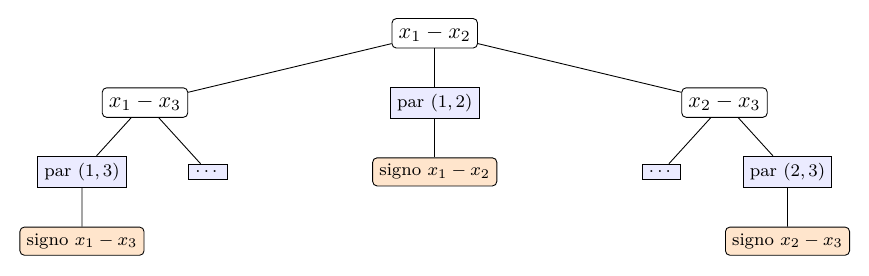
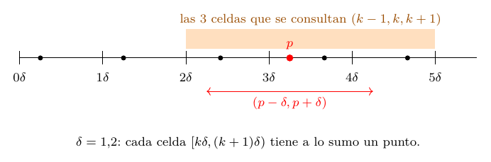

# Ejercicio 10: el par más cercano en una dimensión

## Enunciado

**Ejercicio 10 ($`\star\star`$; C2, C5).** Par más cercano en una dimensión. Demuestra $`\Omega(n\log n)`$ en árboles de decisión algebraicos por reducción desde distinción de elementos. Después di qué algoritmo de la conferencia 2 rompe la cota, en qué modelo, y adáptalo a una dimensión.

## Respuesta corta

- **Cota:** por el teorema de Ben-Or, distinción de elementos requiere $`\Omega(n\log n)`$ en árboles de decisión algebraicos. Un árbol de profundidad $`d`$ para el par más cercano da uno de profundidad $`d+1`$ para distinción (se añade, en cada hoja, una prueba de signo de $`x_i-x_j`$ sobre el par devuelto), luego el par más cercano requiere $`\Omega(n\log n)`$. Ordenar y mirar los consecutivos (C2 §3) lo alcanza: $`\Theta(n\log n)`$.

- **Quién la rompe:** el algoritmo incremental aleatorio con rejilla y tabla hash (Rabin; Kleinberg y Tardos, C2 §9), en el **word RAM con parte entera y tabla hash**, con costo **esperado** $`O(n)`$. No contradice la cota: no es el azar sino la parte entera y el direccionamiento indirecto (C2 §10; Grigoriev et al.).

- **En 1D:** celdas semiabiertas $`[k\delta,(k+1)\delta)`$, a lo sumo un punto por celda, **3** celdas vecinas por consulta (en 2D eran 25), reconstrucción cuando $`\delta`$ baja, y $`\delta=0`$ (un repetido) resuelto devolviendo $`0`$ al detectar la colisión. Reconstrucciones esperadas $`\le2H_n-3`$; costo esperado $`\le6n`$ accesos a la tabla. Medido hasta $`n=10^6`$.

Modelos: árboles de decisión algebraicos (la cota); word RAM con parte entera y tabla hash (el algoritmo).

## Problema y modelos

**Entrada:** $`n\ge2`$ reales $`x_1,\dots,x_n`$ (con repetidos permitidos). **Salida:** el par $`(i,j)`$, $`i\ne j`$, que minimiza $`|x_i-x_j|`$, y su distancia $`\delta^*`$. Es el problema de C2 §2 restringido a la recta.

**Modelo 1: árbol de decisión algebraico** (C2 §8). Un árbol donde cada nodo interno evalúa el signo de un polinomio de grado acotado en las coordenadas de la entrada y ramifica en tres según sea negativo, cero o positivo, y cada hoja da una respuesta. El costo es la profundidad. El modelo capta comparar, sumar, restar, multiplicar y medir distancias: ordenar es una sucesión de pruebas de signo de $`x_i-x_j`$ (grado $`1`$), y comparar dos distancias en 1D, $`|x_i-x_j|<|x_k-x_l|`$, es una prueba de signo de $`(x_i-x_j)^2-(x_k-x_l)^2`$ (grado $`2`$).

**Modelo 2: word RAM con parte entera y tabla hash.** Palabras de $`w`$ bits, operaciones de costo 1 sobre ellas, incluida la división entera exacta y el acceso indirecto a una tabla hash de costo esperado $`O(1)`$.



Un árbol de decisión algebraico para el par más cercano (figura en el estilo de la figura 8 de C2). Cada hoja da un par $`(i,j)`$. En naranja, lo que añade la reducción: una prueba de signo de $`x_i-x_j`$ sobre el par de esa hoja.

## La cota $`\Omega(n\log n)`$ por reducción

**Teorema 1** (Ben-Or, 1983; como se enuncia en C2 §8). *El problema de distinción de elementos (dados $`n`$ reales, decidir si hay dos iguales) requiere $`\Omega(n\log n)`$ en el modelo de árboles de decisión algebraicos.*

La demostración (que se cita y no se repite) acota el número de componentes conexas del conjunto de entradas que llevan a “todos distintos”, que son $`n!`$, por un teorema de Milnor y Thom: un árbol de profundidad $`d`$ (con polinomios de grado acotado) no puede separar más de $`2^{O(d+n)}`$ componentes, y como $`n!=2^{\Theta(n\log n)}`$, de ahí $`d=\Omega(n\log n)`$.

**Teorema 2**. *El par más cercano de $`n`$ reales requiere $`\Omega(n\log n)`$ en árboles de decisión algebraicos.*

*Demostración.* Por reducción desde distinción de elementos. *La transformación de entradas* es la identidad: una entrada $`x_1,\dots,x_n`$ de distinción de elementos es ya una entrada de par más cercano en 1D. (En el plano, C2 §8 usa $`x_i\mapsto(x_i,0)`$; en la recta ni eso hace falta.) Cuesta $`O(n)`$ como mucho y no prueba el signo de ningún polinomio. Ahora, $`\delta^*=0`$ si y solo si dos de los $`x_i`$ son iguales.

Supongamos un árbol algebraico $`T`$ para el par más cercano de profundidad $`d`$. Cada hoja de $`T`$ está etiquetada con un par $`(i,j)`$ (y su distancia $`|x_i-x_j|`$). *Qué se añade:* en cada hoja con par $`(i,j)`$ se agrega un nodo que prueba el signo del polinomio $`x_i-x_j`$: la rama $`=0`$ responde “hay repetidos” y las ramas $`<0`$ y $`>0`$ responden “todos distintos”. El árbol resultante es un árbol algebraico de profundidad $`d+1`$ (las pruebas añadidas son polinomios de grado $`1`$) y decide distinción de elementos: si el par devuelto está a distancia $`0`$ hay un repetido, y si el par más cercano está a distancia positiva, no hay ninguno. Por el teorema de Ben-Or, $`d+1=\Omega(n\log n)`$. ◻

**Qué devuelve el problema, y por qué da igual.** Si el problema devuelve el *par*, el nodo añadido prueba $`x_i-x_j`$. Si devuelve la *distancia* como valor, la etiqueta de la hoja es un polinomio $`p(x)`$ (la distancia es $`|x_i-x_j|`$ o el polinomio $`x_i-x_j`$ con su signo), y la prueba final es el signo de $`p`$: $`|p|=0\iff p=0`$. Si devuelve *ambos*, vale cualquiera. En los tres casos la reducción suma una sola prueba de signo.

**La cota se alcanza: ordenar y mirar los consecutivos (C2 §3).**

**Lema 1**. *Si $`x_1\le x_2\le\dots\le x_n`$, hay un par más cercano que es consecutivo.*

*Demostración.* Entre todos los pares más cercanos elijamos $`(x_i,x_j)`$, $`i<j`$, con $`j-i`$ mínimo, y supongamos $`j>i+1`$. Entonces $`x_i\le x_{i+1}\le x_j`$, luego $`x_{i+1}-x_i\le x_j-x_i`$: el par $`(x_i,x_{i+1})`$ es al menos tan cercano, y por tanto también un mínimo, con $`(i+1)-i<j-i`$. Contradice la minimalidad de $`j-i`$. Así que $`j=i+1`$. Con empates (varios pares igual de cercanos) lo que se prueba es que *uno* de los mínimos es consecutivo, que es lo que se pide. ◻

El algoritmo ordena en $`O(n\log n)`$ y recorre los $`n-1`$ pares consecutivos en $`O(n)`$. Todo son pruebas de signo de polinomios de grado $`\le1`$ (ordenar compara $`x_i-x_j`$; el recorrido compara $`(x_{i+1}-x_i)-(x_{j+1}-x_j)`$), así que es un árbol algebraico de profundidad $`O(n\log n)`$. Con la cota, el par más cercano en 1D cuesta $`\Theta(n\log n)`$ *en este modelo*.

## Quién rompe la cota, y en qué modelo

El algoritmo de C2 §9 (Rabin 1976; Kleinberg y Tardos, §13.7): permutar los puntos al azar, insertarlos de a uno manteniendo $`\delta`$, la distancia mínima entre los ya insertados, y una rejilla de celdas de lado proporcional a $`\delta`$ guardada en una tabla hash, que se reconstruye cuando $`\delta`$ baja. Tiene costo esperado $`O(n)`$.

**Modelo:** el word RAM con parte entera y tabla hash, costo *esperado* (sobre la permutación aleatoria, y sobre la función hash). **Por qué no contradice $`\Omega(n\log n)`$** (C2 §10): el algoritmo usa dos operaciones que un árbol de decisión algebraico no tiene.

- La *parte entera* $`\lfloor x/\delta\rfloor`$, que no es un polinomio ni es continua.

- El *direccionamiento indirecto*: usar el resultado como dirección en la tabla. Un árbol solo ramifica según el signo de un polinomio de la entrada.

Y *no es el azar*: Grigoriev, Karpinski, Meyer auf der Heide y Smolensky (1996) demostraron que distinción de elementos sigue requiriendo $`\Omega(n\log n)`$ en árboles algebraicos aleatorizados. El azar le sirve al algoritmo para que se esperen pocas reconstrucciones. Son dos modelos distintos y el segundo es estrictamente más poderoso para este problema (C2 §10).

## La adaptación a una dimensión

**Rejilla.**

Con $`\delta>0`$, la celda del punto $`p`$ es $`c(p)=\lfloor p/\delta\rfloor`$, es decir el intervalo *semiabierto* $`[k\delta,(k+1)\delta)`$ con $`k=c(p)`$. La tabla hash guarda a lo sumo un punto por clave $`k`$.

**Lema 2** (invariante). *Si $`\delta`$ es la distancia mínima entre los puntos insertados y $`\delta>0`$, cada celda contiene a lo sumo un punto insertado.*

*Demostración.* Dos puntos distintos en $`[k\delta,(k+1)\delta)`$ difieren en *menos* que $`\delta`$ (el intervalo es semiabierto: la diferencia es estrictamente menor que su largo). Pero cualesquiera dos puntos insertados están a distancia $`\ge\delta`$. Entonces no hay dos en la misma celda. ◻

**Cuidado con el borde.** Con intervalos *cerrados* $`[k\delta,(k+1)\delta]`$ el lema es falso: dos puntos a distancia *exactamente* $`\delta`$ pueden compartir celda en los extremos. La parte entera $`\lfloor p/\delta\rfloor`$ elige la celda semiabierta, y las progresiones aritméticas de paso $`\delta`$ (todos los puntos justo en bordes de celda) son el caso de prueba (sección 5). Además, la división $`\lfloor p/\delta\rfloor`$ tiene que ser *exacta*: con enteros (o racionales) lo es; con coma flotante, $`p/\delta`$ puede redondear un punto del borde a la celda vecina. El programa usa enteros y `Fraction`.

**Cuántas celdas hay que consultar: tres.**

**Lema 3**. *Si $`p`$ está en la celda $`k`$ y $`q`$ cumple $`|p-q|<\delta`$, entonces $`q`$ está en la celda $`k-1`$, $`k`$ o $`k+1`$.*

*Demostración.* $`p\in[k\delta,(k+1)\delta)`$, así que $`p-\delta\ge(k-1)\delta`$ y $`p+\delta<(k+2)\delta`$. Luego $`q\in(p-\delta,p+\delta)\subset((k-1)\delta,(k+2)\delta)`$, que está dentro de las celdas $`k-1`$, $`k`$ y $`k+1`$. ◻

Consultamos $`3`$ celdas, cada una con a lo sumo un punto (lema 2): $`3`$ accesos a la tabla, $`O(1)`$. En 2D con celdas de lado $`\delta/2`$ eran $`25`$ (C2 §9); en 1D, como la celda tiene largo $`\delta`$ y no $`\delta/2`$, bastan $`3`$. (Con celdas de largo $`\delta/2`$ harían falta $`5`$; con largo $`\delta`$ ya queda a lo sumo un punto por celda por el lema, y menos celdas.)



**El algoritmo.**

``` python
def par_rejilla(P, semilla=0):            # P: enteros o racionales; division exacta
    pts = list(P); random.Random(semilla).shuffle(pts)
    d = abs(pts[0] - pts[1]); par = (pts[0], pts[1])
    if d == 0: return 0, par              # repetido: no hay rejilla de lado 0
    rejilla = {pts[0] // d: pts[0], pts[1] // d: pts[1]}
    for i in range(2, len(pts)):
        p = pts[i]; k = p // d
        mejor, q_mejor = d, None
        for dk in (-1, 0, 1):             # 3 celdas
            q = rejilla.get(k + dk)
            if q is not None and abs(p - q) < mejor:
                mejor, q_mejor = abs(p - q), q
        if q_mejor is not None:           # delta baja
            if mejor == 0: return 0, (p, q_mejor)    # repetido: 0 es el minimo posible
            d, par = mejor, (p, q_mejor)
            rejilla = {x // d: x for x in pts[:i + 1]}    # reconstruir con lado d
        else:
            rejilla[k] = p
    return d, par
```

**El caso $`\delta=0`$.**

Es un borde de verdad: una rejilla de lado $`0`$ no existe ($`\lfloor p/0\rfloor`$ no está definido). Pero $`\delta=0`$ solo ocurre si hay dos puntos *iguales*, y 0 es la distancia mínima posible: no hay nada más que buscar. Se resuelve de forma explícita: si los dos primeros puntos son iguales, se devuelve $`0`$ antes de construir nada; y en el ciclo, si $`p`$ es igual a un punto insertado, ese punto está a distancia $`0<\delta`$ y cae en una de las $`3`$ celdas consultadas (en la misma celda), así que se detecta ($`\texttt{mejor}=0`$) y se devuelve $`0`$ de inmediato. Nunca se llega a una rejilla de lado $`0`$. Con $`\delta>0`$ no hay problema: los puntos distintos están a distancia positiva.

**Correctitud.**

Invariante $`J`$: tras insertar $`i`$ puntos, $`\delta`$ es la distancia mínima entre ellos, `par` es un par que la alcanza, y la tabla contiene los $`i`$ puntos con lado $`\delta`$ (si $`\delta>0`$). *Inicialización:* con los dos primeros puntos es inmediato. *Mantenimiento:* sea $`p`$ el nuevo punto. La distancia mínima entre los $`i+1`$ puntos es $`\min(\delta,\min_q|p-q|)`$. Si algún $`q`$ está a distancia $`<\delta`$, por el lema 3 está en una de las $`3`$ celdas consultadas y, por el lema 2, esa celda guarda a lo sumo un punto: lo encontramos y `mejor` es el mínimo entre los consultados. Si $`\mathtt{mejor}<\delta`$ el nuevo $`\delta`$ es correcto y se reconstruye la tabla, y como el nuevo $`\delta`$ es la distancia mínima de los $`i+1`$ puntos, el lema 2 garantiza que no hay colisiones; si no, $`\delta`$ no cambia y se inserta $`p`$ en su celda (vacía, por la misma razón). *Conclusión:* al terminar, $`\delta`$ es la distancia mínima de los $`n`$ puntos.

**Costo esperado: el análisis hacia atrás.**

Cada inserción hace $`3`$ búsquedas y, si no reconstruye, $`1`$ inserción: $`O(1)`$. Una reconstrucción en el paso $`i`$ cuesta $`\Theta(i)`$. Todo depende de cuántas haya.

Fijemos el *conjunto* $`S_i`$ de los primeros $`i`$ puntos y olvidemos el orden. La inserción del $`i`$-ésimo reconstruye solo si $`\delta`$ bajó, es decir si $`\delta_i<\delta_{i-1}`$. Esto exige que $`p_i`$ pertenezca a *todo* par más cercano de $`S_i`$: si hubiera un par más cercano de $`S_i`$ sin $`p_i`$, ese par estaría en $`S_{i-1}`$ y $`\delta_{i-1}\le\delta_i`$. Un par más cercano tiene dos puntos, así que a lo sumo dos puntos de $`S_i`$ cumplen eso. Como el orden de inserción es una permutación uniforme, condicionado a $`S_i`$ el punto $`p_i`$ es uniforme entre los $`i`$ de $`S_i`$:
``` math
\Pr[\text{reconstruir en el paso }i]\le\frac2i .
```
(No hace falta que el par más cercano sea único.) Por linealidad de la esperanza, el costo esperado es
``` math
\sum_{i=3}^{n}\left(O(1)+\frac2i\cdot\Theta(i)\right)=O(n),
\qquad
  \mathbb E[\#\text{reconstrucciones}]\le\sum_{i=3}^{n}\frac2i=2H_n-3 .
```
Contando accesos a la tabla: $`3(n-2)`$ búsquedas, a lo sumo $`n`$ inserciones y, en esperanza, a lo sumo $`\sum_i\frac2i\cdot i=2(n-2)`$ inserciones de reconstrucción: en total $`\le6n`$ accesos esperados. (Supone una tabla hash de costo esperado $`O(1)`$ por operación, como una con función hash universal.)

## Comprobación experimental

Código: `ej10_par_1d.py`. Cuenta accesos a la tabla (búsquedas, inserciones y reinserciones en reconstrucciones) y reconstrucciones, con aritmética exacta (enteros y `Fraction`). Salida real:

<details>
<summary><code>ej10_salida.txt</code></summary>

```text
=== 1. Correctitud contra fuerza bruta: enteros, con muchos repetidos y bordes ===
  20000 instancias (n 2..60, rangos de 3 a 10^9 con repetidos, negativos): rejilla == fuerza bruta == ordenar+recorrer; 11730 con repetidos
  bordes: P = [0, 5, 10, 15, 20, 25]: 50 permutaciones, distancia 5 correcta: True
  bordes: P = [0, 7, 14, 21, 28, 35, 42]: 50 permutaciones, distancia 7 correcta: True
  bordes: P = [0, 5, 10, 15, 20, 26]: 50 permutaciones, distancia 5 correcta: True
  bordes: P = [1, 2]: 50 permutaciones, distancia 1 correcta: True
  bordes: P = [4, 4]: 50 permutaciones, distancia 0 correcta: True
  bordes: P = [0, 100, 101]: 50 permutaciones, distancia 1 correcta: True
  3000 instancias con racionales (Fraction): correcto; la division por d es exacta, sin errores de redondeo
  400 progresiones aritmeticas (todas las distancias iguales a delta, puntos justo en los bordes de celda): correcto

=== 2. El caso delta = 0 (repetidos): se devuelve 0 al detectar la colision ===
  P=[3, 3, 9, 12]                        semilla 0: distancia 0, par (3, 3), busquedas 3, reconstrucciones 0
  P=[3, 3, 9, 12]                        semilla 1: distancia 0, par (3, 3), busquedas 6, reconstrucciones 1
  P=[9, 12, 3, 3]                        semilla 0: distancia 0, par (3, 3), busquedas 6, reconstrucciones 1
  P=[9, 12, 3, 3]                        semilla 1: distancia 0, par (3, 3), busquedas 3, reconstrucciones 0
  P=[1, 5, 9, 13, 5]                     semilla 0: distancia 0, par (5, 5), busquedas 6, reconstrucciones 0
  P=[1, 5, 9, 13, 5]                     semilla 1: distancia 0, par (5, 5), busquedas 9, reconstrucciones 0
  P=[0, 1, 2, 3, 4, 5, 6, 7, 8, 9, 10,   semilla 0: distancia 0, par (57, 57), busquedas 99, reconstrucciones 3
  P=[0, 1, 2, 3, 4, 5, 6, 7, 8, 9, 10,   semilla 1: distancia 0, par (57, 57), busquedas 276, reconstrucciones 3
  sin repetidos delta > 0 siempre (distancia positiva entre enteros distintos); con repetidos no se construye lado 0:
  delta = 0 solo se alcanza con un par igual, y el algoritmo termina ahi.

=== 3. Operaciones contra n: rejilla (accesos a la tabla) contra ordenar (comparaciones) ===
         n  accesos tabla  por punto  reconstr.  2H_n - 3  compar. ordenar     n log2 n  t rejilla  t sorted
      1000           5868       5.87       11.8      12.0             8672         9966      0.00s     0.00s
     10000          61581       6.16       17.2      16.6           120176       132877      0.01s     0.00s
    100000         572829       5.73       20.4      21.2          1531973      1660964      0.06s     0.02s
   1000000        5512936       5.51       17.0      25.8         18626522     19931569      1.20s     0.28s
  (acceso de tabla = busqueda + insercion + insercion durante reconstruccion; el orden de ordenar es n log2 n)

=== 4. Reconstrucciones: media sobre muchas permutaciones contra la cota 2 H_n - 3 ===
       n  permutaciones   media  maximo  2H_n - 3
      10           4000    2.84       8      2.86
     100           4000    7.28      18      7.37
    1000           1000   11.72      23     11.97

=== 5. Sin el azar: un orden adversarial fuerza una reconstruccion por insercion ===
  n=200: orden adversarial: 198 reconstrucciones, 20097 inserciones en reconstrucciones (~ n^2/2 = 20000);  barajado: 11 reconstrucciones, 670 inserciones
  n=800: orden adversarial: 798 reconstrucciones, 320397 inserciones en reconstrucciones (~ n^2/2 = 320000);  barajado: 12 reconstrucciones, 1288 inserciones

=== 6. Otra salida del modelo: radix sort sobre enteros de rango acotado ===
         n        U = n^2  ops radix (2 pasadas + recorrido)  por punto     n log2 n
      1000        1000000                               8999       9.00         9966
     10000      100000000                              89999       9.00       132877
    100000    10000000000                             899999       9.00      1660964
   1000000  1000000000000                            8999999       9.00     19931569
  2000 instancias pequenas (con repetidos): radix + recorrido == fuerza bruta
```

</details>

**Qué se ve.**

\(1\) La rejilla coincide con la fuerza bruta y con ordenar$`+`$recorrer en $`20\,000`$ instancias con muchos repetidos, y en $`3000`$ con racionales y $`400`$ progresiones aritméticas (puntos exactamente en los bordes de celda). (2) Con repetidos devuelve $`0`$ sin construir una rejilla de lado $`0`$. (3) Los accesos a la tabla son $`\approx5{,}5`$ a $`6{,}2`$ por punto, constantes en $`n`$ y alrededor de la cota esperada de $`6`$ (es una esperanza, y la media de unas pocas permutaciones fluctúa), mientras que ordenar hace $`\approx n\log_2n`$ comparaciones: $`18{,}6\cdot10^6`$ contra $`5{,}5\cdot10^6`$ accesos para $`n=10^6`$. Es una comparación de operaciones y no de tiempos: en Python, `sorted` es código en C y la rejilla es código interpretado, así que con $`n=10^6`$ el tiempo de reloj es *menor* con `sorted` ($`0{,}28`$ s contra $`1{,}2`$ s); el crecimiento asintótico es otra cosa. (4) Las reconstrucciones medias coinciden con $`2H_n-3`$ ($`2{,}84`$ contra $`2{,}86`$ para $`n=10`$; $`11{,}72`$ contra $`11{,}97`$ para $`n=1000`$, sobre miles de permutaciones). (5) Sin el azar, con los puntos $`2^{n-1},\dots,2,1`$ insertados en ese orden, *cada* inserción baja $`\delta`$: $`n-2`$ reconstrucciones y $`\approx n^2/2`$ reinserciones ($`198`$ y $`20\,097`$ para $`n=200`$), contra $`11`$ y $`670`$ al barajar. El azar no saca al algoritmo del modelo, pero es lo que acota las reconstrucciones.

**Casos elegidos.**

*Bordes:* dos puntos, dos puntos iguales, un repetido al final, progresiones aritméticas con distancias todas iguales a $`\delta`$ (puntos exactamente en los bordes de celda), el mínimo en las celdas $`k\pm1`$. *Típicos:* puntos aleatorios en rangos de $`3`$ a $`10^{12}`$. *Adversarial:* el orden creciente de cercanía, que dispara una reconstrucción por paso.

## Algo más fino

**Otra salida del modelo: el radix sort.**

En 1D hay otra forma de romper la cota, sin tabla hash y de forma determinista. Si los $`x_i`$ son enteros en $`[0,U)`$, un *radix sort* de $`c`$ pasadas con base $`b=\lceil U^{1/c}\rceil`$ ordena en $`O(c\,(n+b))`$ usando los *valores como índices* de un arreglo de contadores, y el recorrido de consecutivos (el lema) termina en $`O(n)`$. Con $`U=n^2`$ y base $`\sqrt U=n`$ son $`2`$ pasadas: $`9n-1`$ operaciones sobre arreglos, que el programa mide ($`9{,}00`$ por punto para $`n=10^3,\dots,10^6`$, contra $`n\log_2n`$ comparaciones). Es la misma lección del tema 1 (§3): *comparaciones contra conteo*. Ordenar por comparaciones cuesta $`\Omega(n\log n)`$, y el ordenamiento por conteo usa los valores como índices y baja a $`O(n)`$ para enteros de rango $`\mathrm{poly}(n)`$. Lo que rompe la cota es, otra vez, *usar el valor como dirección*, no el azar. Aquí cambia también el *dominio de entrada*, no solo el modelo: Ben-Or habla de entradas reales, y el radix exige enteros en $`[0,U)`$. La comparación es entonces *otro modelo y otro problema* (enteros acotados frente a reales), igual que el conteo frente a ordenar por comparaciones en el resumen del tema (§3). El modelo es el word RAM con enteros de rango acotado (palabras de $`\Omega(\log U)`$ bits).

**En 1D el orden ya resuelve la geometría; qué aporta la rejilla.**

C2 §3: “en la recta hay un orden total, y ese orden tiene una propiedad geométrica: si dos números están cerca, entonces están cerca en el orden”. Por eso en 1D ordenar basta, y por eso la rejilla parece innecesaria. Lo que aporta es que *no necesita el orden completo*: la celda $`\lfloor x/\delta\rfloor`$ es un orden *grueso* (un cubo) y la rejilla verifica solo lo local, con $`3`$ consultas. Es lo que se generaliza al plano, donde no existe un orden total con esa propiedad geométrica (C2 §3) y ordenar no sirve, pero la rejilla de celdas cuadradas sí. La versión 1D es el caso en que todo se ve, y el ejercicio es el laboratorio donde las tres herramientas (ordenar, rejilla con hash, radix) se pueden comparar sobre el mismo problema.

## Por qué este enfoque

**Una analogía.**

Ordenar es alinear a todos los invitados por estatura para encontrar a los dos más parecidos. La rejilla es repartirlos en casillas de ancho $`\delta`$ y mirar solo la casilla propia y las dos vecinas: nadie se alinea, y cada vez que aparece una pareja más parecida, las casillas se achican y se vuelve a repartir. La cota $`\Omega(n\log n)`$ es la imposibilidad de averiguar el orden sin hacer comparaciones; la rejilla evita comparar porque *mira dónde está parado cada uno*.

**Otra visión.**

La reducción es una forma de ver la cota: encontrar el par más cercano *contiene* la pregunta “¿hay repetidos?”, que a su vez contiene $`n!`$ componentes conexas que un árbol tiene que separar. El algoritmo con rejilla no separa componentes por comparaciones; las separa con la parte entera.

## Conclusión

- **Cota:** $`\Omega(n\log n)`$ en árboles de decisión algebraicos por reducción desde distinción de elementos (identidad $`+`$ una prueba de signo de $`x_i-x_j`$ en cada hoja); $`\Theta(n\log n)`$ con ordenar y recorrer los consecutivos.

- **La rompe:** la rejilla con tabla hash, en el word RAM con parte entera y direccionamiento indirecto, costo esperado $`O(n)`$; no contradice la cota porque es otro modelo (C2 §10); no es el azar (Grigoriev et al.).

- **En 1D:** celdas semiabiertas de largo $`\delta`$, a lo sumo un punto por celda, $`3`$ consultas, reconstrucción al bajar $`\delta`$; $`\delta=0`$ se resuelve devolviendo $`0`$ al detectar el repetido; reconstrucciones esperadas $`\le2H_n-3`$, costo esperado $`\le6n`$ accesos a la tabla (medidos $`5{,}5`$ a $`6{,}2`$ por punto).

- **También rompe la cota:** el radix sort con enteros de rango acotado, otra instancia de comparaciones contra conteo.
