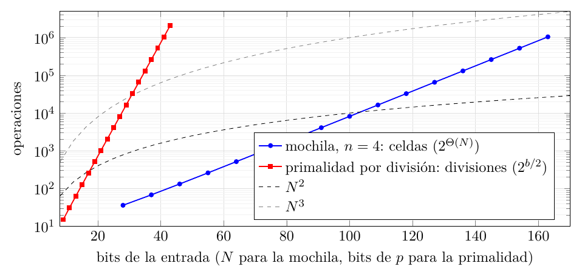

# Ejercicio 11: la mochila, $`O(nW)`$ y el tamaño de la entrada en bits

## Enunciado

**Ejercicio 11 ($`\star\star`$; C1).** La mochila entera se resuelve con programación dinámica en $`O(nW)`$, donde $`W`$ es la capacidad (lo vieron en Estructuras de Datos). Mide el tamaño de la entrada en bits, como en la sección 8 de la conferencia 1. ¿Es polinomial ese algoritmo? ¿En qué se parece a la primalidad por división?

## Respuesta corta

- **No es polinomial.** Escribir $`W`$ en binario ocupa $`\lceil\log_2(W+1)\rceil`$ bits. Con $`n`$ fijo y $`W=2^k`$, el tamaño de la entrada es $`N=\Theta(k)`$ y el algoritmo hace $`nW=\Theta(2^k)=2^{\Theta(N)}`$ operaciones: exponencial en el tamaño. Es **pseudopolinomial** (C1 §8): polinomial en el *valor* $`W`$, no en sus bits.

- **Cuándo sí es polinomial:** si $`W\le\mathrm{poly}(n)`$, o si los pesos están acotados por $`\mathrm{poly}(n)`$, o si los números se escriben en unario.

- **Parecido con la primalidad por división:** en los dos el costo es polinomial en el valor de un número de la entrada ($`\sqrt p`$ divisiones, $`nW`$ celdas) y exponencial en sus bits ($`2^{b/2}`$, $`2^{b}`$). **Diferencia:** la primalidad está en P (Agrawal, Kayal y Saxena); para la mochila no se conoce un algoritmo polinomial en el tamaño (es NP-difícil, un hecho que se verá en el curso).

- **Medido:** con $`n=4`$, pasar de $`k`$ a $`k+1`$ bits en cada número duplica el costo ($`36,68,132,\dots`$ celdas); la primalidad por división multiplica por $`\sqrt2`$ por cada bit de $`p`$.

Modelo: word RAM; el tamaño de la entrada es el número de bits.

## El problema y la programación dinámica

**Problema (mochila 0/1).** $`n`$ objetos con pesos $`w_i`$ y valores $`v_i`$ enteros positivos, y una capacidad $`W`$ entera. Elegir un subconjunto $`S\subseteq\{1,\dots,n\}`$ con $`\sum_{i\in S}w_i\le W`$ que maximice $`\sum_{i\in S}v_i`$. Cada objeto se usa a lo sumo una vez.

**Tabla.**

$`T[i][c]`$ es el mejor valor que se puede obtener con los *primeros $`i`$ objetos* y capacidad $`c`$, para $`0\le i\le n`$ y $`0\le c\le W`$.
``` math
T[0][c]=0,\qquad
  T[i][c]=\begin{cases}T[i-1][c] & \text{si }w_i>c,\\ \max\bigl(T[i-1][c],\;T[i-1][c-w_i]+v_i\bigr) & \text{si }w_i\le c.\end{cases}
```
La respuesta es $`T[n][W]`$.

**Lema 1**. *Para todo $`i`$ y $`c`$, $`T[i][c]`$ es el máximo de $`\sum_{j\in S}v_j`$ sobre los $`S\subseteq\{1,\dots,i\}`$ con $`\sum_{j\in S}w_j\le c`$.*

*Demostración.* Por inducción sobre $`i`$. Para $`i=0`$ el único subconjunto es el vacío, de valor $`0`$. Sea $`i\ge1`$ y supongamos el resultado para $`i-1`$. Un subconjunto óptimo $`S`$ de los primeros $`i`$ objetos, con capacidad $`c`$, o no contiene al objeto $`i`$, y entonces es un subconjunto de los primeros $`i-1`$ con capacidad $`c`$: su valor óptimo es $`T[i-1][c]`$ por hipótesis; o lo contiene, y entonces $`w_i\le c`$ y $`S\setminus\{i\}`$ es un subconjunto de los primeros $`i-1`$ con peso $`\le c-w_i`$, de valor óptimo $`T[i-1][c-w_i]`$ por hipótesis, y $`S`$ vale eso más $`v_i`$. El máximo de los dos casos es la recurrencia. ◻

**Costo.**

La tabla tiene $`(n+1)(W+1)`$ celdas y cada una se calcula con $`O(1)`$ operaciones: tiempo y memoria $`\Theta(nW)`$. Como la fila $`i`$ solo depende de la fila $`i-1`$, basta *una* fila de $`W+1`$ celdas, con memoria $`O(W)`$:

``` python
def mochila(w, v, W):
    T = [0] * (W + 1)
    for wi, vi in zip(w, v):
        for c in range(W, wi - 1, -1):          # c DESCENDENTE
            T[c] = max(T[c], T[c - wi] + vi)
    return T[W]
```

**Por qué $`c`$ baja.** Al calcular $`T[c]`$ de la fila $`i`$, hace falta $`T[c-wi]`$ de la fila $`i-1`$. Recorriendo $`c`$ hacia abajo, $`c-w_i<c`$ todavía no se actualizó en esta pasada y sigue siendo de la fila $`i-1`$. Recorriendo hacia arriba, $`T[c-wi]`$ ya es de la fila $`i`$ y el objeto se podría usar varias veces: eso resuelve la mochila con repetición. La salida 2 lo muestra: con un objeto de peso $`2`$ y valor $`3`$ y $`W=4`$, el descendente da $`3`$ (correcto) y el ascendente da $`6`$ (usa el objeto dos veces); el ascendente falla en el $`79{,}1`$ % de $`3000`$ instancias y coincide con la mochila con repetición en todas.

## El tamaño de la entrada en bits

La entrada son $`n`$ pesos, $`n`$ valores y $`W`$, escritos en binario:
``` math
N=\sum_{i=1}^n\bigl(\lceil\log_2(w_i+1)\rceil+\lceil\log_2(v_i+1)\rceil\bigr)+\lceil\log_2(W+1)\rceil\;=\;\Theta\Bigl(\sum_i(\log w_i+\log v_i)+\log W\Bigr)
```
(más $`O(n)`$ separadores). El algoritmo hace $`\Theta(nW)`$ operaciones, pero $`W`$ es el *valor* de un número de la entrada; su tamaño es $`\log_2W`$.

**Una familia explícita.**

$`F_k`$: $`n=4`$ fijo; pesos y valores de exactamente $`k`$ bits (con el bit más alto en $`1`$); capacidad $`W=2^k`$. Cada peso y cada valor ocupa $`k`$ bits y $`W`$ ocupa $`k+1`$:
``` math
N(F_k)=2\cdot4\cdot k+(k+1)=9k+1=\Theta(k),\qquad
  nW=4\cdot2^k=2^{\Theta(N)} .
```
(Los pesos son cercanos a $`W`$, de modo que recortar $`W`$ a $`\sum w_i`$ no ayuda.)

**Teorema 1**. *Ninguna potencia fija de $`N`$ acota el costo $`n(W+1)`$ del algoritmo en la familia $`F_k`$: para todo $`c`$ existe $`k_0`$ tal que para $`k\ge k_0`$, $`4(2^k+1)>(9k+1)^c`$.*

*Demostración.* $`(9k+1)^c=2^{c\log_2(9k+1)}=2^{o(k)}`$, porque $`\log_2(9k+1)=o(k)`$ para todo $`c`$ fijo, mientras que $`4(2^k+1)>2^k`$. Entonces $`2^k`$ supera a $`(9k+1)^c`$ para $`k`$ grande. Y “polinomial” significa $`\le a\,N^c+b`$ con constantes $`a,b`$: la constante no salva nada, porque $`a\,N^c+b\le N^{c+1}`$ para $`N`$ grande, así que ninguna cota polinomial vale en $`F_k`$. ◻

Los umbrales concretos (salida 4, con las fórmulas exactas): la tabla supera $`N^2`$ desde $`k=12`$ ($`N=109`$), $`N^3`$ desde $`k=21`$ ($`N=190`$), $`N^5`$ desde $`k=41`$ y $`N^{10}`$ desde $`k=96`$. Cada bit más de $`W`$ (y de los demás números) *duplica* el costo.

**Conclusión.**

El algoritmo es *pseudopolinomial* en el sentido de C1 §8: su costo es polinomial en el valor de un número de la entrada ($`W`$) pero no en su cantidad de bits. Como función del tamaño $`N`$ es exponencial.

**En qué caso sí es polinomial.**

- **$`W\le\mathrm{poly}(n)`$:** entonces $`nW\le\mathrm{poly}(n)\le\mathrm{poly}(N)`$, porque $`N\ge n`$.

- **Pesos acotados por un polinomio en $`n`$:** una capacidad mayor que $`\sum_iw_i`$ no sirve de nada (cabe todo), así que se reemplaza $`W`$ por $`\min(W,\sum_iw_i)\le n\max_iw_i`$ y el costo es $`\le n^2\max_iw_i=\mathrm{poly}(n)`$.

- **Números en unario:** si $`W`$ se escribe con $`W`$ símbolos, la entrada mide $`N'\ge W+n`$ y $`n(W+1)\le n\,N'`$ es lineal en $`N'`$ (salida 6).

Lo que no hace falta es que el algoritmo sea lento: es lento *en función de cómo se mide la entrada*.

## El paralelo con la primalidad por división

En C1 §8, probar los divisores $`2,\dots,\lfloor\sqrt p\rfloor`$ hace $`\lfloor\sqrt p\rfloor-1`$ divisiones, que son $`\Theta(\sqrt p)`$ en el *valor* $`p`$ y $`\Theta(2^{b/2})`$ en los $`b`$ bits. Es la misma estructura que la mochila:

| problema | parámetro numérico | costo en el valor | costo en los bits $`b`$ del parámetro | entrada en *unario* | entrada en *binario* |
|:---|:---|:---|:---|:---|:---|
| primalidad por división | el número $`p`$ | $`\Theta(\sqrt p)`$ divisiones | $`\Theta(2^{b/2})`$ | $`\Theta(\sqrt{N'})`$: polinomial | exponencial en $`N=b`$ |
| mochila por tabla | la capacidad $`W`$ | $`\Theta(nW)`$ celdas | $`\Theta(n\,2^{b})`$ | $`\le n\,N'`$: polinomial | exponencial en $`N\ge b`$ |

En los dos casos el bucle “hasta $`p`$” o “hasta $`W`$” parece una sola vuelta lineal, y deja de serlo cuando se mide lo que ocupa el número: $`b=\log_2`$ del valor.

**La diferencia.**

La primalidad *está en P*: Agrawal, Kayal y Saxena (2002) dieron un algoritmo determinista polinomial en $`b`$, y Miller y Rabin uno aleatorio, como cita C1 §8. La división de prueba es un mal algoritmo para un problema fácil. Para la mochila *no se conoce* un algoritmo polinomial en el tamaño $`N`$: la versión de decisión de la mochila es NP-completa, un hecho conocido que se verá en el Tema 3 del curso (reducciones a secuencias y números), y no lo demuestro aquí. Un algoritmo polinomial en $`N`$ para la mochila daría P$`=`$NP. Por eso la tabla de $`O(nW)`$ es “el ejemplo clásico” de C1 §8 y “va a ser importante en el Tema 3”: aquí el pseudopolinomial es lo mejor que se sabe.

## Comprobación experimental

Código: `ej11_mochila.py`. Cuenta las celdas evaluadas por la tabla. Salida real:

<details>
<summary><code>ej11_salida.txt</code></summary>

```text
=== 1. Correctitud: la tabla contra fuerza bruta, e invariante T[i][c] vigilado ===
  3000 instancias (n<=9): tabla == una fila == fuerza bruta; invariante comprobado en 370707 celdas T[i][c]

=== 2. Por que c va hacia abajo: con c ascendente el objeto se puede usar varias veces ===
  un objeto de peso 2 y valor 3, W=4: descendente -> 3 (correcto: 3); ascendente -> 6 (usa el objeto 2 veces)
  3000 instancias: el ascendente falla en 2373 (79.1 %), y coincide con la mochila con repeticion en 3000 de 3000

=== 3. El costo: n (W + 1) celdas, y la memoria; con una fila O(W) ===
  n= 4, W= 1000: tabla 4004 celdas evaluadas = n(W+1) = 4004, memoria 5005 celdas; una fila: 1001 celdas, 3957 actualizaciones
  n=10, W= 5000: tabla 50010 celdas evaluadas = n(W+1) = 50010, memoria 55011 celdas; una fila: 5001 celdas, 49729 actualizaciones
  n=50, W= 2000: tabla 100050 celdas evaluadas = n(W+1) = 100050, memoria 102051 celdas; una fila: 2001 celdas, 98710 actualizaciones

=== 4. Tamano de la entrada en bits y la familia que no es polinomial en N ===
  Familia F_k: n = 4 fijo, pesos y valores de k bits (con el bit alto en 1), W = 2^k.
    k  N (bits)          n W  celdas evaluadas  celdas/2^k      N^2       N^3
    3        28           32                36        4.50      784     21952
    4        37           64                68        4.25     1369     50653
    5        46          128               132        4.12     2116     97336
    6        55          256               260        4.06     3025    166375
    7        64          512               516        4.03     4096    262144
    8        73         1024              1028        4.02     5329    389017
    9        82         2048              2052        4.01     6724    551368
   10        91         4096              4100        4.00     8281    753571
   11       100         8192              8196        4.00    10000   1000000
   12       109        16384             16388        4.00    11881   1295029
   13       118        32768             32772        4.00    13924   1643032
   14       127        65536             65540        4.00    16129   2048383
   15       136       131072            131076        4.00    18496   2515456
   16       145       262144            262148        4.00    21025   3048625
   17       154       524288            524292        4.00    23716   3652264
   18       163      1048576           1048580        4.00    26569   4330747
  Cada bit mas de W (y de los demas numeros) duplica las celdas: costo = 2^{Theta(N)} para n fijo.
  Como cada numero tiene exactamente k bits, N = 2nk + (k+1) = 9k+1 con n = 4, y las celdas son n(2^k+1) (verificado arriba hasta k = 18).
  Primer k donde la tabla supera N^c (con esas formulas exactas):
    N^2 : desde k =  12  (N = 109)
    N^3 : desde k =  21  (N = 190)
    N^5 : desde k =  41  (N = 370)
    N^10: desde k =  96  (N = 865)
  Ninguna potencia fija de N acota n(2^k+1) cuando k crece: para toda potencia hay un k a partir del cual la tabla es mayor.

=== 5. La primalidad por division (C1 sec. 8): divisiones contra bits ===
  bits de p              primo p  divisiones     sqrt(p)  divisiones/sqrt(p)
          9                  257          15          16              0.9375
         11                 1031          31          32              0.9688
         13                 4099          63          64              0.9844
         15                16411         127         128              0.9922
         17                65537         255         256              0.9961
         19               262147         511         512              0.9980
         21              1048583        1023        1024              0.9990
         23              4194319        2047        2048              0.9995
         25             16777259        4095        4096              0.9998
         27             67108879        8191        8192              0.9999
         29            268435459       16383       16384              0.9999
         31           1073741827       32767       32768              1.0000
         33           4294967311       65535       65536              1.0000
         35          17179869209      131071      131072              1.0000
         37          68719476767      262143      262144              1.0000
         39         274877906951      524287      524288              1.0000
         41        1099511627791     1048575     1048576              1.0000
         43        4398046511119     2097151     2097152              1.0000
  Cada 2 bits mas multiplican las divisiones por 2 (cada bit, por raiz de 2): ~2^{b/2}, exponencial en los bits.

=== 6. El mismo bucle, en unario: polinomial ===
  Con W escrito en unario (W simbolos) la entrada mide N' >= W + n, y n(W+1) <= n N': lineal en N'.
    W=   10: N' >= 14 simbolos, celdas = 44 <= n*N' = 56
    W=  100: N' >= 104 simbolos, celdas = 404 <= n*N' = 416
    W= 1000: N' >= 1004 simbolos, celdas = 4004 <= n*N' = 4016

=== 7. Cambiar de unidades: la misma instancia en gramos y en miligramos ===
     unidad          W  N (bits)       celdas  celdas/base  bits extra  mejor valor
      x10^0        800        86         4005          1.0           0  440
      x10^1       8000       106        40005         10.0          20  440
      x10^2      80000       127       400005         99.9          41  440
      x10^3     800000       146      4000005        998.8          60  440
      x10^4    8000000       166     40000005       9987.5          80  (no se corre; celdas = n(W+1))
      x10^5   80000000       187    400000005      99875.2         101  (no se corre; celdas = n(W+1))
  Multiplicar los pesos y la capacidad (6 numeros) por 10 agrega ~3,3 bits a cada uno: ~20 bits en total por cada factor 10,
  pero multiplica por 10 el costo. Un algoritmo cuyo costo depende de la unidad elegida no es polinomial en el tamano.

=== 8. Otra pseudopolinomial: la tabla por valores, O(n V) con V = suma de valores ===
  2000 instancias: la tabla por valores == la tabla por peso
  pesos chicos, capacidad W = 10^6: tabla por peso: 5999936 actualizaciones; tabla por valores con V = 70: 356 (mucho menos)
  valores grandes (x10^6, V = 70000000), W = 1000: por peso 5936 actualizaciones, por valores 350000006 (mucho mas)
  Cada una es pseudopolinomial en SU parametro: elegir bien depende de cual es chico.

=== 9. La idea del esquema de aproximacion: escalar los valores (solo como idea) ===
  300 instancias con valores hasta 10^9, eps = 0.1: valor de la solucion escalada / optimo >= 0.9949 (garantia: >= 0.9)
  Con los valores escalados V' = O(n^2/eps), la tabla por valores cuesta O(n^3/eps): polinomial en n y 1/eps.
```

</details>



Escala logarítmica en las ordenadas: una exponencial es una recta, y un polinomio se curva hacia abajo. Las dos son rectas (exponenciales). En la mochila (azul), pasar de $`k`$ a $`k+1`$ duplica el costo, pero agrega $`9`$ bits a $`N`$ (a los cuatro pesos, los cuatro valores y $`W`$): $`\times2^{1/9}\approx1{,}08`$ por bit de $`N`$. En la primalidad (roja) cada bit pertenece al único número que cuenta, y multiplica por $`\sqrt2\approx1{,}41`$; por eso la roja es más empinada en este eje. Las dos terminan por pasar a las curvas polinomiales. La curva de la mochila cruza a $`N^2`$ en $`N\approx109`$; cruza a $`N^3`$ en $`N=190`$, ya fuera del rango medido (es la cuenta de la salida 4).

**Casos elegidos.**

*Corrección:* $`3000`$ instancias contra fuerza bruta, con el invariante $`T[i][c]`$ comprobado en $`370\,707`$ celdas. *Bordes:* $`W=0`$, un objeto, el que no cabe. *Adversarial para la demostración:* el recorrido ascendente (sección 4, salida 2); y para el costo, la familia $`F_k`$ con pesos cercanos a $`W`$ (el recorte $`W\mapsto\sum w_i`$ no la simplifica).

## Algo más fino

**Un ejemplo inventado: cambiar de unidades.**

La misma instancia, con pesos $`120`$, $`200`$, $`310`$, $`450`$ y $`95`$ gramos y capacidad $`800`$ gramos, expresada en miligramos tiene capacidad $`800\,000`$. La respuesta (el mejor valor, $`440`$) es la misma. El tamaño de la entrada pasa de $`86`$ a $`146`$ bits (cada factor $`10`$ agrega $`\approx3{,}3`$ bits a cada uno de los $`6`$ números que cambian), pero la tabla pasa de $`4005`$ a $`4\,000\,005`$ celdas: $`\times1000`$ (salida 7). Un algoritmo cuyo costo depende de la *unidad* en que se miden los pesos no puede ser polinomial en el tamaño de la entrada. Por eso “un bucle hasta $`W`$” parece lineal y no lo es: $`W`$ es una cantidad que se mide en las unidades que uno elige, y cada unidad más fina multiplica el bucle.

**La tabla por valores: otro parámetro pseudopolinomial.**

Hay una segunda programación dinámica: $`P[u]`$ es el *peso mínimo* con el que se alcanza valor exactamente $`u`$, para $`u=0,\dots,V`$ con $`V=\sum_iv_i`$; la respuesta es el mayor $`u`$ con $`P[u]\le W`$. Cuesta $`O(nV)`$ y es pseudopolinomial en $`V`$. La salida 8 verifica que da lo mismo en $`2000`$ instancias y muestra que cuál conviene depende de qué parámetro es chico: con pesos chicos y $`W=10^6`$, la tabla por peso hace $`5\,999\,936`$ actualizaciones y la de valores ($`V=70`$) solo $`356`$; con valores multiplicados por $`10^6`$ y $`W=1000`$, ocurre al revés ($`5936`$ contra $`350\,000\,006`$). Cada una es polinomial en *su* parámetro numérico y exponencial en sus bits.

**La idea del esquema de aproximación (solo como idea).**

Si los valores son enormes pero se aceptan errores, se pueden *escalar*: con $`\mu=\varepsilon v_{\max}/n`$ y $`v_i'=\lfloor v_i/\mu\rfloor`$, el nuevo $`V'=O(n^2/\varepsilon)`$ es chico, y la tabla por valores cuesta $`O(n\cdot V')=O(n^3/\varepsilon)`$, polinomial en $`n`$ y $`1/\varepsilon`$. Pierde poco: si $`S'`$ es óptimo con valores escalados y $`O`$ es el óptimo, $`v(S')\ge\mu\sum_{S'}v_i'\ge\mu\sum_Ov_i'\ge v(O)-n\mu=v(O)-\varepsilon v_{\max}\ge(1-\varepsilon)\,v(O)`$, porque $`v_{\max}\le v(O)`$ si cada objeto cabe solo. La salida 9 lo comprueba en $`300`$ instancias con valores de hasta $`10^9`$ y $`\varepsilon=0.1`$: el valor obtenido fue siempre al menos el $`99{,}49`$ % del óptimo (garantía: $`90`$ %). Es la idea de los esquemas de aproximación del Tema 3; aquí solo se enuncia.

## Por qué este enfoque

**Una analogía.**

Pasar de una regla marcada en centímetros a una marcada en milímetros no cambia la longitud de la mesa que se mide, pero multiplica por diez el número de marcas que hay que recorrer. La tabla de la mochila recorre marcas, no longitudes. Un algoritmo *polinomial* es el que no se entera de la unidad: su costo depende de cuántos bits se necesitan para escribir los datos, no de cuántas marcas tiene la regla.

**Otra visión.**

Pseudopolinomial no es un defecto del análisis sino una descripción exacta: el costo es polinomial en $`(n,W)`$ *como números*. Dice cuándo el algoritmo es práctico (capacidades razonables) y cuándo no (capacidades de $`64`$ bits), y es la manera honesta de decir que “$`O(nW)`$” no es “polinomial”. La pregunta de si se puede hacer polinomial en $`N`$ es el comienzo del Tema 3.

## Conclusión

- **Algoritmo:** $`T[i][c]`$ por la recurrencia, con $`c`$ descendente en una sola fila; correctitud por inducción sobre $`i`$; costo $`\Theta(nW)`$ en tiempo y $`O(W)`$ en memoria.

- **En bits:** $`N=\Theta(\sum\log w_i+\sum\log v_i+\log W)`$; con $`n`$ fijo y $`W=2^k`$, $`N=\Theta(k)`$ y el costo es $`2^{\Theta(N)}`$ (la tabla duplica con cada bit y supera a $`N^2`$, $`N^3`$, …). Pseudopolinomial, no polinomial.

- **Polinomial si:** $`W\le\mathrm{poly}(n)`$, los pesos son $`\le\mathrm{poly}(n)`$, o los números van en unario.

- **Como la primalidad por división:** polinomial en el valor, exponencial en los bits. **Distinto:** la primalidad está en P (AKS); la mochila no tiene algoritmo polinomial conocido (NP-difícil, Tema 3).

Modelo: word RAM; el tamaño de la entrada es el número de bits de los números escritos en binario.
