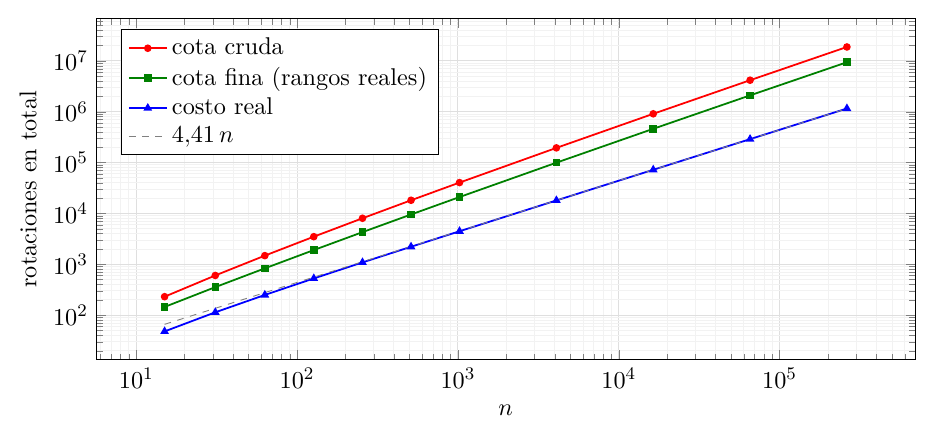
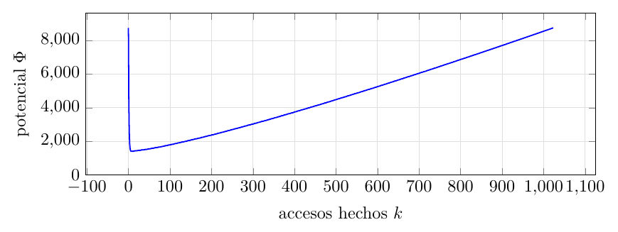
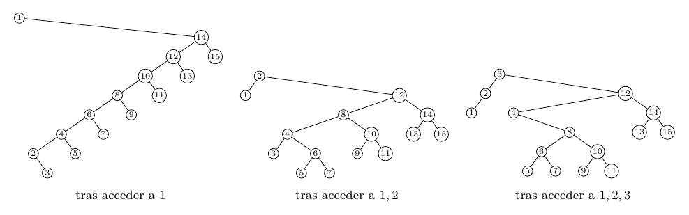
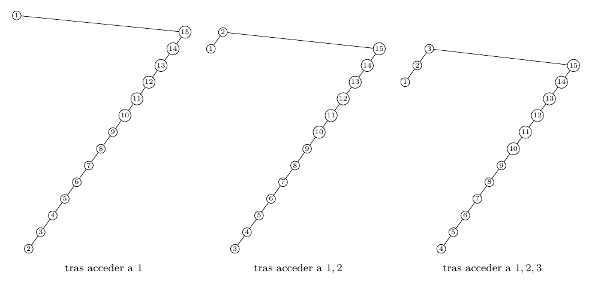

# Ejercicio 13: splay desde un camino, accediendo a $`1,\dots,n`$ en orden

## Enunciado

**Ejercicio 13 ($`\star\star`$; C4).** En un splay tree que empieza como un camino de $`n`$ nodos se accede a las claves $`1,\dots,n`$ en orden. Acota el costo total con el lema de acceso y la cuenta de la sección 5 de la conferencia 4, y compáralo con lo que mide la sección 6. ¿Es ajustada la cota?

## Respuesta corta

- **La cota del lema:** $`\sum c_k\le n(3\log_2n+1)+\log_2 n!\;\approx\;4\,n\log_2n-0{,}44\,n`$. Con los rangos reales de la ejecución se afina a $`\sum_k[3(\log_2n-r_k)+1]`$, porque $`\Phi_0-\Phi_{\text{final}}=0`$.

- **Lo medido:** el costo total exacto es $`4{,}41\,n`$ para $`n`$ grande ($`4472`$ rotaciones para $`n=1023`$, contra una cota de $`40\,468`$ y una cota fina de $`21\,024`$).

- **¿Ajustada?** No: $`\Theta(n)`$ real contra $`\Theta(n\log n)`$ de la cota; el cociente cota$`/`$costo crece como $`\log n`$ ($`16{,}2`$ para la cruda y $`8{,}1`$ para la fina en $`n=262\,143`$). **Por qué:** el árbol vuelve a ser el camino al final de la ronda (lema 2, demostrado), así que $`\Phi_0`$ y $`\Phi_{\text{final}}`$ *se cancelan*; la pérdida está entera en el tope $`3(\log n-r_k)+1`$ por acceso, que vale $`\approx20`$ cuando el costo amortizado real es $`\approx4`$.

- **Lo que se demuestra del lado real:** el primer acceso cuesta exactamente $`n-1`$ rotaciones y deja un árbol de forma exacta; *subir a la raíz* cuesta exactamente $`n(n+1)/2-1`$ en total ($`\Theta(n^2)`$). El $`O(n)`$ del splay es el teorema de acceso secuencial de Tarjan (1985): se cita, no se demuestra, y su constante se mide.

Modelo: C4, costo $`=`$ rotaciones ($`1`$ si el nodo ya es la raíz), potencial $`\Phi=\sum_xr(x)`$, $`r(x)=\log_2s(x)`$.

## Modelo y el lema de acceso

Como en C4 §4–5: un nodo $`x`$ tiene $`s(x)`$ nodos en su subárbol (contándose a sí mismo), rango $`r(x)=\log_2s(x)`$, y el árbol tiene potencial $`\Phi=\sum_xr(x)`$. El *costo* de un acceso es el número de rotaciones del splay (zig: $`1`$; zig-zig y zig-zag: $`2`$), y $`1`$ si el nodo ya es la raíz. El árbol inicial es `camino(n)`: $`n`$ en la raíz y cada clave $`k`$ hija izquierda de $`k+1`$. Un camino tiene subárboles de tamaños $`1,2,\dots,n`$, así que
``` math
\Phi_0=\sum_{k=1}^n\log_2k=\log_2n!\;=\;n\log_2n-n\log_2e+O(\log n) .
```
**Lema de acceso** (Sleator y Tarjan; C4 §5). El costo amortizado $`\hat c=c+\Phi'-\Phi`$ de hacer splay de un nodo $`x`$ en un árbol con raíz $`t`$ es a lo sumo $`3\,(r(t)-r(x))+1`$.

## La cota con el lema, explícita

En el acceso $`k`$ se accede a la clave $`k`$, el nodo $`x_k`$, con $`r_k=r(x_k)`$ *antes* del splay. La raíz tiene siempre los $`n`$ nodos, así que $`r(t)=\log_2n`$. Por el lema, $`\hat c_k\le3(\log_2n-r_k)+1`$. Sumando y telescopiando (C4 §2), con $`\Phi_{\text{final}}`$ el potencial tras los $`n`$ accesos:
``` math
\sum_kc_k=\sum_k\hat c_k+\Phi_0-\Phi_{\text{final}}\ \le\ \sum_{k=1}^n\bigl[3(\log_2n-r_k)+1\bigr]+\Phi_0-\Phi_{\text{final}} .\tag{$\ast$}
```

**La cota cruda.**

Con $`r_k\ge0`$ y $`\Phi_{\text{final}}\ge0`$ (como en C4),
``` math
\sum_kc_k\ \le\ 3n\log_2n+n+\log_2n!\ \approx\ 4\,n\log_2n-0{,}44\,n .
```
(Con $`\Phi_{\text{final}}\ge\log_2n`$, el rango de la raíz, se resta $`\log_2n`$; no cambia el orden.)

**La cota fina.**

Es el lado derecho de $`(\ast)`$ con los $`r_k`$ y $`\Phi_{\text{final}}`$ *reales* de la ejecución: $`A=\sum_k[3(\log_2n-r_k)+1]`$ más $`\Phi_0-\Phi_{\text{final}}`$. El programa los calcula acceso por acceso, con $`\Phi`$ mantenido incrementalmente y verificado contra el cálculo desde cero, y comprueba con `assert` que $`\hat c_k\le3(\log_2n-r_k)+1`$ en *todos* los accesos (el lema se cumple) y que $`\sum c_k=\sum\hat c_k+\Phi_0-\Phi_{\text{final}}`$ (la identidad de la suma telescópica).

## Lo medido contra las cotas

Costo real exacto (rotaciones; $`1`$ si ya es la raíz), para el splay de C4 desde `camino(n)` con las claves $`1,\dots,n`$ en orden (salida 2):

| $`n`$ | costo total | total$`/n`$ | cota cruda | cruda$`/`$total | cota fina | fina$`/`$total |
|---:|---:|---:|---:|---:|---:|---:|
| 15 | 48 | 3,20 | 231 | 4,81 | 145 | 3,03 |
| 63 | 250 | 3,97 | 1483 | 5,93 | 834 | 3,33 |
| 255 | 1090 | 4,27 | 8047 | 7,38 | 4293 | 3,94 |
| 1023 | 4472 | 4,37 | 40468 | 9,05 | 21024 | 4,70 |
| 4095 | 18038 | 4,41 | 194749 | 10,80 | 99715 | 5,53 |
| 65535 | 289254 | 4,41 | 4165232 | 14,40 | 2098008 | 7,25 |
| 262143 | 1157200 | 4,41 | 18758251 | 16,21 | 9399203 | 8,12 |

La reproducción de la tabla de C4 §6 (tres rondas, costo por acceso) da $`4{,}2`$, $`4{,}2`$, $`4{,}3`$, $`4{,}4`$ para $`n=100,200,400,800`$, igual a C4 (salida 3). Eso no depende de cuántas rondas se hagan: por el lema 2, al final de cada ronda el árbol vuelve a ser `camino(n)`, el mismo del que partió, así que todas las rondas hacen exactamente las mismas rotaciones y el promedio de tres rondas es el costo de una sola. Aquí, con una sola ronda, el costo por acceso $`T(n)/n`$ pasa de $`3{,}2`$ ($`n=15`$) a $`4{,}37`$ ($`n=1023`$) y se estabiliza cerca de $`4{,}41`$.



En ejes logarítmicos, el costo real (azul) es una recta de pendiente $`1`$, y las dos cotas se curvan hacia arriba: pendiente $`>1`$, la de $`n\log n`$.

## ¿Es ajustada? No, y por qué pierde

Real $`\Theta(n)`$ contra cota $`\Theta(n\log n)`$: no es ajustada. Dónde se pierde, medido (salida 4):

**Un hecho: el árbol vuelve a ser un camino.**

Tras acceder a $`1,\dots,n`$ en orden el árbol queda con la forma de `camino(n)` (lema 2, que se demuestra en la sección siguiente y se verifica para $`n\le300`$), de modo que $`\Phi_{\text{final}}=\Phi_0`$ para todo $`n`$. Entonces en $`(\ast)`$ el término $`\Phi_0-\Phi_{\text{final}}`$ *es cero*: no es cierto que $`\Phi_0=\log_2n!`$ “pague por un camino que se desarma” y quede como pérdida, porque el camino se vuelve a armar y el potencial vuelve a subir. La trayectoria de $`\Phi`$ para $`n=1023`$: $`8759`$ al principio, $`4387`$ tras el primer acceso, $`2737`$ tras $`n/4`$ accesos, $`4575`$ tras $`n/2`$, $`6606`$ tras $`3n/4`$ y otra vez $`8759`$ al final:



**El potencial baja y vuelve a subir.** El primer acceso tiene costo amortizado $`\hat c_1=1022-4372=-3350`$ (el potencial cae), y los demás son positivos, en media $`7{,}65`$ y como máximo $`20{,}2`$: la suma de todos los $`\hat c_k`$ es exactamente el costo real $`4472`$.

**La pérdida está en el tope por acceso.**

La cota fina es $`A+(\Phi_0-\Phi_{\text{final}})=A`$. Los términos:

| $`n`$ | costo $`T`$ | $`A=\sum[3(\log n-r_k)+1]`$ | $`n(3\log_2n+1)`$ | $`3\sum r_k`$ | $`\Phi_0=\Phi_{\text{final}}`$ | $`A/T`$ |
|---:|---:|---:|---:|---:|---:|---:|
| 1023 | 4472 | 21024 | 31709 | 10685 | 8759 | 4,70 |
| 16383 | 72276 | 461610 | 704465 | 242855 | 205733 | 6,39 |
| 262143 | 1157200 | 9399203 | 14417861 | 5018658 | 4340390 | 8,12 |

La cota cruda se obtiene con $`r_k=0`$ ($`n(3\log_2n+1)`$, tercera columna) más $`\Phi_0`$; la fina descuenta $`3\sum r_k`$ (quinta columna) y $`\Phi_0-\Phi_{\text{final}}=0`$. Los $`r_k`$ reales sí son grandes: media $`3{,}48`$ para $`n=1023`$ y $`6{,}38`$ para $`n=262\,143`$, con valores $`0`$ en los accesos a hojas y hasta $`9{,}98`$ en otros ($`r_k=0,1,0,3,0,2{,}58,0,6{,}09,0,6{,}04,0,9{,}98,\dots`$). Por eso la cota fina es mejor que la cruda (entre un $`37`$ y un $`50`$ %), pero sigue $`4{,}7`$ a $`8{,}1`$ veces por encima: *el tope del lema vale en media $`20{,}6`$ por acceso ($`n=1023`$), y el costo amortizado real es $`\approx4`$*. El lema es una cota *por acceso* que supone el peor aumento de potencial en cada paso; en esta secuencia, el costo amortizado de cada acceso es mucho menor que ese tope, y la diferencia se acumula acceso tras acceso. Tampoco se arregla “midiendo $`r(x)`$ mejor”: incluso con los $`r_k`$ reales, el tope crece como $`3\log n`$ por acceso.

## Lo que se puede demostrar del lado real

### El primer acceso, exacto

**Lema 1**. *Splay de la clave $`1`$ en `camino(n)` cuesta exactamente $`n-1`$ rotaciones ($`n\ge2`$): $`\lfloor(n-1)/2\rfloor`$ pasos zig-zig y un zig si $`n`$ es par. El árbol resultante es: raíz $`1`$ sin hijo izquierdo; su hijo derecho es la espina izquierda de los pares $`2,4,\dots,2\lfloor n/2\rfloor`$ (el mayor arriba, cada par con el siguiente menor como hijo izquierdo), y cada par $`2j`$ tiene el impar $`2j+1`$, si existe, como hijo derecho.*

*Demostración.* La clave $`1`$ está a profundidad $`n-1`$ y todos sus ancestros son hijos izquierdos. Sea $`R_0=\varnothing`$ y $`R_j`$ el árbol de raíz $`2j`$ con hijo izquierdo $`R_{j-1}`$ e hijo derecho $`2j+1`$. *Invariante $`I_j`$*: tras $`j`$ pasos zig-zig, el árbol es la cadena izquierda $`n\to n-1\to\dots\to2j+2`$ seguida de $`x=1`$ como hijo izquierdo de $`2j+2`$, y $`1`$ no tiene hijo izquierdo y tiene como hijo derecho a $`R_j`$. $`I_0`$ es el camino. Para pasar de $`I_j`$ a $`I_{j+1}`$: $`x=1`$, su padre $`p=2j+2`$ y su abuelo $`g=2j+3`$ forman un zig-zig; primero se rota $`p`$ sobre $`g`$ ($`p`$ queda con hijo derecho $`g`$ y hijo izquierdo $`x`$), después $`x`$ sobre $`p`$: $`x`$ queda arriba, con hijo derecho $`p`$, y $`p`$ queda con hijo izquierdo el antiguo hijo derecho de $`x`$ ($`R_j`$) y con hijo derecho $`g`$. Es decir, el hijo derecho de $`x`$ es $`(2j+2;\,R_j;\,2j+3)=R_{j+1}`$, y $`x`$ ocupa el lugar de $`g`$ en la cadena: vale $`I_{j+1}`$. Cada paso zig-zig sube a $`x`$ dos niveles, así que hay $`\lfloor(n-1)/2\rfloor`$ de ellos y, si $`n-1`$ es impar, queda un zig (que sube $`x`$ sobre la raíz $`n`$, dejando a $`n`$ como hijo derecho de $`x`$ con $`R_j`$ de hijo izquierdo y sin hijo derecho). Rotaciones: $`2\lfloor(n-1)/2\rfloor+[n\text{ par}]=n-1`$. ◻

El programa lo verifica para $`n=1,\dots,300`$ (rotaciones, número de zig-zig y zig, y forma del árbol, salida 1). Para $`n=15`$ el árbol es $`(1\,.\,(14\,(12\,(10\,(8\,(6\,(4\,(2\,.\,3)\,5)\,7)\,9)\,11)\,13)\,15))`$.



*Splay, $`n=15`$.* Tras acceder a $`1,2,3`$ el árbol es $`(3\,(2\,1\,.)\,(12\,(4\,.\,(8\,(6\,5\,7)\,(10\,9\,11)))\,(14\,13\,15)))`$, que es exactamente el árbol de la izquierda de la figura 4 de C4 (raíz $`3`$, hijos $`2`$ y $`12`$, $`4`$ a la izquierda de $`12`$, y la espina que baja por $`8`$, $`6`$, $`10`$). La profundidad máxima pasó de $`14`$ a $`6`$.

### El árbol vuelve a ser un camino

**Lema 2** ($`J_k`$). *Para $`1\le k\le n`$, tras acceder a $`1,2,\dots,k`$ en orden (splay desde `camino(n)`), la raíz es $`k`$ y su subárbol izquierdo es la cadena izquierda $`k-1\to k-2\to\dots\to1`$ (cada clave $`j`$ hija izquierda de $`j+1`$), sin ningún hijo derecho. En particular, con $`k=n`$ el árbol es `camino(n)` y $`\Phi_{\text{final}}=\Phi_0`$.*

*Demostración.* Por inducción sobre $`k`$. *Base* $`k=1`$: es el lema 1: la raíz es $`1`$ y no tiene hijo izquierdo (la cadena vacía).

*Paso $`k\to k+1`$* ($`k<n`$). Por $`J_k`$ la raíz es $`k`$, su subárbol izquierdo es la cadena $`L=(k-1\to\dots\to1)`$ sin hijos derechos, y su subárbol derecho contiene exactamente las claves $`k+1,\dots,n`$. La clave $`x=k+1`$ es el *mínimo* del subárbol derecho, así que su camino desde la raíz es: $`k\to a_1\to a_2\to\dots\to a_d=x`$, donde $`a_1`$ es el hijo derecho de $`k`$ y todos los demás pasos son hijos izquierdos; y $`x`$ no tiene hijo izquierdo. Sea $`e`$ la profundidad de $`x`$ (la raíz $`k`$ tiene profundidad $`0`$).

- Mientras $`e\ge3`$, el abuelo $`g`$ de $`x`$ está a profundidad $`e-2\ge1`$ y el padre $`p`$ es hijo izquierdo de $`g`$, y $`x`$ es hijo izquierdo de $`p`$: es un paso *zig-zig*. Solo toca nodos de profundidad $`\ge1`$ y sus subárboles, así que $`k`$ y $`L`$ no cambian. Tras el paso, $`x`$ ocupa el lugar de $`g`$ (hijo, del mismo lado, del padre de $`g`$), sigue sin hijo izquierdo (solo gana el hijo derecho $`p`$), y su profundidad baja en $`2`$.

- Al terminar esos pasos, $`e\in\{1,2\}`$. Si $`e=1`$, $`x`$ es el hijo derecho de la raíz $`k`$ y el último paso es un *zig*: se rota $`x`$ sobre $`k`$, quedando $`x`$ de raíz con hijo izquierdo $`k`$, y como $`x`$ no tenía hijo izquierdo, el nuevo hijo derecho de $`k`$ es vacío. Si $`e=2`$, $`x`$ es hijo izquierdo de un nodo $`p`$ que es el hijo derecho de $`k`$: el último paso es un *zig-zag* con abuelo $`k`$ (con la convención de C4, se rota $`x`$ dos veces): la primera rotación deja a $`x`$ como hijo derecho de $`k`$, con $`p`$ de hijo derecho de $`x`$; la segunda rota $`x`$ sobre $`k`$, y $`x`$ queda de raíz con hijo izquierdo $`k`$, y el hijo derecho de $`k`$ pasa a ser el antiguo hijo izquierdo de $`x`$, que es vacío.

En los dos casos la raíz es $`k+1`$, su hijo izquierdo es $`k`$, y $`k`$ conserva su hijo izquierdo $`L`$ y tiene hijo derecho vacío: el subárbol izquierdo de $`k+1`$ es la cadena $`k\to k-1\to\dots\to1`$ sin hijos derechos. Eso es $`J_{k+1}`$.

Para $`k=n`$ no hay claves mayores que $`n`$, así que la raíz $`n`$ no tiene subárbol derecho, y el árbol es la cadena $`n\to n-1\to\dots\to1`$: `camino(n)`. Los tamaños de subárbol son los mismos que al principio, y $`\Phi_{\text{final}}=\Phi_0`$. ◻

El programa comprueba $`J_k`$ con `assert` tras *cada* acceso para $`n=1,\dots,300`$ ($`45\,150`$ comprobaciones, sin fallos; salida 4).

### Subir a la raíz en la misma secuencia: exacto, $`\Theta(n^2)`$

**Teorema 1**. *Subir a la raíz con rotaciones simples, desde `camino(n)` y accediendo a $`1,\dots,n`$ en orden, cuesta exactamente $`n-1`$ en el acceso $`1`$, $`n-j+1`$ en el acceso $`j`$ ($`2\le j\le n`$), y en total $`n(n+1)/2-1`$.*

*Demostración.* Invariante tras acceder a $`k\ge1`$: el árbol es raíz $`k`$, con hijo izquierdo la raíz $`k-1`$ (con lo que tenía) y con hijo derecho la *cadena izquierda* $`n\to n-1\to\dots\to k+1`$. Para $`k=1`$: la clave $`1`$, a profundidad $`n-1`$ en el camino, sube por rotaciones simples; tras rotar sobre $`2`$, sobre $`3`$, …, sobre $`n`$, queda la raíz $`1`$ con hijo derecho $`n`$ y la cadena izquierda $`n\to\dots\to2`$. Para pasar de $`k`$ a $`k+1`$: $`k+1`$ es el último de la cadena que cuelga a la derecha de la raíz $`k`$, a profundidad $`1+(n-k-1)=n-k`$ (cuesta $`n-k`$ rotaciones). Rotar un hijo izquierdo $`x`$ sobre su padre $`p`$ deja a $`x`$ en el lugar de $`p`$, con $`p`$ de hijo derecho y el antiguo hijo derecho de $`x`$ como hijo izquierdo de $`p`$. Así, al rotar $`x=k+1`$ sobre $`k+2`$, luego sobre $`k+3`$, …, sobre $`n`$, el nodo $`x`$ va reemplazando a cada uno y su hijo derecho pasa a ser la cadena izquierda $`n\to n-1\to\dots\to k+2`$; tras la rotación sobre $`n`$, $`x`$ es el hijo derecho de la raíz $`k`$. Una última rotación sobre $`k`$ lo deja de raíz, con $`k`$ (y todo lo que tenía) de hijo izquierdo y la cadena $`n\to\dots\to k+2`$ de hijo derecho. Eso es el invariante para $`k+1`$. Costos: acceso $`1`$: $`n-1`$; acceso $`j=k+1\ge2`$: $`n-k=n-j+1`$. Total $`(n-1)+\sum_{j=2}^n(n-j+1)=(n-1)+n(n-1)/2=n(n+1)/2-1`$. ◻

El programa verifica la forma de los costos y el total para $`n=2,\dots,200`$ (salida 6): $`n=4000`$ da $`8\,001\,999`$ rotaciones, contra $`17\,620`$ del splay (un factor $`454`$). La demostración de C4 §5–6 explica por qué: subir a la raíz es una cadena de zigs, cada uno con costo amortizado $`1+3(r'-r)`$, y los $`+1`$ no se telescopian; el splay agrupa dos rotaciones en un paso y el $`-2`$ de la concavidad paga ese $`+1`$, pero solo cuando se rota primero el padre en el zig-zig. Aquí *todos* los pasos son zig-zig (la cadena es izquierda), y rotar el nodo en vez del padre deja siempre una cadena de longitud casi igual (figura 4 de C4, derecha).



*Subir a la raíz, $`n=15`$.* Tras $`1,2,3`$ el árbol es la raíz $`3`$ con $`(2\,1)`$ a la izquierda y la cadena $`15\to14\to\dots\to4`$ a la derecha, como en la figura 4 de C4: el siguiente acceso (la clave $`4`$) vuelve a costar $`n-3=12`$ rotaciones.

### El splay en la misma secuencia: $`O(n)`$, cota conocida

El $`O(n)`$ total del splay para esta secuencia es un caso del **teorema de acceso secuencial** (Tarjan, 1985): acceder a las $`n`$ claves de un splay tree de $`n`$ nodos en orden creciente cuesta $`O(n)`$ en total desde *cualquier* árbol inicial. Lo *cito* como resultado conocido, sin demostrarlo: no encontré aquí una demostración directa más corta para este árbol inicial. Lo que sí se mide es la constante (salida 5): $`T(n)/n=2{,}29`$ ($`n=7`$), $`3{,}20`$ ($`15`$), $`4{,}16`$ ($`100`$), $`4{,}37`$ ($`1000`$), $`4{,}4049`$ ($`4095`$), $`4{,}4137`$ ($`65\,535`$), $`4{,}4144`$ ($`262\,143`$), $`4{,}4146`$ ($`1\,048\,575`$). El máximo de $`T(n)/n`$ sobre todos los $`2\le n\le1500`$ es $`4{,}4055`$ (en $`n=1100`$) y sobre $`40`$ valores de $`n`$ al azar entre $`2^{11}`$ y $`2^{17}`$ es $`4{,}4142`$. La sucesión crece despacio y parece estabilizarse cerca de $`4{,}41`$; no demuestro ningún valor límite. Además los costos por acceso tienen una estructura repetida (para $`n=15`$: $`14,7,4,2,4,2,3,1,3,1,2,1,2,1,1`$), con costos grandes solo al principio de cada bloque.

## Comprobación experimental

Código: `ej13_splay.py`. Implementa el splay y el subir-a-la-raíz de C4 con tamaños y potencial mantenidos en cada rotación (el costo cuenta rotaciones, igual que C4). Salida real:

<details>
<summary><code>ej13_salida.txt</code></summary>

```text
=== 1. El primer acceso (clave 1 desde camino(n)): costo exacto y forma del arbol ===
  n = 1..300: rotaciones = n-1, zig-zig = floor((n-1)/2), zig = 1 si n es par (0 si es impar), y la forma coincide con la
  del lema (raiz 1; hijo derecho = espina izquierda de pares 2,4,..; cada par 2j con el impar 2j+1 como hijo derecho): fallos = 0
  n= 7: tras acceder a 1:  (1 . (6 (4 (2 . 3) 5) 7))   (zig-zig 3, zig 0)
  n=15: tras acceder a 1:  (1 . (14 (12 (10 (8 (6 (4 (2 . 3) 5) 7) 9) 11) 13) 15))   (zig-zig 7, zig 0)
  n=16: tras acceder a 1:  (1 . (16 (14 (12 (10 (8 (6 (4 (2 . 3) 5) 7) 9) 11) 13) 15) .))   (zig-zig 7, zig 1)
  n=15 tras acceder a 1..1:  (1 . (14 (12 (10 (8 (6 (4 (2 . 3) 5) 7) 9) 11) 13) 15))
  n=15 tras acceder a 1..2:  (2 1 (12 (8 (4 3 (6 5 7)) (10 9 11)) (14 13 15)))
  n=15 tras acceder a 1..3:  (3 (2 1 .) (12 (4 . (8 (6 5 7) (10 9 11))) (14 13 15)))
  n=15, subir a la raiz tras acceder a 1..1: (1 . (15 (14 (13 (12 (11 (10 (9 (8 (7 (6 (5 (4 (3 2 .) .) .) .) .) .) .) .) .) .) .) .) .))
  n=15, subir a la raiz tras acceder a 1..2: (2 1 (15 (14 (13 (12 (11 (10 (9 (8 (7 (6 (5 (4 3 .) .) .) .) .) .) .) .) .) .) .) .))
  n=15, subir a la raiz tras acceder a 1..3: (3 (2 1 .) (15 (14 (13 (12 (11 (10 (9 (8 (7 (6 (5 4 .) .) .) .) .) .) .) .) .) .) .))

=== 2. El costo real de n accesos en orden desde camino(n), y las cotas del lema ===
  Cota cruda (C4): sum c <= n (3 log2 n + 1) + log2 n!   [r(x) >= 0, Phi_final >= 0]
  Cota cruda afinada con Phi_final >= log2 n (la raiz):  n (3 log2 n + 1) + log2 n! - log2 n
  Cota fina: sum_k [3 (log2 n - r_k) + 1] + Phi_0 - Phi_final, con los r_k y Phi_final REALES de la ejecucion
        n  costo total  total/n       cruda  cruda/n        fina   fina/n  cruda/total  fina/total
       15           48    3.200         231    15.40         145     9.69         4.81        3.03
       31          114    3.677         604    19.50         356    11.50         5.30        3.13
       63          250    3.968        1483    23.53         834    13.23         5.93        3.33
      127          528    4.157        3499    27.55        1908    15.03         6.63        3.61
      255         1090    4.275        8047    31.56        4293    16.84         7.38        3.94
      511         2216    4.337       18170    35.56        9545    18.68         8.20        4.31
     1023         4472    4.371       40468    39.56       21024    20.55         9.05        4.70
     4095        18038    4.405      194749    47.56       99715    24.35        10.80        5.53
    16383        72276    4.412      910198    55.56      461610    28.18        12.59        6.39
    65535       289254    4.414     4165232    63.56     2098008    32.01        14.40        7.25
   262143      1157200    4.414    18758251    71.56     9399203    35.86        16.21        8.12
  (verificado con assert: sum c = sum c_hat + Phi_0 - Phi_final, y total <= fina <= cruda afinada)

=== 3. Reproduccion de la tabla de C4 sec. 6: 3 rondas, costo por acceso ===
      n   splay  subir a la raiz   (C4: 4,2 4,2 4,3 4,4  y  50,5 100,5 200,5 400,5)
    100     4.2             50.5
    200     4.2            100.5
    400     4.3            200.5
    800     4.4            400.5

=== 4. Por que la cota pierde: de donde sale (n accesos en orden) ===
  Lema J_k (demostrado en el texto): tras acceder a 1..k la raiz es k y su subarbol izquierdo es la cadena izquierda k-1 -> ... -> 1, sin hijos derechos.
  Consecuencia: tras acceder a 1..n el arbol es camino(n) y Phi_final = Phi_0.
  J_k comprobado con assert tras CADA acceso para n = 1..300 (45150 comprobaciones): fallos = 0
  forma final == camino(n) para n = 1..300: fallos = 0
        n  costo real T  A=sum[3(log n - r_k)+1]  n(3 log n+1)  3 sum r_k      Phi_0  Phi_final  cota fina=A    A/T
     1023          4472                    21024         31709      10685       8759       8759        21024   4.70
    16383         72276                   461610        704465     242855     205733     205733       461610   6.39
   262143       1157200                  9399203      14417861    5018658    4340390    4340390      9399203   8.12
  La cota fina es A + (Phi_0 - Phi_final) = A: Phi_0 y Phi_final SE CANCELAN. Toda la perdida esta en los terminos 3(log n - r_k) + 1.
  Cota cruda = n(3 log n + 1) + Phi_0; fina = cruda - 3 sum r_k - Phi_0 + (Phi_0 - Phi_final) = cruda - 3 sum r_k - Phi_final.
  n = 1023: Phi_0 = 8759; tras el 1er acceso Phi = 4387; tras n/4 accesos 2737; tras n/2 4575; tras 3n/4 6606; final 8759  (baja y vuelve a subir)
  costo amortizado c_hat_k: suma = 4472 = costo real (el potencial vuelve a su valor); 1er acceso c_hat = -3350 (el potencial cae), maximo 20.2, media de los demas 7.65
  el tope del lema 3(log2 n - r_k) + 1 vale en media 20.6 por acceso; el costo real por acceso es 4.37
  r_k reales (primeros 14): [0.0, 1.0, 0.0, 3.0, 0.0, 2.58, 0.0, 6.09, 0.0, 6.04, 0.0, 9.98, 0.0, 2.58]   (media 3.48; la cota cruda supone 0)

=== 5. Constante empirica del acceso secuencial (Tarjan 1985: O(n) desde cualquier arbol inicial) ===
         n  costo total   total/n
         7           16    2.2857
        15           48    3.2000
        31          114    3.6774
       100          416    4.1600
      1000         4374    4.3740
      4095        18038    4.4049
     16383        72276    4.4116
     65535       289254    4.4137
    262143      1157200    4.4144
   1048575      4629010    4.4146
  maximo de total/n para 2 <= n <= 1500 (todos los n): 4.4055  en n = 1100
  maximo de total/n en 40 valores de n entre 2^11 y 2^17 elegidos al azar: 4.4142 en n = 106164

=== 6. Contraste: subir a la raiz en la misma secuencia ===
  n = 2..200: costos por acceso = [n-1, n-1, n-2, ..., 1] y total = n(n+1)/2 - 1: fallos = 0
       n  subir a la raiz   n(n+1)/2 - 1      splay  cociente
      15              119            119         48       2.5
     100             5049           5049        416      12.1
    1000           500499         500499       4374     114.4
    4000          8001999        8001999      17620     454.1
```

</details>

**Casos elegidos.**

*Bordes:* $`n=1`$ (un acceso a la raíz, costo $`1`$), $`n=2`$, $`n`$ par e impar (el zig final del primer acceso). *Típicos:* $`n`$ de $`15`$ a $`1\,048\,575`$. *Adversarial:* el camino como árbol inicial (el peor para subir a la raíz), y el recorrido en orden, que dispara el zig-zig (C4 §6).

## Por qué este enfoque

**Una analogía.**

El lema de acceso es una *tarifa máxima por viaje*: “un acceso cuesta a lo sumo $`3\log n`$ en promedio”. Para cobrar justo, la tarifa tiene que ser un tope válido para *cualquier* secuencia de accesos. En la secuencia en orden, el potencial que se acumula en un camino se gasta casi entero en el primer acceso y se vuelve a acumular después, pero el tope de cada viaje ni se entera: sigue cobrando $`\approx3\log n`$ aunque el viaje real cueste $`\approx4`$.

**Otra visión.**

La cuenta sirve para *cualquier* secuencia; el teorema de acceso secuencial (Tarjan) es la herramienta para la secuencia *en orden*, con un análisis específico (un potencial adaptado a la secuencia) que da $`O(n)`$. Es la diferencia entre una cota *general* y una *exacta para un caso*: C4 no la pide, pero la medición la muestra.

## Conclusión

- **Cota del lema:** $`\sum c_k\le n(3\log_2n+1)+\log_2n!\approx4n\log_2n`$; con los rangos reales $`\sum_k[3(\log_2n-r_k)+1]`$ (porque $`\Phi_{\text{final}}=\Phi_0`$).

- **Real:** $`\approx4{,}41\,n`$ (medido hasta $`n\approx10^6`$); primer acceso exactamente $`n-1`$ con forma exacta; subir a la raíz exactamente $`n(n+1)/2-1`$.

- **No es ajustada:** real $`\Theta(n)`$ contra cota $`\Theta(n\log n)`$; la pérdida está en el tope por acceso $`3(\log n-r_k)+1`$ ($`\approx20`$ contra un costo amortizado real $`\approx4`$ para $`n=1023`$), no en $`\Phi_0`$, que se cancela con $`\Phi_{\text{final}}`$ porque el árbol vuelve a ser `camino(n)` (lema 2, demostrado).

- **$`O(n)`$ del splay:** teorema de acceso secuencial (Tarjan 1985), citado; constante medida $`\approx4{,}41`$; sin demostración propia.

Modelo: splay trees de C4, costo $`=`$ rotaciones.
