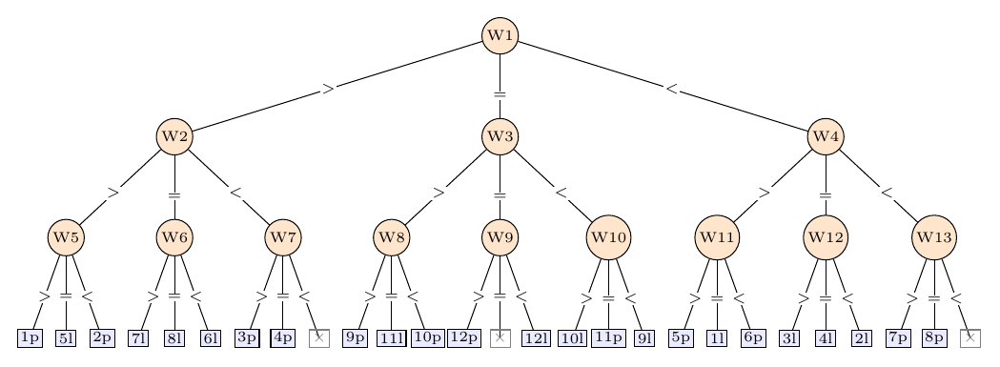

# Ejercicio 14: el ciclo completo sobre la moneda falsa de Dyson

## Enunciado

**Ejercicio 14 ($`\star\star\star`$; C2 a C5).** Escoge un problema que no hayamos visto, recorre el ciclo completo de la conferencia 2 sobre él y consigue que el algoritmo y la cota mínima coincidan. Es el formato de la pregunta larga del examen final.

## Respuesta corta

**Problema elegido: la moneda falsa de Dyson.** $`n\ge3`$ monedas, exactamente una falsa, de peso distinto *sin saber si es más pesada o más liviana*, y *ninguna moneda genuina extra*. Una balanza de platillos compara dos conjuntos disjuntos del mismo tamaño y da tres resultados ($`>`$, $`=`$, $`<`$). Hay que decir *cuál* es la falsa y *en qué sentido*. Costo: número de pesadas en el peor caso.

- **Resultado:** $`k`$ pesadas bastan si y solo si $`n\le(3^k-3)/2`$. El costo exacto es $`k(n)=\min\{k:n\le(3^k-3)/2\}`$: $`2`$ pesadas para $`n=3`$, $`3`$ para $`4\le n\le12`$, $`4`$ para $`13\le n\le39`$, $`5`$ para $`40\le n\le120`$.

- **Algoritmo:** pesar en tercios, llevando el estado $`(u,h,l,g)`$ (desconocidas, posibles-pesadas, posibles-livianas, genuinas conocidas); correcto por un invariante sobre el conjunto de hipótesis (moneda, sentido).

- **Cota mínima:** la información da $`2n\le3^k`$, o sea $`n\le(3^k-1)/2`$ (13 monedas en 3 pesadas pasan esa cuenta y son imposibles). El adversario aporta lo que falta: la primera pesada reparte las $`2n`$ hipótesis en tres clases *de tamaño par*, y como $`3^{k-1}`$ es impar, cada clase tiene a lo sumo $`3^{k-1}-1`$: $`2n\le3(3^{k-1}-1)=3^k-3`$.

- **Verificación:** una búsqueda minimax independiente sobre estados confirma $`n_{\max}=3,12,39`$ para $`k=2,3,4`$ y que $`n_{\max}+1`$ es imposible; la estrategia resuelve las $`2n`$ hipótesis de cada $`n\le40`$ (y $`n=60,100,120`$) en exactamente $`k(n)`$ pesadas.

Modelo: árboles de decisión ternarios con pesadas de conjuntos; el costo es la profundidad.

## Pregunta 1: ¿cuál es el problema?

**Entrada:** $`n`$ monedas numeradas $`1,\dots,n`$, idénticas salvo una. **Hipótesis:** un par $`(i,s)`$ con $`i\in\{1,\dots,n\}`$ la moneda falsa y $`s\in\{\mathrm{p},\mathrm{l}\}`$ su sentido (más *p*esada o más *l*iviana). Hay $`2n`$ hipótesis y exactamente una es la verdadera. **Operación:** una *pesada* elige dos conjuntos disjuntos de monedas $`X,Y`$ con $`|X|=|Y|`$ y devuelve “$`>`$” si $`X`$ pesa más, “$`=`$” si pesan igual, “$`<`$” si $`X`$ pesa menos. Con la hipótesis $`(i,\mathrm p)`$ el resultado es $`>`$ si $`i\in X`$, $`<`$ si $`i\in Y`$ y $`=`$ si $`i`$ no está en la balanza; con $`(i,\mathrm l)`$, es $`<`$ si $`i\in X`$, $`>`$ si $`i\in Y`$ y $`=`$ si no está. Las pesadas son *adaptativas*: cada una se elige mirando los resultados anteriores. **Salida:** $`(i,s)`$, la hipótesis verdadera. **Costo:** número de pesadas en el peor caso. **Modelo:** cualquier estrategia es un árbol de decisión ternario (una pesada por nodo interno, una rama por resultado, una hipótesis por hoja); el costo es su profundidad.

**Por qué $`n\ge3`$.**

Con $`n=2`$ (y con $`n=1`$) es imposible con cualquier número de pesadas. Con monedas $`a,b`$ las únicas pesadas no vacías son $`\{a\}`$ contra $`\{b\}`$ y $`\{b\}`$ contra $`\{a\}`$ (no hay ninguna otra moneda con la que rellenar). En ellas, $`(a,\mathrm p)`$ y $`(b,\mathrm l)`$ dan siempre el mismo resultado, igual que $`(a,\mathrm l)`$ y $`(b,\mathrm p)`$: ninguna sucesión de pesadas las distingue. (La salida 1 lo comprueba, y el minimax confirma que $`n=1,2`$ no se resuelven con $`1,\dots,5`$ pesadas.) Para $`n\ge3`$ sí se puede, y eso es lo que pide la cota: el problema está bien planteado exactamente desde $`n=3`$.

## Estados e hipótesis: el invariante

En cada momento, lo que se sabe se resume en un *estado*: cada moneda es de uno de cuatro tipos.

- **U** (*desconocida*): siguen vivas las dos hipótesis $`(i,\mathrm p)`$ y $`(i,\mathrm l)`$.

- **H** (*posible-pesada*): solo sigue viva $`(i,\mathrm p)`$.

- **L** (*posible-liviana*): solo sigue viva $`(i,\mathrm l)`$.

- **G** (*genuina*): ninguna hipótesis sobre ella sigue viva.

Con $`u,h,l,g`$ las cantidades, las hipótesis vivas son $`2u+h+l`$. Al principio el estado es $`(u,h,l,g)=(n,0,0,0)`$. **Invariante:** *el conjunto de hipótesis consistentes con todos los resultados vistos es exactamente el que describe el estado.* Se mantiene por el lema siguiente.

**Lema 1** (transición). *Sea un estado y una pesada $`X`$ contra $`Y`$. Escribimos $`X_{\mathrm U},X_{\mathrm H},X_{\mathrm L}`$ para las monedas de $`X`$ de cada tipo (e igual para $`Y`$). Entonces:*

- *Resultado $`>`$ ($`X`$ pesa más): quedan vivas $`(i,\mathrm p)`$ para $`i\in X_{\mathrm U}\cup X_{\mathrm H}`$ y $`(j,\mathrm l)`$ para $`j\in Y_{\mathrm U}\cup Y_{\mathrm L}`$. Estado nuevo: $`\mathrm U'=\varnothing`$, $`\mathrm H'=X_{\mathrm U}\cup X_{\mathrm H}`$, $`\mathrm L'=Y_{\mathrm U}\cup Y_{\mathrm L}`$, y todo lo demás es genuino. Tamaño de la clase: $`|X_{\mathrm U}|+|X_{\mathrm H}|+|Y_{\mathrm U}|+|Y_{\mathrm L}|`$.*

- *Resultado $`<`$: simétrico: $`\mathrm H'=Y_{\mathrm U}\cup Y_{\mathrm H}`$, $`\mathrm L'=X_{\mathrm U}\cup X_{\mathrm L}`$.*

- *Resultado $`=`$: quedan vivas exactamente las hipótesis de las monedas *fuera* de la balanza, con sus mismos tipos: $`\mathrm U'=\mathrm U\setminus(X\cup Y)`$, $`\mathrm H'=\mathrm H\setminus(X\cup Y)`$, $`\mathrm L'=\mathrm L\setminus(X\cup Y)`$. Las monedas de la balanza pasan a ser genuinas. Tamaño: $`2|\mathrm U'|+|\mathrm H'|+|\mathrm L'|`$.*

*Demostración.* Es la tabla de resultados de la sección anterior leída hacia atrás. Una hipótesis $`(i,s)`$ da $`>`$ exactamente cuando ($`i\in X`$ y $`s=\mathrm p`$) o ($`i\in Y`$ y $`s=\mathrm l`$), y $`=`$ exactamente cuando $`i\notin X\cup Y`$. Y solo estaban vivas las hipótesis del estado: de una moneda H solo la hipótesis $`\mathrm p`$, de una L solo la $`\mathrm l`$, de una G ninguna. ◻

**Lema 2** (cota de información). *Si desde un estado se puede resolver el problema con $`j`$ pesadas, entonces las hipótesis vivas son a lo sumo $`3^j`$: $`2u+h+l\le3^j`$.*

*Demostración.* La estrategia es un árbol ternario de profundidad $`\le j`$, que tiene a lo sumo $`3^j`$ hojas. Cada hipótesis viva determina todos los resultados (tabla de la sección 1), luego determina una hoja; si dos llegaran a la misma, esa hoja daría la misma respuesta para las dos, y una de ellas sería falsa. Entonces hay tantas hojas como hipótesis vivas. ◻

## Pregunta 2: el algoritmo

Estrategia explícita, por tipo de estado, con $`k`$ las pesadas que quedan y $`B=3^{k-1}`$.

**(R) Pesada inicial, $`(n,0,0,0)`$.**

Con $`k=k(n)`$ y $`M=(3^{k-1}-1)/2`$, sea $`m=\min\bigl(M,\lfloor(n-1)/2\rfloor\bigr)`$. Se pesa $`m`$ monedas contra $`m`$ monedas.

**(A) Solo desconocidas, $`(u,0,0,g)`$ con $`g\ge1`$.**

Sea $`U=\min(u,B)`$. Se ponen $`\lceil U/2\rceil`$ desconocidas a la izquierda y $`\lfloor U/2\rfloor`$ a la derecha, más *una* moneda genuina a la derecha si $`U`$ es impar.

**(B) Solo posibles-pesadas y posibles-livianas, $`(0,h,l,g)`$ con $`g\ge1`$ y $`N=h+l\ge2`$.**

1.  Se elige $`T`$, el número de monedas que van a la balanza: si $`N=3^k`$, $`T=2B`$; si no, $`T`$ es el mayor *impar* $`\le\min(N,2B)`$.

2.  Se eligen $`p`$ monedas H y $`q=T-p`$ monedas L, con $`p\le h`$, $`q\le l`$: si $`T`$ es impar, cualquier $`p`$ posible; si $`T=2B`$, un $`p`$ *par*.

3.  Se toman $`c_1=\lceil T/2\rceil`$, $`c_2=\lfloor T/2\rfloor`$ y $`a_1=p/2`$ si $`p`$ es par, $`a_1=(p+1)/2`$ si $`p`$ es impar; $`a_2=p-a_1`$, $`b_1=c_1-a_1`$, $`b_2=c_2-a_2`$.

4.  Izquierda: $`a_1`$ monedas H y $`b_2`$ monedas L. Derecha: $`a_2`$ monedas H y $`b_1`$ monedas L. Se rellena con *una* genuina el platillo de menos monedas si hace falta.

El código completo (`regla` en `ej14_moneda.py`) es ejecutable y es el que se verifica en la sección <a href="#sec:exp" data-reference-type="ref" data-reference="sec:exp">8</a>.

**Lema 3** (colocación). *Sean $`p,q\ge0`$, $`T=p+q`$, $`c_1=\lceil T/2\rceil`$, $`c_2=\lfloor T/2\rfloor`$, y supongamos que $`T`$ es impar o que $`T`$ y $`p`$ son pares. Con $`a_1,a_2,b_1,b_2`$ como en (B.3): son enteros $`\ge0`$, $`a_1+a_2=p`$, $`b_1+b_2=q`$, $`a_1+b_1=c_1`$, $`a_2+b_2=c_2`$, y los platillos difieren en $`|(a_1+b_2)-(a_2+b_1)|=1`$ si $`T`$ es impar y en $`0`$ si $`T`$ es par.*

*Demostración.* Con $`b_1=c_1-a_1`$, $`a_2=p-a_1`$, $`b_2=c_2-a_2`$, la diferencia es $`D=(a_1+b_2)-(a_2+b_1)=4a_1-2p-(c_1-c_2)`$. *$`T`$ par* ($`c_1=c_2=T/2`$, $`p`$ par, $`a_1=p/2`$): $`D=0`$, $`a_2=p/2`$ y $`b_1=b_2=(T-p)/2\ge0`$ (porque $`p\le T`$). *$`T`$ impar* ($`c_1-c_2=1`$): si $`p`$ es par, $`a_1=p/2`$ da $`D=-1`$, y $`b_1=(T+1-p)/2\ge1`$, $`b_2=(T-1-p)/2\ge0`$ (enteros, porque $`p\le T-1`$); si $`p`$ es impar, $`a_1=(p+1)/2`$ da $`D=1`$, $`a_2=(p-1)/2\ge0`$, y $`b_1=b_2=(T-p)/2=q/2\ge0`$. En todos los casos $`a_1+a_2=p`$, $`b_1+b_2=T-p=q`$. ◻

**Lema 4** ((i): estados sin desconocidas). *Sea $`g\ge1`$. El estado $`(0,h,l,g)`$ se resuelve en $`k`$ pesadas si y solo si $`h+l\le3^k`$.*

*Demostración.* *Solo si:* lema <a href="#lema:info" data-reference-type="ref" data-reference="lema:info">2</a>. *Si:* por inducción sobre $`k`$. Para $`k=0`$, $`N=h+l\le1`$ y no hay nada que resolver. Sea $`k\ge1`$, $`N\ge2`$, $`B=3^{k-1}`$ y la regla (B).

*(B.1) existe $`T`$ con las propiedades que hacen falta.* Hacen falta: $`1\le T\le N`$, $`T\le2B`$ (para que $`c_1\le B`$), $`N-T\le B`$ (para que la clase de $`=`$ sea $`\le B`$), y $`T`$ impar. Sea $`t=\min(N,2B)`$. Si $`t`$ es impar, $`T=t`$. Si es par, $`T=t-1`$. Se cumple $`T\ge N-B`$: si $`t=N`$, porque $`T\ge N-1\ge N-B`$; si $`t=2B`$ (y $`N\ge2B`$, $`t`$ par), $`T=2B-1\ge N-B`$ equivale a $`N\le3B-1`$, que vale salvo si $`N=3B=3^k`$. Y $`T\ge1`$ porque $`t\ge2`$. El caso $`N=3^k`$ es el único donde no hay $`T`$ impar: se toma $`T=2B`$ (par), $`c_1=c_2=B`$ y $`N-T=B`$.

*(B.2) existe $`p`$.* Con $`T`$ impar, cualquier $`p`$ con $`\max(0,T-l)\le p\le\min(h,T)`$ (el intervalo no es vacío porque $`T\le N`$). Con $`T=2B`$ y $`N=3B`$ ($`h+l=3B`$), hace falta un $`p`$ *par* en $`[\alpha,\beta]`$, $`\alpha=\max(0,2B-l)`$, $`\beta=\min(h,2B)`$. Si $`h,l\le2B`$, $`\beta-\alpha=h+l-2B=B\ge1`$: el intervalo tiene dos enteros consecutivos y uno es par. Si $`h>2B`$, entonces $`l<B`$, $`\alpha=2B-l`$, $`\beta=2B`$, que es par y está en el intervalo. Si $`l>2B`$, entonces $`\alpha=0`$ está en el intervalo.

*Las tres clases.* Por el lema <a href="#lema:col" data-reference-type="ref" data-reference="lema:col">3</a> (que necesita $`T`$ impar o ($`T`$ y $`p`$ pares), justo lo que se eligió) los platillos difieren en a lo sumo $`1`$, y con $`g\ge1`$ se rellena. Por el lema <a href="#lema:trans" data-reference-type="ref" data-reference="lema:trans">1</a>, el resultado $`>`$ da el estado $`(0,a_1,b_1,g')`$ de tamaño $`c_1\le B`$ (porque $`T\le2B`$ si $`T`$ es par y $`T\le2B-1`$ si $`T`$ es impar), el resultado $`<`$ da $`(0,a_2,b_2,g'')`$ de tamaño $`c_2\le B`$, y $`=`$ da $`(0,h-p,l-q,g''')`$ de tamaño $`N-T\le B`$. Las genuinas no disminuyen ($`g',g'',g'''\ge g\ge1`$). Por la hipótesis de inducción con $`k-1`$ cada una se resuelve.

*Observación aparte, sobre $`g=0`$.* El estado $`(0,1,1,0)`$ es imposible (demostrado): hay dos monedas, una posible-pesada $`A`$ y una posible-liviana $`C`$, sin genuinas; la única pesada no vacía es $`A`$ contra $`C`$ y da $`>`$ tanto si $`A`$ es pesada como si $`C`$ es liviana. Que sea el único caso con $`g=0`$ y $`h+l\le3^k`$ lo comprueba el minimax para $`k\le3`$, y no se usa. ◻

**Lema 5** ((ii): estados con desconocidas). *Sea $`g\ge1`$. El estado $`(u,0,0,g)`$ se resuelve en $`k`$ pesadas si y solo si $`u\le(3^k-1)/2`$.*

*Demostración.* *Solo si:* el lema <a href="#lema:info" data-reference-type="ref" data-reference="lema:info">2</a> da $`2u\le3^k`$, y como $`3^k`$ es impar, $`u\le(3^k-1)/2`$. *Si:* por inducción sobre $`k`$; para $`k=0`$, $`u\le0`$. Sea $`k\ge1`$, $`B=3^{k-1}`$ y la regla (A), con $`U=\min(u,B)`$. Por el lema <a href="#lema:trans" data-reference-type="ref" data-reference="lema:trans">1</a>, el resultado $`>`$ da $`(0,u_1,u_2,g')`$ con $`u_1+u_2=U\le B`$ y el resultado $`<`$ da $`(0,u_2,u_1,g'')`$, con $`g',g''\ge g\ge1`$: por el lema <a href="#lema:i" data-reference-type="ref" data-reference="lema:i">4</a> con $`k-1`$ se resuelven. El resultado $`=`$ da $`(u-U,0,0,g+U)`$ (las monedas de la balanza pasan a ser genuinas), con $`g+U\ge1`$ genuinas: si $`u\le B`$, $`u-U=0`$; si $`u>B`$, $`U=B`$ y $`u-B\le(3^k-1)/2-B=(B-1)/2=(3^{k-1}-1)/2`$, que es la cota del enunciado con $`k-1`$. Por inducción se resuelve. Y la pesada es posible: los platillos tienen $`\lceil U/2\rceil`$ y $`\lfloor U/2\rfloor`$ monedas, y se rellena con $`1`$ genuina si $`U`$ es impar. ◻

**Teorema 1** (el algoritmo). *Para todo $`n\ge3`$, la estrategia (R), (A), (B) identifica la moneda falsa y su sentido en $`k(n)`$ pesadas, donde $`k(n)=\min\{k:n\le(3^k-3)/2\}`$.*

*Demostración.* Sea $`k=k(n)\ge2`$ (pues $`n\ge3`$) y $`M=(3^{k-1}-1)/2\ge1`$. Como $`n\le(3^k-3)/2=3M`$ y $`n\ge3`$, $`m=\min(M,\lfloor(n-1)/2\rfloor)\ge1`$. Se pesa $`m`$ contra $`m`$. Por el lema <a href="#lema:trans" data-reference-type="ref" data-reference="lema:trans">1</a>, $`>`$ y $`<`$ dan el estado $`(0,m,m,n-2m)`$, con $`2m\le2M=3^{k-1}-1\le3^{k-1}`$ hipótesis y $`g=n-2m\ge1`$ (porque $`m\le(n-1)/2`$): se resuelve en $`k-1`$ pesadas por el lema <a href="#lema:i" data-reference-type="ref" data-reference="lema:i">4</a>. El resultado $`=`$ da $`(n-2m,0,0,2m)`$ con $`2m\ge2`$ genuinas, y se cumple $`n-2m\le M`$: si $`m=M`$, porque $`n\le3M`$; si $`m=\lfloor(n-1)/2\rfloor<M`$, porque entonces $`n-2m\in\{1,2\}`$ y $`M\ge2`$ (ya que $`1\le m<M`$). Se resuelve en $`k-1`$ por el lema <a href="#lema:ii" data-reference-type="ref" data-reference="lema:ii">5</a>. ◻

## Pregunta 3: correctitud

**Invariante.**

Tras cada pesada, el conjunto de hipótesis consistentes con los resultados es exactamente el que describe el estado: lo da el lema <a href="#lema:trans" data-reference-type="ref" data-reference="lema:trans">1</a>, con base en el estado inicial $`(n,0,0,0)`$ (las $`2n`$ hipótesis están vivas) y en que la pesada se elige entre las posibles del estado (platillos del mismo tamaño, genuinas solo si $`g\ge1`$). Como la hipótesis verdadera es consistente con todos los resultados, *nunca se pierde*: siempre está en el conjunto descrito por el estado.

**Terminación y conclusión.**

Se hacen a lo sumo $`k(n)`$ pesadas (teorema <a href="#teo:alg" data-reference-type="ref" data-reference="teo:alg">1</a>). Al final el estado describe a lo sumo una hipótesis (si no, el algoritmo seguiría o sus clases excederían la cota del lema <a href="#lema:info" data-reference-type="ref" data-reference="lema:info">2</a>), y como la verdadera nunca se pierde, queda exactamente una: la verdadera. El algoritmo devuelve $`(i,s)`$ correcto en todas las ramas.

## Costo

El costo exacto en el peor caso es $`k(n)=\min\{k:n\le(3^k-3)/2\}`$: es el número de pesadas del teorema <a href="#teo:alg" data-reference-type="ref" data-reference="teo:alg">1</a>, y no se puede menos por la cota de la sección siguiente. Los primeros valores:

| $`k`$ | $`(3^k-3)/2`$ | valores de $`n`$ con $`k(n)=k`$ |
|------:|--------------:|--------------------------------:|
|     2 |             3 |                               3 |
|     3 |            12 |                          4 a 12 |
|     4 |            39 |                         13 a 39 |
|     5 |           120 |                        40 a 120 |

## Pregunta 5: la cota mínima

**Teorema 2** (cota mínima). *Si $`n\ge3`$ monedas se pueden resolver, sin ninguna moneda genuina extra, con $`k`$ pesadas, entonces $`n\le(3^k-3)/2`$.*

*Demostración.* Por inducción sobre $`k`$.

*Base $`k=0`$.* Sin pesadas, el lema de información (lema <a href="#lema:info" data-reference-type="ref" data-reference="lema:info">2</a>) da $`2n\le3^0=1`$, imposible para $`n\ge3`$: no hay nada que demostrar (la afirmación del teorema es vacía).

*Paso $`k\ge1`$.* Sea una estrategia con $`k`$ pesadas que resuelve $`n\ge3`$ monedas.

*Si la primera pesada es vacía* ($`X=Y=\varnothing`$), no da información y lo que sigue es una estrategia con $`k-1`$ pesadas: por hipótesis de inducción, $`n\le(3^{k-1}-3)/2<(3^k-3)/2`$.

*Si la primera pesada no es vacía.* No hay genuinas (todas son desconocidas), así que los platillos tienen el mismo número $`m\ge1`$ de monedas, ambas de tipo U. Por el lema <a href="#lema:trans" data-reference-type="ref" data-reference="lema:trans">1</a> las tres clases de hipótesis son:
``` math
\text{``}>\text{''}:\ m+m=2m,\qquad \text{``}<\text{''}:\ 2m,\qquad \text{``}=\text{''}:\ 2(n-2m).
```
Las tres son *pares*: las dos primeras porque los platillos tienen *igual* número de monedas, la tercera porque cada moneda desconocida fuera de la balanza trae sus *dos* hipótesis. Cada clase debe resolverse con $`k-1`$ pesadas, así que por el lema <a href="#lema:info" data-reference-type="ref" data-reference="lema:info">2</a> cada una tiene a lo sumo $`3^{k-1}`$ hipótesis; pero $`3^{k-1}`$ es impar y cada clase es par, así que cada una tiene a lo sumo $`3^{k-1}-1`$. Sumando las tres,
``` math
2n=2m+2m+2(n-2m)\ \le\ 3\,(3^{k-1}-1)=3^k-3,
```
es decir $`n\le(3^k-3)/2`$. (Para $`k=1`$ resulta $`2n\le0`$: no se resuelve ningún $`n\ge3`$.) ◻

**Formulado como adversario.** El adversario contesta el resultado de la primera pesada cuya clase es mayor. Las tres clases son pares y suman $`2n`$. Si $`2n>3^k-3`$, alguna es mayor que $`3^{k-1}-1`$; como es par y $`3^{k-1}`$ es impar, esa clase tiene al menos $`3^{k-1}+1`$ hipótesis, más de las $`3^{k-1}`$ hojas que caben en $`k-1`$ pesadas (lema <a href="#lema:info" data-reference-type="ref" data-reference="lema:info">2</a>): el algoritmo no puede resolver esa rama. Es información aplicada a los tres subárboles de la primera pesada, más la paridad de las clases.

**Qué usa cada pieza.** (1) *Información* (lema <a href="#lema:info" data-reference-type="ref" data-reference="lema:info">2</a>): cada clase cabe en $`3^{k-1}`$ hojas. (2) *Paridad*, que es el argumento propio del problema: las clases de la primera pesada son pares porque no hay moneda genuina con la que desequilibrar los platillos y porque las hipótesis de una moneda desconocida van de a dos. (3) La imparidad de $`3^{k-1}`$: de las $`3^{k-1}`$ hojas de cada subárbol, una queda sin usar, y son tres subárboles: $`3^k-3`$ hojas útiles. Eso es el “$`-3`$”.

**Los lemas auxiliares y sus bordes.**

El lema <a href="#lema:i" data-reference-type="ref" data-reference="lema:i">4</a> es “si y solo si” con $`g\ge1`$; sin genuinas, el estado $`(0,1,1,0)`$ no se puede resolver aunque $`h+l\le3^k`$, por el argumento de la sección 1 (es el caso $`n=2`$). El lema <a href="#lema:ii" data-reference-type="ref" data-reference="lema:ii">5</a> es “si y solo si” pero *con $`g\ge1`$*: con $`g=0`$ el estado $`(u,0,0,0)`$ requiere además $`u\ge3`$ y no admite $`u=(3^k-1)/2`$ (eso es el teorema <a href="#teo:cota" data-reference-type="ref" data-reference="teo:cota">2</a>). Otro borde, que el minimax confirma en la sección <a href="#sec:exp" data-reference-type="ref" data-reference="sec:exp">8</a> (salida 7): *hace falta saber el sentido al final.* Si bastara con decir cuál es la falsa, la hoja de “todo igual” podría reunir las dos hipótesis de la única moneda que nunca se pesó, y el umbral sube en $`1`$.

## Contraste con la información

La información sola (lema <a href="#lema:info" data-reference-type="ref" data-reference="lema:info">2</a> en el estado inicial) da $`2n\le3^k`$, o sea $`n\le(3^k-1)/2`$: $`1,4,13,40`$ para $`k=1,2,3,4`$. El teorema <a href="#teo:cota" data-reference-type="ref" data-reference="teo:cota">2</a> da $`0,3,12,39`$: una moneda menos. La diferencia está a la vista en $`n=13`$, $`k=3`$: $`2n=26\le27`$, y aun así es imposible (la salida 2 lo confirma por minimax, igual que $`n=40`$, $`k=4`$: $`80\le81`$).

**Qué ve el adversario que la información no ve.** La información mira el árbol *entero* y supone que se puede repartir las $`2n`$ hipótesis en las $`3^k`$ hojas como se quiera. El adversario mira la *primera pesada*: sea cual sea ($`m`$ contra $`m`$, cualquier $`m`$), el reparto de las hipótesis en sus tres ramas no es libre, es $`(2m,2m,2n-4m)`$, con las tres cantidades pares. Un árbol de $`k-1`$ niveles tiene $`3^{k-1}`$ hojas, un número impar, y para la cantidad par de hipótesis de una rama no hay manera de llenarlas todas: una hoja queda vacía en cada una de las tres ramas. Es el espíritu de C5 §4, “cuándo la información no alcanza”: la información cuenta salidas, y aquí hay salidas que *ninguna* estrategia puede alcanzar por la *estructura* de lo que una pesada puede hacer. Con $`13`$ monedas: el reparto sería $`(2m,2m,26-4m)`$ y para que cada parte sea $`\le9`$ hace falta $`m\le4`$ y $`26-4m\le9`$, o sea $`m\ge4{,}25`$: ningún $`m`$ sirve (salida 6).

## Verificación

Código: `ej14_moneda.py`. Tiene tres partes que no se usan entre sí. (A) La *regla* (`regla`, `transiciones`, `resolver`), sobre contadores. (B) La *búsqueda minimax* (`puede`), que *no usa la regla*: prueba todas las pesadas posibles (todas las combinaciones de monedas de cada tipo en cada platillo, con relleno genuino) desde cada estado $`(u,h,l,g)`$, con la única poda de la cota de información. (C) La estrategia con monedas *concretas*, el árbol de decisión y la simulación de las $`2n`$ hipótesis. Salida real:

``` default
```

**Qué se comprueba.**

\(a\) *Simulación exhaustiva* (salida 5): para todo $`3\le n\le40`$ y para $`n=60,100,120`$, la estrategia con monedas concretas se ejecuta contra cada una de las $`2n`$ hipótesis; todas terminan en una hoja *distinta* y correcta en a lo sumo $`k(n)`$ pesadas, y el peor caso medido es *exactamente* $`k(n)`$ en todos los $`n`$ probados. (b) *Minimax independiente* (salidas 2 y 3): confirma $`n_{\max}(k)=3,12,39`$ para $`k=2,3,4`$, que $`n_{\max}+1`$ es imposible, que “resoluble $`\iff n\le(3^k-3)/2`$” para todo $`3\le n<44`$, y los lemas <a href="#lema:i" data-reference-type="ref" data-reference="lema:i">4</a> y <a href="#lema:ii" data-reference-type="ref" data-reference="lema:ii">5</a>, incluido el estado excepcional $`(0,1,1,0)`$. (c) La regla se comprueba en los $`11\,760`$ estados $`(0,h,l,g\ge1)`$ con $`h+l\le3^k`$ y $`(u,0,0,g\ge1)`$ con $`u\le(3^k-1)/2`$ para $`k\le4`$ (salida 4), y desde $`(n,0,0,0)`$ para todo $`3\le n\le122`$ en exactamente $`k(n)`$ pesadas.

**El árbol para $`n=12`$, $`k=3`$.**

Es la estrategia clásica: 4 contra 4; las $`24`$ hipótesis ocupan $`24`$ de las $`27`$ hojas posibles (salida 8). Las tres hojas sin hipótesis son resultados imposibles.



*Hojas:* $`5\mathrm l`$ es “la moneda $`5`$ es la falsa y pesa menos”, $`5\mathrm p`$ “pesa más”, $`\times`$ es un resultado imposible. En cada nodo, el resultado $`>`$ es la rama izquierda, $`=`$ la central y $`<`$ la derecha. Las pesadas son:

|     | izquierda | derecha |     | izquierda | derecha |
|:----|:----------|:--------|:----|:----------|:--------|
| W1  | 1 2 3 4   | 5 6 7 8 | W8  | 9         | 10      |
| W2  | 1 2 9     | 3 4 5   | W9  | 12        | 1       |
| W3  | 9 10      | 1 11    | W10 | 9         | 10      |
| W4  | 5 6 9     | 1 7 8   | W11 | 5         | 6       |
| W5  | 1         | 2       | W12 | 2         | 3       |
| W6  | 6         | 7       | W13 | 7         | 1       |
| W7  | 3         | 1       |     |           |         |

Cada pesada sale de la regla de la sección 3 aplicada al estado de su rama; por ejemplo W2 usa la moneda $`9`$, que tras el resultado $`>`$ de W1 es genuina, para igualar los platillos.

## Algo más fino

**Historia.**

El resultado es clásico y se atribuye a Dyson (1946, *The Mathematical Gazette*): la caracterización $`n\le(3^k-3)/2`$ del problema de la moneda falsa de sentido desconocido, de donde sale el conocido rompecabezas de las $`12`$ monedas en $`3`$ pesadas. Lo cito como resultado conocido, sin haber consultado el artículo original; lo que aquí se demuestra es una prueba completa de la cota (información más paridad), un algoritmo explícito para *todo* $`n`$ y la verificación mecánica.

**Con una moneda genuina extra: $`(3^k-1)/2`$.**

Si hay al menos una moneda genuina conocida, la primera pesada puede ser $`m+1`$ contra $`m`$ más la genuina. Las clases $`>`$ y $`<`$ tienen $`m+1+m=2m+1`$ hipótesis, *impares*, y el argumento de paridad desaparece: las clases pueden llenar las $`3^{k-1}`$ hojas. El óptimo pasa a ser el de la información, $`n\le(3^k-1)/2`$ (el lema <a href="#lema:ii" data-reference-type="ref" data-reference="lema:ii">5</a>). La diferencia entre con y sin referencia es exactamente una moneda: la genuina deja desequilibrar los platillos en la primera pesada. La salida 7 lo mide por minimax:

| $`k`$ | sin ref., con sentido | con ref., con sentido | sin ref., solo moneda | con ref., solo moneda |
|---:|---:|---:|---:|---:|
| 1 | 0 | 1 | 1 | 2 |
| 2 | 3 | 4 | 4 | 5 |
| 3 | 12 | 13 | 13 | 14 |
| fórmula | $`\tfrac{3^k-3}{2}`$ | $`\tfrac{3^k-1}{2}`$ | $`\tfrac{3^k-1}{2}`$ | $`\tfrac{3^k+1}{2}`$ |

Las dos columnas de la derecha son la variante en la que *basta decir cuál* es la falsa, sin su sentido. Sube el umbral en una moneda: si se pesa $`k`$ veces y todo da $`=`$, la moneda que nunca estuvo en la balanza es la falsa, y no hace falta saber su sentido. Esa hoja reúne las dos hipótesis de una misma moneda, y es la única hoja que puede hacerlo (una moneda que alguna vez estuvo en la balanza da resultados distintos con sus dos sentidos). Con sentido requerido, cada hoja tiene una sola hipótesis y no hay esa ganancia: por eso en el problema del enunciado “hay que saber el sentido al final” importa. Las cuatro columnas salen de la búsqueda minimax para $`k\le3`$; no demuestro aquí las fórmulas de las dos de la derecha.

**Una analogía.**

Un teatro de $`3^k`$ butacas dividido en tres secciones iguales de $`3^{k-1}`$ butacas, una por cada resultado de la primera pesada. Las hipótesis son parejas de espectadores: la primera pesada las reparte en las secciones, y como los platillos tienen el mismo número de monedas, cada sección recibe un número *par* de espectadores. Pero cada sección tiene un número *impar* de butacas, así que a cada sección le queda una butaca vacía: en total quedan $`3`$ butacas sin usar, y caben $`3^k-3`$ espectadores, es decir $`(3^k-3)/2`$ monedas. Con una moneda genuina, uno puede mandar a una sección un número impar de espectadores, y las tres secciones se llenan.

**Por qué este problema para el ejercicio.**

Cumple todo lo que pide el enunciado: no aparece en C1–C5, recorre el ciclo de C2 completo (problema, algoritmo, correctitud, costo, cota), y el algoritmo y la cota coinciden *exactamente* ($`n\le(3^k-3)/2`$ en los dos sentidos). Además es un caso donde la cota de información no alcanza y el argumento del adversario, aquí de paridad sobre la primera pesada, es imprescindible, exactamente como C5 §4 anuncia con el máximo y el segundo mayor.

## Conclusión

- **Problema:** $`n\ge3`$ monedas, una falsa de sentido desconocido, sin genuina extra, balanza de tres resultados, salida (moneda, sentido); $`n=2`$ es imposible.

- **Algoritmo:** pesar en tercios con estados $`(u,h,l,g)`$; la regla (R), (A), (B) funciona para todo $`n\ge3`$; correcta por el invariante del conjunto de hipótesis.

- **Costo:** exactamente $`k(n)=\min\{k:n\le(3^k-3)/2\}`$ pesadas en el peor caso.

- **Cota mínima:** $`n\le(3^k-3)/2`$ con $`k`$ pesadas: información (cada clase $`\le3^{k-1}`$) más paridad (las clases de la primera pesada son pares y $`3^{k-1}`$ es impar). La información sola da $`(3^k-1)/2`$ y no alcanza.

- **Verificación:** simulación exhaustiva de las $`2n`$ hipótesis para $`n\le40`$ y $`n=60,100,120`$; minimax independiente que confirma $`3,12,39`$ y que $`n_{\max}+1`$ es imposible; con una genuina extra, $`(3^k-1)/2`$.

Modelo: árboles de decisión ternarios con pesadas de conjuntos; coincide con el algoritmo en el mismo modelo.
